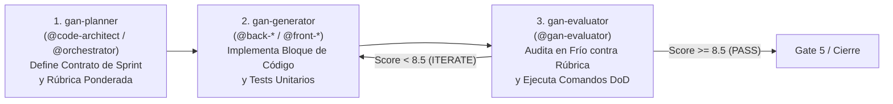

# Skill: `gan-style-harness` (Bucle Adversario Planificador-Generador-Evaluador)

Inspirada en la investigación de diseño de arneses de Anthropic y `affaan-m/ECC`, esta meta-skill resuelve los dos modos de fallo clásicos en desarrollos complejos con IA: (1) degradación de coherencia cuando el contexto se llena y (2) sesgo de autocomplacencia cuando el mismo agente que escribe el código evalúa su calidad.

## 1. La Tríada de Agentes Desacoplados

## 2. Rúbrica Estricta de Evaluación (Sobre 10 Puntos)

El agente `@gan-evaluator` califica cada entrega sin haber participado en su escritura:

1. **Fidelidad de Especificación y Contratos Espejo (35%)**:
   - Cumplimiento 1:1 de todos los DTOs Pydantic `camelCase`, interfaces TypeScript y firmas de servicios definidos en `02-tech-spec.md`.
2. **Calidad Cognitiva y Funcional (25%)**:
   - Ausencia de plantillas genéricas clónicas; comportamiento real extremo a extremo (ej. enrutamiento al experto, Highlight Ejecutivo de Project, persistencia atómica de instintos).
3. **Solidez Arquitectónica y Seguridad (20%)**:
   - Cero violaciones de Clean Architecture, cero bloques `except: pass` silenciosos y protección contra *Path Traversal* / *Prompt Injection*.
4. **Verificación Empírica (20%)**:
   - Ejecución real en consola de `pytest`, `npx tsc --noEmit` y `vitest` con 100% de éxito.

## 3. Regla de Decisión
- **$\ge 8.5 / 10$ (y todas las categorías $\ge 7.0$)**: Veredicto `PASS`.
- **$< 8.5 / 10$**: Veredicto `ITERATE` con lista numerada de hallazgos exactos (`archivo:línea` + corrección requerida) devuelta al generador.
