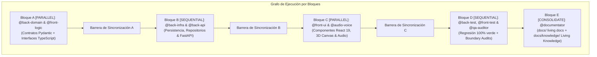

# Skill: `pipeline-run`

Executes the end-to-end development lifecycle for a formally approved **Feature** (`FEAT-XXX`), **Change Request** (`CR-XXX`), or **Bug** (`BUG-XXX`) that has passed Gates 1, 2, and 3 with explicit user approval.

## Expected Parameters
- `<work-item-id>`: Either a Feature ID (e.g. `FEAT-006-declarative-agents`), a Change Request ID (e.g. `CR-004-avatar-engine-dual-representation`), or a Bug ID.

## Pre-Flight Governance Check (Mandatory)
1. Resolve the target specification folder (`<spec-dir>`):
   - If `<work-item-id>` starts with `FEAT-`: `specs/features/<work-item-id>/`
   - If `<work-item-id>` starts with `CR-`: `specs/changes/<work-item-id>/`
   - If `<work-item-id>` starts with `BUG-`: `specs/bugs/<work-item-id>/`
2. Verify that `01-spec.md`, `02-tech-spec.md`, and `03-tasks.md` exist in `<spec-dir>` and have been approved by the user (`RN-SDD-GATE2-CODE-LOCK`).
3. Verify that `.agents/active_work_item.json` is configured with `active_work_item_id = <work-item-id>` and `approved_by_human = true`.
4. If the target is a `FEAT-XXX` that is already marked `Done` in `specs/BACKLOG.md`, **ABORT IMMEDIATELY** (`RN-SDD-IMMUTABLE-DONE`) and require a `CR-XXX` instead.

---

## Multi-Agent DAG Execution Model (OpenSpec / Harness Engineering)

`@jarvis` orchestrates the implementation strictly without writing production code directly (`RN-SDD-ORCHESTRATOR-SUBAGENTS`), processing `<spec-dir>/03-tasks.md` block by block:

### Operational Protocol per Block:
1. `@jarvis` reads `<spec-dir>/03-tasks.md` and identifies the active execution block.
2. **If the block is marked `[PARALLEL]`**:
   - For each task in the block, `@jarvis` dispatches a dedicated subagent (`invoke_subagent` / `runSubAgent`) concurrently:
     - Passes only the assigned task, the relevant contracts from `02-tech-spec.md`, the applicable agent rule (`.agents/rules/`), and the deterministic DoD command.
   - `@jarvis` waits at the **Synchronization Barrier** for all parallel subagents to return green verification output.
3. **If the block is marked `[SEQUENTIAL]`**:
   - Tasks execute sequentially, ensuring prerequisite contracts and services are running and tested before downstream components start.
4. Verify that each specialist has marked its task completed (`- [x]`) in `<spec-dir>/03-tasks.md` with zero unhandled errors.
5. **Quality & Boundary Audit (Phase D)**:
   - Run `sdd-spec-compliance-audit` (1:1 contract isomorphism, zero `any`, obsolete code cleanup).
   - Run `sdd-silent-failure-audit` (zero swallowed exceptions or silent fallbacks).
   - Run `sdd-test-quality-audit` (100% BDD scenario coverage, no mock-only tautologies).
   - Run `python .agents/scripts/verify_architecture_boundaries.py`.
   - Run full regression suites: `pytest backend/tests/` and `cd frontend && npx tsc --noEmit && npm test -- --run && npm run build`.
   - Run `python .agents/scripts/sdd_healthcheck.py` (100% green).
6. **Consolidation of Living Knowledge (Phase E)**:
   - `@documentator` updates `docs/knowledge/API_CATALOG.md`, `docs/knowledge/DATA_MODELS.md`, `docs/knowledge/ADRS.md` and `docs/knowledge/SYSTEM_TOPOLOGY.md`.
   - `@documentator` updates bilingual user/architecture documentation in `docs/es/` and `docs/en/` (`RN-SDD-0DD`).
7. Upon confirming 100% compliance with the Definition of Done (DoD):
   - Update the status of `<work-item-id>` (`FEAT-XXX` or `CR-XXX`) to `Done` in `specs/BACKLOG.md` without mutating any historical `Done` feature baseline.
   - Reset `.agents/active_work_item.json` back to locked (`active_work_item_id: null`, `approved_by_human: false`).
   - **Mandatory GitHub Sync (`RN-SDD-GIT-SYNC`):** Stage all changes (`git add -A`), create a semantic commit (`git commit -m "feat(<work-item-id>): ..."`), and push to remote (`git push origin main`).
