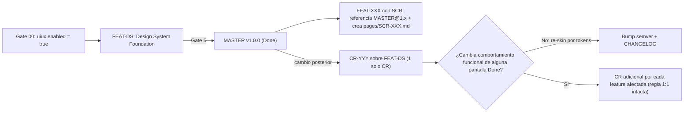

# RFC-001 — Integración de UI UX Pro Max en `sdd-agentic-starter` (v2)

| Campo | Valor |
|---|---|
| **Estado** | `Aceptado` — aprobado por usuario humano el 2026-11-10 (habilita `FWK-001`; sin Gates de código aprobados aún) |
| **Versión** | v2 (2026-11-09) — sustituye a [v1](./RFC-001-ui-ux-pro-max.v1.md) |
| **Ámbito** | Framework (rama `develop`); no afecta a `src/` |
| **Work items derivados** | `FWK-001` (P0), `FWK-002` (P1), `FWK-003` (P2) — ver [BACKLOG del framework](../BACKLOG.md) |
| **Proveedor externo** | [`nextlevelbuilder/ui-ux-pro-max-skill`](https://github.com/nextlevelbuilder/ui-ux-pro-max-skill) — MIT |

---

## 0. Cambios respecto a v1

| # | Cambio | Motivo |
|---|---|---|
| A | El Design System pasa a ser un **artefacto transversal versionado (semver)**, propiedad de una feature fundacional. Sus cambios posteriores son **un CR sobre esa feature**, no N CRs. | v1 chocaba con `RN-SDD-IMMUTABLE-DONE` + `RN-SDD-1-TO-1-CR` en cuanto `MASTER.md` cambiase con varias features `Done`. |
| B | Ubicación normativa única y **neutra de idioma**: `docs/design-system/` con overrides `pages/SCR-XXX.md`. La documentación bilingüe `docs/{es,en}/03-ux-ui/` enlaza, no duplica. | v1 creaba `design-system/<slug>/` en raíz, paralelo a `03-ux-ui/` y con slugs de página en vez de IDs `SCR-###`. |
| C | **Pack independiente `capability-ui-design`** en lugar de `extensions/` dentro de `capability-web-frontend`. | Menos maquinaria: el importador ECC ya ignora packs fuera de `STACK_PACKS`; procedencia separada de forma natural; el rol de diseño no queda acoplado a un pack de tecnología. |
| D | Proveedor **vendorizado** y fijado con checksums; `npx` solo en un script de actualización explícito. | Reproducibilidad y modo offline sin coste. |
| E | `@ui-ux-designer` obtiene **escritura acotada a artefactos de diseño** (nunca código ni specs aprobadas). | En v1 era read-only y obligaba a delegar cada persistencia a otro agente: un salto sin valor de gobernanza. |
| F | Separación en **3 work items**; `FWK-001` (corrección del generador) es independiente de la adopción de UI UX Pro Max. | `RN-SDD-SESSION-LIFECYCLE` (1 work item por hilo) y valor propio de las correcciones. |
| G | Corrección de terminología de Gates y hallazgos adicionales verificados en código (§2). | Precisión. |

---

## 1. Decisión propuesta

Incorporar UI UX Pro Max como **proveedor opcional de inteligencia de diseño**, empaquetado en un pack propio `capability-ui-design`, con un especialista `@ui-ux-designer` que opera **solo en Gate 2 y solo en features que tocan pantallas (`SCR-###`)**. No sustituye las reglas SDD, el estándar funcional ni las skills ECC existentes (`design-system`, `accessibility`, `browser-qa`), que siguen funcionando si el proveedor está desactivado.

**Precondición:** `FWK-001` debe estar completado antes de iniciar `FWK-002`.

---

## 2. Hallazgos verificados en el repositorio (base de `FWK-001`)

| # | Hallazgo | Evidencia |
|---|---|---|
| H1 | `materialize_squad` solo materializa `agents/` de los packs; nunca skills, rules ni workflows. | `scripts/sdd_agent_generator.py` L327-L340 |
| H2 | Los agentes de pack/especialistas se copian **sin cabecera `GENERATED`** ni hash → imposible distinguir generado de manual; no hay limpieza al desactivar un pack. | `sdd_agent_generator.py` L317-L340 |
| H3 | `parse_stack_specs` aplica regex a todo `STACK.md`, incluidas opciones de ejemplo. `java` casa con "javascript"; `web` casa con casi cualquier texto. | `sdd_agent_generator.py` L244-L270 |
| H4 | `squad.lock.json` contiene 11 packs con Gate 00 **sin aprobar**; `.agents/agents/` contiene `java-reviewer`, `go-reviewer`, `csharp-reviewer`, `vue-reviewer`… en la plantilla. | `.agents/squad.lock.json`, `specs/STACK.md` L3 |
| H5 | El importador reescribe `pack.json` de `STACK_PACKS` pero **no borra directorios** y **no toca packs fuera de `STACK_PACKS`**. | `scripts/sdd_catalog_import.py` L291-L351 |
| H6 | El importador declara `workflows` en el manifiesto pero **nunca los descarga**. | `sdd_catalog_import.py` L316-L349 |
| H7 | Ningún test cubre generador ni importador (8 tests, todos de gobernanza). | `tests/test_sdd_governance.py` |
| H8 | La documentación viva es bilingüe: `docs/{es,en}/03-ux-ui/…`. | `.agents/agents/documentator.md` L30-L41 |
| H9 | Terminología de Gates inconsistente entre ficheros (Gate 4 = "Implementación" / "QA"; Gate 5 = "Verificación y DoD" / "Docs"). | `specs/SDD_FRAMEWORK.md`, `specs/BACKLOG.md`, `AGENTS.md` |

---

## 3. Arquitectura objetivo

### 3.1. Catálogo (inerte, sincronizable por `sdd_sync.py`)

```text
.sdd/catalog/packs/capability-ui-design/        # Pack NO-ECC: el importador nunca lo toca (H5)
├── pack.json                                   # Manifiesto propio con procedencia nextlevelbuilder
├── NOTICE.md                                   # Atribución y licencia del tercero
├── agents/ui-ux-designer.md                    # Especialista de diseño (Gate 2)
├── skills/sdd-ui-design/SKILL.md               # Adaptador metodológico SDD ↔ proveedor
├── workflows/ui-design-review.md               # Flujo diseño → a11y → sign-off humano
└── vendor/ui-ux-pro-max/                       # Salida congelada del instalador oficial
    ├── LICENSE
    ├── VENDOR.lock.json                        # versión, fecha, sha256 por fichero
    └── ...                                     # SKILL.md, data/*.csv, scripts/search.py
```

`pack.json` (borrador):

```json
{
  "id": "capability:ui-design",
  "family": "capability",
  "requires": ["capability:web-frontend"],
  "targets": ["web"],
  "description": "Inteligencia de diseño UI/UX (estilos, paletas, tipografía, UX) con gobernanza SDD.",
  "upstream": {
    "repo": "nextlevelbuilder/ui-ux-pro-max-skill",
    "license": "MIT",
    "version": "<PIN_APROBADO>",
    "vendor_lock": "vendor/ui-ux-pro-max/VENDOR.lock.json"
  },
  "specialists": ["agents/ui-ux-designer.md"],
  "skills": ["skills/sdd-ui-design", "vendor/ui-ux-pro-max"],
  "workflows": ["workflows/ui-design-review.md"],
  "rules": []
}
```

> `targets` y `requires` permiten ampliar a mobile/desktop en el futuro sin migrar el pack (basta con relajar `requires` y añadir targets).

### 3.2. Materialización (solo si el pack está activo)

```text
.agents/agents/ui-ux-designer.md        # con cabecera GENERATED + hash en lock
.agents/skills/sdd-ui-design/
.agents/skills/ui-ux-pro-max/           # desde vendor/, nunca desde npx
.agent-inbox/ui-ux-designer/
```

### 3.3. Artefactos del proyecto

```text
docs/design-system/                     # NORMATIVO, neutro de idioma, versionado
├── MASTER.md                           # Sistema visual global (versión semver en cabecera)
├── design-tokens.json                  # Fuente estructurada, coherente con MASTER
├── CHANGELOG.md                        # Historial semver + referencia a CR
└── pages/SCR-XXX.md                    # Overrides por pantalla (ID SCR, no slug)

specs/features/FEAT-XXX-*/ux/SCR-XXX/hi-fi/   # Borradores hi-fi de Gate 2 (parte de la línea base de la feature)

docs/{es,en}/03-ux-ui/screens/SCR-XXX/        # Consolidación Gate 5 (@documentator):
                                              # screen-spec.md enlaza a docs/design-system@versión
```

| Tipo de artefacto | Ubicación | Naturaleza |
|---|---|---|
| Norma visual | `docs/design-system/MASTER.md` | Única fuente normativa |
| Tokens | `docs/design-system/design-tokens.json` | Estructurada, verificable en QA |
| Overrides | `docs/design-system/pages/SCR-XXX.md` | Propiedad de la feature dueña del `SCR` |
| Hi-fi | `specs/features/…/ux/` → `docs/{lang}/03-ux-ui/screens/…/hi-fi/` | Evidencia / diseño de pantalla, no norma |
| Previews ECC `design-system` | Evidencias | Nunca fuente normativa paralela |

> **Pendiente de PoC:** el proveedor persiste por defecto en `design-system/` relativo al cwd. Si no admite ruta de salida configurable, `sdd-ui-design` ejecuta la generación en un directorio temporal y traslada/renombra al destino canónico. Nunca `--force` sobre un `MASTER.md` existente.

---

## 4. Ciclo de vida del Design System (enmienda A)



1. **Feature fundacional:** al activar `uiux.enabled` en Gate 00, el bootstrap registra en `specs/BACKLOG.md` una feature `Design System Foundation` (ID asignado en ese momento). Produce `MASTER v1.0.0`, tokens y `CHANGELOG`.
2. **Consumo:** cada feature con pantallas declara en su `02-tech-spec.md` el rango (`design-system: MASTER@1.x`) y crea sus `pages/SCR-XXX.md`. Specs y hi-fi **referencian tokens, nunca valores literales**.
3. **Evolución:** tras el `Done` de la fundacional, cualquier cambio en `MASTER.md`/tokens es **un CR sobre esa feature** (cumple `RN-SDD-1-TO-1-CR` sin excepciones).
4. **Semver:**
   - *patch*: ajuste de valor de token sin cambio de contrato visual.
   - *minor*: tokens/componentes nuevos, retrocompatibles.
   - *major*: eliminación/renombrado de tokens o ruptura de contrato visual → análisis de impacto obligatorio con lista de `SCR` afectados.
5. **Impacto funcional:** si un cambio altera el comportamiento de una pantalla de una feature `Done`, se abre además un CR por cada feature afectada (regla vigente). Un re-skin puro por tokens **no** requiere CR en las features consumidoras.
6. **Overrides:** `pages/SCR-XXX.md` pertenece a la feature dueña del `SCR`; tras su `Done`, cambiarlo exige CR sobre esa feature.

---

## 5. Contrato de `@ui-ux-designer`

| Aspecto | Definición |
|---|---|
| **Activación** | Pack `capability-ui-design` activo **y** feature con al menos un `SCR` |
| **DoR** | Gate 00 aprobado con `uiux.enabled`; Gate 1 de la feature aprobado (wireframes aprobados según §18 del estándar funcional); `docs/design-system/` vigente o feature fundacional en curso |
| **Escritura permitida** | `docs/design-system/**` (solo vía feature fundacional o CR sobre ella, y `pages/SCR-XXX.md` de la feature activa); `specs/features/<feature-activa>/ux/**` mientras la feature no esté `Done` |
| **Prohibido** | `src/**`, `tests/**`, `01-spec.md`, cualquier artefacto de feature `Done`, casillas de sign-off, instalar dependencias, invocar `npx`, `--force` |
| **Responsabilidades** | Leer EARS/BDD/`SCR`/navegación/stack; consultar el proveedor (producto, estilo, paleta, tipografía, UX, stack); proponer variantes trazadas a `RF`/`SCR`; proponer tokens, componentes, estados (vacío/error/loading), responsive y antipatrones; validar coherencia con wireframes aprobados |
| **Revisión obligatoria** | `@a11y-architect` (independiente) antes del sign-off; `@architect` valida encaje con stack/contratos |
| **Salidas** | Etiquetas `Confirmado` / `Propuesto` / `Pendiente`; trazas `RF`→`SCR`→token; diff propuesto sobre `MASTER`/tokens; evidencia de revisión a11y |
| **Escalado** | Si el diseño introduce o altera comportamiento → *Stop-the-Line*, vuelta a Gate 1 (`RN-SDD-FAIL-CLOSED`) |

---

## 6. Encaje en el ciclo SDD

| Gate | Cambio |
|---|---|
| **Gate 00** | Solo si hay UI: bloque estructurado `uiux` en `STACK.md` (§7). API-only/CLI: no se pregunta ni se activa nada. Si `uiux.enabled`, el bootstrap registra la feature fundacional. |
| **Gate 1** | Sin cambios de propiedad: `@functional-analyst` define `RF`, `SCR`, wireframes de baja fidelidad (Excalidraw). `@ui-ux-designer` puede asesorar, nunca aprueba. |
| **Gate 2** | `@ui-ux-designer` produce hi-fi + overrides + propuesta de tokens; `@a11y-architect` revisa; `@architect` valida. Nueva subsección **"Diseño visual"** en `02-tech-spec.md` con casilla `[ ] Visual Sign-off (Human)`, **bloqueante solo si la feature toca `SCR`** (si no, `N/A`). |
| **Gate 3** | Tareas `front-ui`/`front-engineer` con referencias explícitas a `SCR`, `MASTER@versión`, `pages/SCR-XXX.md` y tokens en su DoR. |
| **Gate 4** | Implementación. El DoD de las tareas UI incluye comprobaciones visuales verificables (`@qa-tester`): navegador, responsive, teclado, contraste, estados, coherencia con tokens. Cambios de baseline de capturas requieren revisión humana. Nunca un score subjetivo como único quality gate. |
| **Gate 5** | `@documentator` consolida en `docs/{es,en}/03-ux-ui/` enlazando a `docs/design-system@versión`; matriz `RF`→`SCR`→tarea→prueba→evidencia. |

---

## 7. Configuración en `STACK.md`

Para eliminar H3, el generador solo leerá un **bloque estructurado** (los textos de ejemplo dejan de influir):

````markdown
```yaml sdd:stack-config
gate00_approved: false        # el generador además verifica la casilla de firma
preset: compact
packs:
  - lang-typescript
  - framework-react
  - capability-web-frontend
  - capability-ui-design
uiux:
  enabled: true
  provider: ui-ux-pro-max
  version: "<PIN_APROBADO>"
  hifi_format: html            # html | figma | html+figma
  brand_constraints: docs/design-system/BRAND.md   # opcional
```
````

---

## 8. Decisiones cerradas

| ID | Decisión |
|---|---|
| D1 | Alcance inicial **web**, en pack neutro `capability-ui-design` (`targets: [web]`). Mobile/desktop: ampliación futura sin migración. |
| D2 | Hi-fi por defecto en **HTML/CSS navegable** (verificable por `browser-qa`). Excalidraw para baja fidelidad. Figma opcional si el equipo ya lo usa. |
| D3 | **Visual sign-off** como casilla explícita dentro de Gate 2, bloqueante solo si hay `SCR`. |
| D4 | Proveedor **vendorizado y fijado** con `VENDOR.lock.json` (sha256). `npx` solo en `scripts/sdd_vendor_update.py` ejecutado en directorio temporal, con revisión de diff y aprobación humana. |
| D5 | Cambios de framework se gestionan en `.sdd/framework/` (RFC + work items `FWK-XXX`), no en `specs/BACKLOG.md` del proyecto plantilla. |

---

## 9. Plan de work items

### `FWK-001` — Materialización y activación fiables (P0, independiente del proveedor)

- Selección de packs **solo** desde el bloque `sdd:stack-config` (§7). Sin Gate 00 aprobado: solo core + builders; packs únicamente vía `--packs` explícito, registrados en lock como `manual`.
- Materializar skills, rules y workflows de packs. **El destino de las rules debe respetar la Matriz de Carga Perezosa** (no convertirlas en reglas always-on); se decide en el Gate 2 de `FWK-001`.
- Procedencia: cabecera `GENERATED` + sha256 por fichero en `squad.lock.json`.
- Limpieza segura al desactivar: solo se borran ficheros del lock anterior cuyo hash no cambió; si el usuario los modificó → conflicto y parada (*fail-closed*).
- Colisiones (dos packs con el mismo slug de skill/agente) → error explícito.
- Importador: descargar workflows (H6); test que garantice que packs fuera de `STACK_PACKS` no se tocan.
- Saneamiento de la plantilla: regenerar `.agents/agents/` y `squad.lock.json` para que no contengan packs no seleccionados (H4).
- Tests unitarios de selección, idempotencia, limpieza, colisión y manifiesto inválido.

### `FWK-002` — Pack `capability-ui-design` (P1, depende de `FWK-001`)

- **Spike PoC (Gate 2):** en directorio temporal, `npx ui-ux-pro-max-cli@<PIN> init --ai antigravity`; inventariar ficheros; confirmar si existen `--dry-run` y ruta de salida configurable; versión mínima de Python; ausencia de llamadas de red/telemetría en ejecución; licencia.
- Pack, `NOTICE.md`, vendor + lock, agente, skill adaptadora, workflow.
- `scripts/sdd_vendor_update.py`.
- `sdd-bootstrap`: preguntas `uiux` solo con UI; registro automático de la feature fundacional.
- Plantillas: bloque §7 en `00-stack.template.md`; subsección "Diseño visual" + sign-off en `02-technical-spec.template.md`; DoR de arquetipos front.
- `orchestrator.md`: delegación a `@ui-ux-designer` en Gate 2 cuando hay `SCR`.

### `FWK-003` — Quality gates visuales (P2, depende de `FWK-002`)

- Comprobaciones condicionales en `qa-tester`, `a11y-architect` y CI (solo con herramientas realmente instaladas): contraste, teclado, responsive, coherencia de tokens, baselines de capturas con revisión humana.

### Fuera de alcance (candidato)

- `FWK-004` — Unificar terminología de Gates (H9) en `SDD_FRAMEWORK.md`, `BACKLOG.md` y `AGENTS.md`.

---

## 10. Pruebas de aceptación

| # | Escenario | Item |
|---|---|---|
| 1 | `STACK.md` con React/Vue/Java solo en ejemplos y bloque `packs: [lang-python]` → solo se activa `lang-python`. | FWK-001 |
| 2 | Gate 00 sin aprobar y sin `--packs` → ningún pack activado; lock lo refleja. | FWK-001 |
| 3 | `--materialize` ×2 → mismo conjunto de ficheros y hashes; sin duplicados. | FWK-001 |
| 4 | Desactivar un pack → sus ficheros generados desaparecen; un fichero modificado manualmente provoca conflicto y parada. | FWK-001 |
| 5 | Dos packs con el mismo slug de skill → error explícito. | FWK-001 |
| 6 | `sdd_catalog_import.py` → `capability-ui-design` permanece íntegro; workflows de packs ECC descargados. | FWK-001/002 |
| 7 | Proyecto `api-only` con Gate 00 aprobado → sin `@ui-ux-designer`, sin skills del proveedor. | FWK-002 |
| 8 | `spa-only` con `uiux.enabled` → agente, inbox, skills y workflow disponibles; feature fundacional registrada. | FWK-002 |
| 9 | `spa-only` sin proveedor → `design-system`, `accessibility`, `browser-qa` ECC siguen operativos. | FWK-002 |
| 10 | Vendor con un fichero alterado → verificación de checksum falla. | FWK-002 |
| 11 | Feature con Gate 1 sin aprobar → `@ui-ux-designer` rechaza producir hi-fi (DoR). | FWK-002 |
| 12 | Cambio de token tras `Done` de la fundacional → 1 CR sobre ella + bump semver; sin tocar carpetas `Done`. | FWK-002 |
| 13 | Errores de contraste/teclado y regresiones de captura producen resultado verificable y bloqueante. | FWK-003 |

---

## 11. Riesgos

| Riesgo | Mitigación |
|---|---|
| Abandono o cambio incompatible del proveedor | Vendorización fijada; degradación a skills ECC |
| Inflación de contexto (más agentes/skills) | Activación solo por bloque estructurado; agente invocado solo en Gate 2 con `SCR` |
| Estética homogénea "generada por IA" | Variantes justificadas + `brand_constraints` + sign-off humano |
| Deriva entre `MASTER.md` y `design-tokens.json` | Verificación de coherencia en QA (`FWK-003`) |
| Licencias / procedencia mezcladas | `NOTICE.md` y `upstream` propios; nunca atribuir a ECC |
| `.sdd/framework/` viaja a proyectos creados desde la plantilla | Inocuo (no lo lee ningún agente de proyecto); evaluar exclusión en bootstrap |

---

## 12. Aprobación

- [x] **Usuario humano:** RFC-001 v2 `Aceptado` (2026-11-10 — habilita abrir `FWK-001` en un hilo nuevo)
