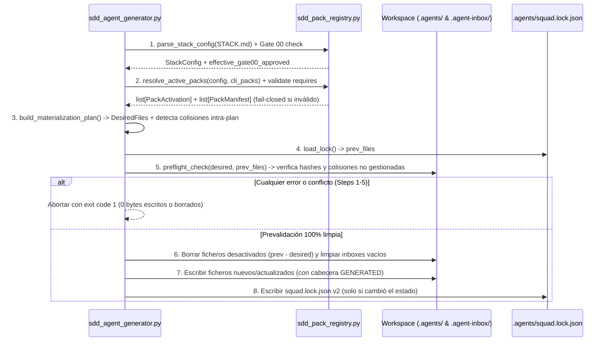

# Especificación Técnica: Materialización y Activación Fiables de Packs

- **ID de la Feature (Work Item del Framework)**: `FWK-001-pack-materialization`
- **RFC de Origen**: [`RFC-001` v2](../../rfcs/RFC-001-ui-ux-pro-max.md)
- **Especificación Funcional Asociada**: [`01-spec.md`](./01-spec.md) (Gate 1 Aprobado)
- **Estado**: `Aprobado` (Gate 2 aprobado por el usuario el 2026-11-10)
- **Tech Lead / Arquitecto**: `@orchestrator` / `@architect`
- **Fecha de Creación**: 2026-11-10
- **Última Actualización**: 2026-11-10

---

## 0. Inventario *Research-First* y Fronteras de Propiedad (`ecc` & `rea`)
- **Activos y Librerías Reutilizadas del Workspace**:
  - Solo librería estándar de Python 3.12+ (`argparse`, `dataclasses`, `datetime`, `hashlib`, `json`, `pathlib`, `re`, `shutil`, `sys`, `typing`, `urllib`); **sin PyYAML** ni dependencias externas (verificado en entorno y CI).
  - [`scripts/sdd_agent_generator.py`](../../../../scripts/sdd_agent_generator.py): conserva CLI (`--materialize`, `--mode`, `--packs`, `--list`), `CORE_AGENTS`, `PRESET_CONFIGS` y `compile_builder_agent`.
  - [`scripts/sdd_catalog_import.py`](../../../../scripts/sdd_catalog_import.py): conserva `RAW_BASE`, `UNIVERSAL_SPECIALISTS`, `STACK_PACKS` y `adapt_agent_frontmatter`.
  - [`scripts/sdd_sync.py`](../../../../scripts/sdd_sync.py): `is_syncable_framework_file()` ya filtra por marcador `GENERATED by sdd_agent_generator` y excluye `.agents/squad.lock.json`.
  - [`.agents/scripts/sdd_stack_gate_guard.py`](../../../../.agents/scripts/sdd_stack_gate_guard.py): patrón exacto de verificación humana `[x] Gate 00 Approved` / `[X] Gate 00 Approved`.
- **Frontera Productora Única (*Producing-Boundary Ownership*)**:
  - Nuevo módulo [`scripts/sdd_pack_registry.py`](../../../../scripts/sdd_pack_registry.py): dueño único de parsear y validar el bloque ```` ```yaml sdd:stack-config ```` de `specs/STACK.md` y de cargar/validar los manifiestos `pack.json` y rutas de catálogo (manteniendo además ambos scripts por debajo del umbral de modularidad de 500 líneas).
  - [`scripts/sdd_agent_generator.py`](../../../../scripts/sdd_agent_generator.py): dueño único de resolver el plan de materialización, ejecutar la prevalidación atómica (*fail-closed*), mutar `.agents/` / `.agent-inbox/` y persistir `.agents/squad.lock.json` (esquema v2).
- **Plan de Limpieza de Código Obsoleto (*Zero Zombie Code*)**:
  - Eliminar `parse_stack_specs()` basado en regex sobre todo `STACK.md` (`sdd_agent_generator.py` L220–L273).
  - Purgar los 14 agentes de pack huérfanos actualmente en `.agents/agents/` (`a11y-architect.md`, `csharp-reviewer.md`, `database-reviewer.md`, `fastapi-reviewer.md`, `go-build-resolver.md`, `go-reviewer.md`, `java-build-resolver.md`, `java-reviewer.md`, `python-reviewer.md`, `react-build-resolver.md`, `react-reviewer.md`, `seo-specialist.md`, `typescript-reviewer.md`, `vue-reviewer.md`) y sus 14 directorios vacíos en `.agent-inbox/`.
  - Regenerar `.agents/squad.lock.json` en esquema `v2` con `active_packs: []`.

---

## 1. Arquitectura General y Flujo de Materialización Atómica



---

## 2. Decisiones Técnicas Clave (Cierre de Diseño Gate 2)

### 2.1. Destino de `rules` de Pack (Matriz de Carga Perezosa — `RF-003`)
- **Decisión**: Las `rules` declaradas por un pack activo se materializan en **`.agents/pack-rules/<pack-name>/<rule-filename>`** (por ejemplo `.agents/pack-rules/lang-python/coding-style.md`), **nunca** dentro de `.agents/rules/`.
- **Justificación**:
  1. `.agents/rules/*.md` es raíz de descubrimiento *always-on* / reglas de proyecto en IDEs como Antigravity; aislar las reglas de pack en `.agents/pack-rules/<pack-name>/` garantiza cumplimiento estricto de `RN-SDD-SELECTIVE-CONTEXT` (carga únicamente cuando un subagente de ese lenguaje/stack las consulta explícitamente).
  2. Múltiples packs ECC (`lang-python`, `lang-typescript`, `framework-react`, `framework-vue`, `lang-csharp`, `lang-go`, `lang-java`, `lang-kotlin`) comparten nombres de fichero idénticos (`coding-style.md`, `hooks.md`, `patterns.md`, `security.md`, `testing.md`). El subdirectorio `<pack-name>/` evita falsas colisiones entre packs legítimamente combinables.
  3. `scripts/sdd_sync.py` solo sincroniza `.agents/rules/00-`..`07-`, por lo que `.agents/pack-rules/` nunca contamina el sincronizador de plantilla.

### 2.2. Destinos Canónicos por Tipo de Activo Materializado
| Tipo de activo en `pack.json` | Resolución en origen (`.sdd/catalog/packs/<pack>/`) | Destino materializado en repo | Buzón `.agent-inbox/` |
|---|---|---|---|
| `specialists` (`agents/*.md`) | `<pack>/agents/<file>.md` | `.agents/agents/<file>.md` | `.agent-inbox/<stem>/.gitkeep` |
| `skills` (`skills/<slug>` o `vendor/<slug>`) | Directorio `<pack>/<entry>/` (recursivo, debe contener `SKILL.md`) | `.agents/skills/<slug>/<rel_path>` | — |
| `rules` (`rules/.../*.md`) | `<pack>/<entry>` o fallback `<pack>/rules/<basename>` (para rutas ECC `rules/<lang>/<file>.md`) | `.agents/pack-rules/<pack>/<basename>` | — |
| `workflows` (`commands/*.md` o `workflows/*.md`) | `<pack>/<entry>` o fallback `<pack>/workflows/<basename>` (para rutas ECC `commands/<file>.md`) | `.agents/workflows/<basename>` | — |

### 2.3. Cabecera `GENERATED` y Preservación de YAML Frontmatter (`RF-004`)
- Para todo fichero Markdown (`.md`) gestionado por el generador (builders, especialistas universales, agentes de pack, skills `*.md`, pack-rules y pack-workflows):
  - Si el documento comienza por YAML frontmatter (`---\n...\n---` o CRLF equivalente), el marcador `<!-- GENERATED by sdd_agent_generator (<owner>). Do not edit directly. -->` se inserta **inmediatamente después** del cierre `---` del frontmatter, preservando la línea 1 `---` válida para los parsers de skills/agentes del IDE.
  - Si no tiene frontmatter, se antepone en la línea 1.
  - Los ficheros no Markdown (p. ej. `.py`, `.json`, `.csv`, `.sh` dentro de una skill) no reciben comentario HTML; su procedencia queda registrada igualmente por ruta + `sha256` en `squad.lock.json`.
- **Compatibilidad `scripts/sdd_sync.py`**: ampliar la ventana de inspección de marcador `GENERATED by sdd_agent_generator` de `[:300]` a `[:4096]` y excluir cualquier ruta presente en `squad.lock.json["files"]` (protege tanto `.md` con frontmatter largo como futuros activos no Markdown).

### 2.4. Contrato del Parser YAML `sdd:stack-config` (`scripts/sdd_pack_registry.py`)
- Localiza exactamente 0 o 1 bloque vallado ```` ```yaml sdd:stack-config ```` (insensible a mayúsculas en `yaml` y espacios finales en el cierre de línea). Si hay más de 1 bloque → `StackConfigError`.
- Subconjunto YAML determinista sin PyYAML (soporta pares `clave: valor`, comentarios `#` fuera de comillas, booleanos `true`/`false`, strings con o sin comillas, listas inline `[a, b]` y listas en bloque `- item`, y mapas anidados de 1+ niveles para futuras claves como `uiux:`).
- Rechaza (*fail-closed* `StackConfigError`) claves duplicadas en el mismo nivel, indentación inconsistente, valores de `gate00_approved` no booleanos, `preset` desconocido fuera de `PRESET_CONFIGS`, o `packs` que no sea lista de strings no vacíos.
- **Reglas de activación (`RF-001`, `RF-002`, `AMB-003`)**:
  - Firma humana: `has_human_signoff = ("[x] Gate 00 Approved" in content or "[X] Gate 00 Approved" in content)`.
  - Si `has_human_signoff` es `True` y falta el bloque `sdd:stack-config` → **error explícito (`StackConfigError`)**.
  - Si `has_human_signoff` es `False` y falta el bloque `sdd:stack-config` → fallback seguro: `StackConfig(gate00_approved=False, preset="compact", packs=())`.
  - `effective_gate00_approved = has_human_signoff and config.gate00_approved`.
  - Si `effective_gate00_approved` es `True`: packs = `config.packs` (`source="stack-config"`) + `--packs` no ya presentes (`source="manual"`).
  - Si `effective_gate00_approved` es `False`: packs de `config.packs` se ignoran; packs = solo `--packs` (`source="manual"`).

---

## 3. Contratos de Datos y Excepciones (`scripts/sdd_pack_registry.py` & `sdd_agent_generator.py`)

```python
class SddGeneratorError(Exception):
    """Base fail-closed error for squad generation (exits with code 1)."""

class StackConfigError(SddGeneratorError): ...
class InvalidManifestError(SddGeneratorError): ...
class PackDependencyError(SddGeneratorError): ...
class CollisionError(SddGeneratorError): ...
class ManualModificationConflictError(SddGeneratorError): ...
```

### 3.1. Modelos Inmutables (`@dataclass(frozen=True)`)
- `StackConfig`: `gate00_approved: bool`, `preset: str`, `packs: tuple[str, ...]`, `uiux: dict[str, Any] | None`.
- `PackActivation`: `name: str` (dir name, ej. `lang-python`), `pack_id: str` (ej. `lang:python`), `source: Literal["stack-config", "manual"]`.
- `PackManifest`: `dir_name: str`, `pack_id: str`, `family: str`, `requires: tuple[str, ...]`, `description: str`, `rules: tuple[str, ...]`, `specialists: tuple[str, ...]`, `skills: tuple[str, ...]`, `workflows: tuple[str, ...]`.
- `PlannedFile`: `rel_path: str` (POSIX), `content: bytes`, `sha256: str`, `owner: str` (`"builder:<name>"`, `"specialists"`, `"pack:<dir_name>"`), `kind: Literal["agent", "skill", "rule", "workflow"]`.

### 3.2. Esquema `.agents/squad.lock.json` (`schema_version: 2`)
```json
{
  "schema_version": 2,
  "timestamp": "2026-11-10T19:45:00+00:00",
  "gate00_approved": false,
  "preset": "compact",
  "tech_stack": "Multi-Stack",
  "core_agents": ["orchestrator", "functional-analyst", "architect", "qa-tester", "documentator", "devops"],
  "builders": ["back-engineer", "front-engineer"],
  "specialists": ["build-error-resolver", "..."],
  "active_packs": [
    {
      "name": "lang-python",
      "id": "lang:python",
      "source": "manual"
    }
  ],
  "files": {
    ".agents/agents/back-engineer.md": {
      "sha256": "<64-hex>",
      "owner": "builder:back-engineer",
      "kind": "agent"
    }
  }
}
```
- **Idempotencia del Lock (`RF-007`)**: si la carga útil completa excepto `timestamp` coincide exactamente con el `squad.lock.json` existente en disco, se preserva el `timestamp` anterior y no se reescribe el fichero.

---

## 4. Algoritmo de Prevalidación y Limpieza Segura (`RN-03`, `RN-04`, `RF-005`, `RF-006`)

Antes de realizar ninguna operación de escritura o borrado:
1. **Validación de `requires` (`AMB-004`)**: construir mapa de packs activos por `name` e `id`; si cualquier pack activo exige un `req` ausente del conjunto activo → `PackDependencyError`.
2. **Validación de rutas y manifiestos (`RF-008`)**:
   - Exigir JSON válido, campos obligatorios `id` (`str` no vacío), `family` (`str` no vacío), `description` (`str`), listas de strings en `rules`, `specialists`, `skills`, `workflows`, `requires`.
   - Rechazar rutas absolutas o con `..` que escapen de `pack_dir.resolve()` (anti path-traversal).
   - Exigir que cada fichero o directorio de skill (`SKILL.md` obligatorio) exista en disco dentro de `pack_dir`.
3. **Detección de colisiones intra-plan (`RF-006`)**:
   - Insertar secuencialmente builders, especialistas universales y todos los activos de packs en `desired_files: dict[str, PlannedFile]`.
   - Si `rel_path` ya está ocupado en `desired_files` → `CollisionError` detallando ambos orígenes (`existing.owner` vs `new.owner`) y ruta destino.
4. **Verificación contra estado previo y modificaciones manuales (`RF-005`, `AMB-002`)**:
   - Cargar `prev_files` desde `squad.lock.json` (si existe y tiene `files`). Si `squad.lock.json` existe pero está corrupto (JSON inválido) → `InvalidManifestError` (*fail-closed*).
   - Para cada `rel_path` en `desired_files`:
     - Si `disk_path.exists()` y `rel_path` NO está en `prev_files` → `CollisionError` (*unmanaged destination*, protege `fastapi-patterns`, `postgres-patterns` u otros ficheros artesanales del usuario).
     - Si `disk_path.exists()` y `rel_path` SÍ está en `prev_files`, calcular `sha256(disk_path.read_bytes())`; si difiere de `prev_files[rel_path]["sha256"]` → `ManualModificationConflictError`.
   - Para cada `rel_path` en `prev_files` ausente de `desired_files` (recurso desactivado):
     - Si `disk_path.exists()` y `sha256(disk_path.read_bytes()) != prev_files[rel_path]["sha256"]` → `ManualModificationConflictError`.
5. **Mutación Segura**:
   - Borrar ficheros en `prev_files - desired_files` y podar directorios vacíos bajo `.agents/skills/<slug>/` y `.agents/pack-rules/<pack>/`.
   - Escribir cada `PlannedFile` solo si no existe o su hash en disco difiere del hash objetivo.
   - Limpiar `.agent-inbox/<agent>/` para agentes que estaban gestionados en el lock anterior y ya no están activos, **solo** si no contienen ficheros distintos de `.gitkeep` (si hay tickets pendientes, conservar carpeta y emitir aviso).

---

## 5. Diseño del Importador de Catálogo (`scripts/sdd_catalog_import.py`, `RF-009`)
- Parametrizar `import_specialists(..., fetcher=fetch_text, specialists_dir=SPECIALISTS_DIR)` e `import_packs(..., fetcher=fetch_text, packs_dir=PACKS_DIR)` manteniendo la firma CLI sin argumentos sin cambios.
- Añadir descarga de `meta["workflows"]` en `import_packs()`:
  - Crear `pack_dir / "workflows"` solo si `meta["workflows"]` no está vacío.
  - Descargar `txt = fetcher(w)` y guardar en `workflows_dir / pathlib.Path(w).name`.
- Garantizar explícitamente mediante diseño y test que `import_packs()` únicamente itera sobre `STACK_PACKS` y jamás borra ni modifica directorios existentes en `.sdd/catalog/packs/` que no pertenezcan a `STACK_PACKS`.
- **Consistencia inicial del catálogo en Gate 4**: verificar/poblar los 22 workflows declarados en los `pack.json` actuales de `STACK_PACKS` para que todo pack del catálogo pase la validación estricta de `RF-008`. (Si algún path upstream en `affaan-m/ecc` ya no existiera en `HEAD`, reportar parada *fail-closed* antes de alterar `STACK_PACKS`).

---

## 6. Saneamiento de la Plantilla Base (`RF-010`)
- Añadir bloque inicial en [`specs/STACK.md`](../../../../specs/STACK.md) §3.3:
  ````markdown
  ```yaml sdd:stack-config
  gate00_approved: false
  preset: compact
  packs: []
  ```
  ````
- Retirar los 14 agentes de pack huérfanos en `.agents/agents/` y sus 14 `.agent-inbox/*/` vacíos, y ejecutar `uv run python scripts/sdd_agent_generator.py --materialize` dejando:
  - 6 core agents + 2 builders (`back-engineer`, `front-engineer` con `GENERATED`) + 20 especialistas universales (`GENERATED`).
  - `active_packs: []` y mapa completo `files` con hashes SHA-256 en `.agents/squad.lock.json` (`schema_version: 2`).

---

## 7. Plan de Pruebas Unitarias Offline y Verificación (`tests/test_sdd_pack_materialization.py`)
Suite determinista y 100% offline (< 2s) usando `tempfile.TemporaryDirectory` y mocks in-memory para `fetcher`:
1. **Selección desde `sdd:stack-config`**: `STACK.md` con menciones a React/Vue/Java/TypeScript en prosa y `packs: [lang-python]` + `[x] Gate 00 Approved` + `gate00_approved: true` → solo se activa `lang-python`; se materializan agente, skills, `pack-rules/lang-python/*` (no en `.agents/rules/`) y workflows.
2. **Gate 00 lock & `--packs` manual**: Gate 00 sin aprobar sin `--packs` → `active_packs == []`; con `--packs lang-python` → `lang-python` registrado con `source: "manual"`. Caso mismatch (`[x]` checkbox con `gate00_approved: false`) → tratado como no aprobado; `[x]` sin bloque `sdd:stack-config` → error `StackConfigError`.
3. **Dependencias `requires` (`AMB-004`)**: activar `framework-fastapi` sin `lang-python` → `PackDependencyError` (exit code 1) sin tocar disco.
4. **Idempotencia (`--materialize` ×2)**: exactamente mismos ficheros, hashes y `timestamp` del lock preservado.
5. **Limpieza segura y conflicto manual**: desactivar `lang-python` borra sus ficheros e inbox vacío; si el usuario modifica un fichero generado y desactiva o rematerializa → `ManualModificationConflictError` sin borrar ni sobrescribir.
6. **Colisiones (intra-packs y destino no gestionado)**: dos packs con el mismo slug de skill/agente o destino ocupado por skill artesanal no presente en lock (`fastapi-patterns` / `postgres-patterns`) → `CollisionError` atómico sin escrituras parciales.
7. **Manifiestos `pack.json` inválidos y path traversal**: JSON roto, campo faltante, ruta inexistente o `../escape` → `InvalidManifestError`.
8. **Importador offline (`sdd_catalog_import.py`)**: verifica descarga de `workflows/` para `STACK_PACKS` con fetcher mockeado e integridad byte a byte de un pack externo (`capability-ui-design`).
9. **Integridad del catálogo y plantilla saneada**: test de humo sobre `.agents/squad.lock.json` (v2, `active_packs == []`, cero packs en `.agents/agents/`) y validación de que ningún script supera las 500/800 líneas ni viola `sdd_healthcheck.py`.

---

## 8. Aprobación Formal Gate 2 (`RN-SDD-HUMAN-GATE-OWNERSHIP`)
> ⚠️ **Exclusivo para el Stakeholder Humano** (Sin esta aprobación queda bloqueada toda edición de código por `RN-SDD-GATE2-CODE-LOCK`):
- [x] **Gate 2 Aprobado por el Usuario**: La arquitectura, ubicación `.agents/pack-rules/<pack>/` para carga perezosa, contratos, esquema de `squad.lock.json` v2 y plan de pruebas han sido validados (aprobación expresa en chat 2026-11-10: *"Aprobado"*).
