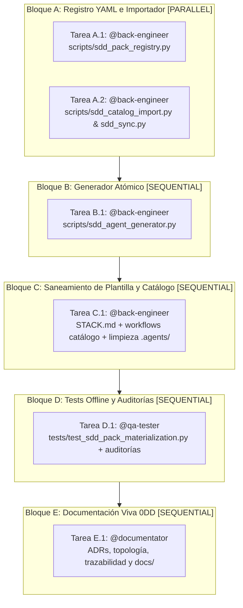

# Tareas de Implementación: Materialización y Activación Fiables de Packs

- **ID del Expediente**: `FWK-001-pack-materialization`
- **RFC de Origen**: [`RFC-001` v2](../../rfcs/RFC-001-ui-ux-pro-max.md)
- **Orquestador Principal**: `@orchestrator`
- **Agentes Especialistas Asignados**: [`@back-engineer`, `@qa-tester`, `@documentator`]
- **Especificaciones de Referencia**:
  - Funcional (Qué): [`01-spec.md`](01-spec.md) (Gate 1 Aprobado)
  - Técnica (Cómo): [`02-tech-spec.md`](02-tech-spec.md) (Gate 2 Aprobado)

---

## 🗺️ Grafo de Ejecución de Tareas (DAG / OpenSpec)



---

## 📋 Desglose Operativo por Bloques de Ejecución

### 🔹 Bloque A: Registro Estructurado e Importador de Workflows [PARALLEL]
> *Tareas concurrentes sobre ficheros disjuntos. Cero solapamiento de rutas.*

- [x] **Tarea A.1** [`@back-engineer`]: Crear módulo de parseo `sdd:stack-config` y validación de manifiestos `pack.json`
  - *Ámbito permitido*: `scripts/`
  - *Archivos exactos*: `scripts/sdd_pack_registry.py`
  - *Contrato de referencia*: `02-tech-spec.md` §0, §2.4, §3, §3.1, §4 (pasos 1–2)
  - *Comando de verificación DoD*: `uv run python -m py_compile scripts/sdd_pack_registry.py`

- [x] **Tarea A.2** [`@back-engineer`]: Añadir descarga de `workflows` con *fetcher* inyectable en importador y compatibilidad de detección `GENERATED`/lock en sincronizador
  - *Ámbito permitido*: `scripts/`
  - *Archivos exactos*: `scripts/sdd_catalog_import.py`, `scripts/sdd_sync.py`
  - *Contrato de referencia*: `02-tech-spec.md` §2.3 (compatibilidad `sdd_sync.py`), §5
  - *Comando de verificación DoD*: `uv run python -m py_compile scripts/sdd_catalog_import.py scripts/sdd_sync.py`

---

### 🔹 Bloque B: Materializador Atómico y Lock v2 [SEQUENTIAL - Requiere Bloque A]
> *Integra `sdd_pack_registry.py` para reemplazo completo del selector regex y materialización segura.*

- [x] **Tarea B.1** [`@back-engineer`]: Refactorizar `scripts/sdd_agent_generator.py` con materialización completa, `.agents/pack-rules/<pack>/`, cabecera `GENERATED` tras frontmatter, prevalidación atómica, limpieza segura y `squad.lock.json` v2
  - *Ámbito permitido*: `scripts/`
  - *Archivos exactos*: `scripts/sdd_agent_generator.py`
  - *Contrato de referencia*: `02-tech-spec.md` §1, §2.1, §2.2, §2.3, §3.2, §4
  - *Comando de verificación DoD*: `uv run python -m py_compile scripts/sdd_agent_generator.py && uv run python scripts/sdd_agent_generator.py --list`

---

### 🔹 Bloque C: Saneamiento de Plantilla y Workflows de Catálogo [SEQUENTIAL - Requiere Bloque B]
> *Deja el repositorio plantilla limpio, coherente con Gate 00 sin aprobar y con todos los `pack.json` válidos en disco.*

- [x] **Tarea C.1** [`@back-engineer`]:
  1. Incorporar el bloque inicial ```` ```yaml sdd:stack-config ```` (`gate00_approved: false`, `preset: compact`, `packs: []`) en `specs/STACK.md`.
  2. Ejecutar `scripts/sdd_catalog_import.py` (o sincronizar los `workflows` declarados en `STACK_PACKS`) y validar que todos los packs del catálogo superan la comprobación de manifiesto; si algún archivo upstream en `affaan-m/ecc` devolviera 404, detener (*fail-closed*) y reportar antes de alterar `STACK_PACKS`.
  3. Retirar los 14 agentes de pack huérfanos de `.agents/agents/` y sus 14 carpetas vacías de `.agent-inbox/`, y ejecutar `--materialize` dejando `.agents/squad.lock.json` en `schema_version: 2` con `active_packs: []`.
  - *Ámbito permitido*: `specs/STACK.md`, `.sdd/catalog/packs/*/workflows/`, `.agents/agents/`, `.agent-inbox/`, `.agents/squad.lock.json`
  - *Archivos exactos*: `specs/STACK.md`, `.agents/squad.lock.json`, `.agents/agents/*.md`, `.agent-inbox/*`, `.sdd/catalog/packs/*/workflows/*.md`
  - *Contrato de referencia*: `02-tech-spec.md` §5, §6
  - *Comando de verificación DoD*: `uv run python scripts/sdd_agent_generator.py --materialize && uv run python .agents/scripts/sdd_healthcheck.py`

---

### 🔹 Bloque D: Pruebas Unitarias Offline y Auditorías Gate 4 [SEQUENTIAL - Requiere Bloque C]
> *Validación determinista independiente de todos los requisitos EARS, escenarios BDD y límites de arquitectura.*

- [x] **Tarea D.1** [`@qa-tester`]: Implementar suite de tests offline en `tests/test_sdd_pack_materialization.py` (9 grupos del §7 de `02-tech-spec.md`) y ejecutar auditorías de calidad (`sdd-test-quality-audit`, `sdd-silent-failure-audit`, `sdd-spec-compliance-audit`)
  - *Ámbito permitido*: `tests/`
  - *Archivos exactos*: `tests/test_sdd_pack_materialization.py`
  - *Contrato de referencia*: `02-tech-spec.md` §7 y `01-spec.md` §5 (Escenarios 1–7)
  - *Comando de verificación DoD*: `uv run python -m unittest discover tests -v && uv run python .agents/scripts/verify_architecture_boundaries.py && uv run python .agents/scripts/sdd_healthcheck.py`

---

### 🔹 Bloque E: Documentación Viva (0DD) y Cierre Gate 5 [SEQUENTIAL - Requiere Bloque D]
> *Consolidación de ADRs, topología, trazabilidad y actualización final de estado en `.sdd/framework/BACKLOG.md`.*

- [x] **Tarea E.1** [`@documentator`]: Registrar `ADR-002` (carga perezosa `.agents/pack-rules/` y lock v2), actualizar `docs/knowledge/` y `docs/traceability/TRACEABILITY-MATRIX.md`, documentación viva en `docs/es/` y `docs/en/` afectada por el generador/importador y marcar cierre de `FWK-001`
  - *Ámbito permitido*: `docs/`, `.sdd/framework/BACKLOG.md`, `.agents/ACTIVE_STATE.md`
  - *Archivos exactos*: `docs/knowledge/ADRS.md`, `docs/knowledge/SYSTEM_TOPOLOGY.md`, `docs/knowledge/DATA_MODELS.md`, `docs/traceability/TRACEABILITY-MATRIX.md`, `docs/es/`, `docs/en/`, `.sdd/framework/BACKLOG.md`, `.agents/ACTIVE_STATE.md`
  - *Contrato de referencia*: `02-tech-spec.md` §2.1, §3.2 y `.agents/rules/06-functional-doc-0dd.md`
  - *Comando de verificación DoD*: `uv run python .agents/scripts/sdd_healthcheck.py && uv run python -m unittest discover tests -v`

---

## 🚦 Aprobación Formal Gate 3 (`RN-SDD-HUMAN-GATE-OWNERSHIP`)
> ⚠️ **Exclusivo para el Stakeholder Humano**:
- [x] **Gate 3 Aprobado por el Usuario**: El grafo de dependencias, bloques paralelos, rutas exactas y comandos de verificación DoD están autorizados para iniciar la ejecución mediante subagentes en Gate 4 (aprobación expresa en chat 2026-11-10: *"Aprobado"*).
