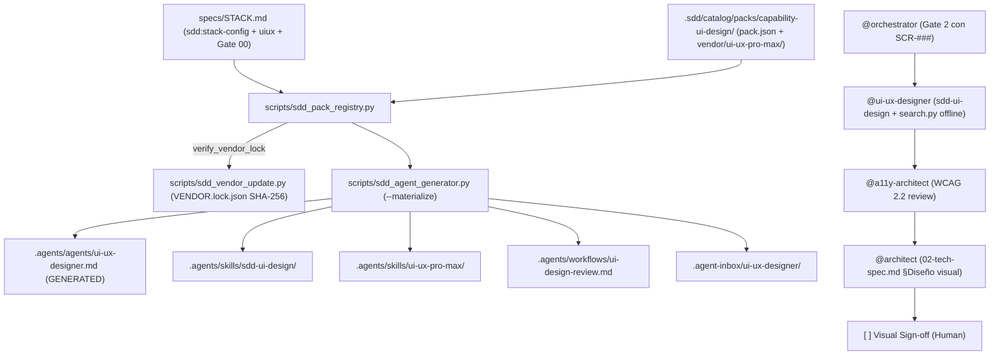

# Especificación Técnica: Pack `capability-ui-design` (UI UX Pro Max)

- **ID de la Feature (Work Item del Framework)**: `FWK-002-capability-ui-design`
- **RFC de Origen**: [`RFC-001` v2](../../rfcs/RFC-001-ui-ux-pro-max.md)
- **Especificación Funcional Asociada**: [`01-spec.md`](./01-spec.md) (Gate 1 Aprobado)
- **Estado**: `Aprobado` (Gate 2 aprobado por el usuario el 2026-11-11; `<PIN_APROBADO> = "2.15.0"`)
- **Tech Lead / Arquitecto**: `@orchestrator` / `@architect`
- **Fecha de Creación**: 2026-11-11
- **Última Actualización**: 2026-11-11

---

## 0. Inventario *Research-First* y Fronteras de Propiedad (`ecc` & `rea`)

- **Activos y Librerías Reutilizadas del Workspace**:
  - Solo librería estándar de Python 3.12+ (`argparse`, `dataclasses`, `datetime`, `difflib`, `hashlib`, `json`, `os`, `pathlib`, `re`, `shutil`, `subprocess`, `sys`, `tempfile`, `typing`); cero dependencias externas fuera de stdlib.
  - [`scripts/sdd_pack_registry.py`](../../../../scripts/sdd_pack_registry.py) (496 líneas actuales; límite modular testado `<= 500` líneas en [`tests/test_sdd_pack_materialization.py`](../../../../tests/test_sdd_pack_materialization.py#L488-L493)): reutiliza `StackConfig`, `PackManifest`, `ResolvedPackAssets`, `_resolve_safe_pack_path()`, `parse_stack_config()`, `load_pack_manifest()`, `resolve_active_packs()` y `resolve_pack_assets()`.
  - [`scripts/sdd_agent_generator.py`](../../../../scripts/sdd_agent_generator.py) (471 líneas actuales; límite `<= 500`): reutiliza `_build_materialization_plan()`, `_iter_skill_files()`, `_preflight_check()`, `inject_generated_header()` y `squad.lock.json` v2 sin cambiar el formato del lock.
  - [`scripts/sdd_catalog_import.py`](../../../../scripts/sdd_catalog_import.py): se preserva intacto (`capability-ui-design` queda fuera de `STACK_PACKS`).
  - [`scripts/sdd_sync.py`](../../../../scripts/sdd_sync.py): ya incluye `.sdd/catalog`, `scripts`, `specs/templates`, `.agents/workflows` y skills core (`sdd-bootstrap`) y excluye ficheros `GENERATED` / `squad.lock.json["files"]`.
  - [`.sdd/catalog/packs/capability-web-frontend/`](../../../../.sdd/catalog/packs/capability-web-frontend/pack.json): provee `@a11y-architect` y las skills ECC (`design-system`, `accessibility`, `browser-qa`, `frontend-a11y`, `make-interfaces-feel-better`, `motion-foundations`, `i18n-sync`).
- **Frontera Productora Única (*Producing-Boundary Ownership*)**:
  - Nuevo módulo [`scripts/sdd_vendor_update.py`](../../../../scripts/sdd_vendor_update.py): dueño único de (1) calcular y verificar `VENDOR.lock.json` (`verify_vendor_lock()`), (2) ejecutar `npx --yes ui-ux-pro-max-cli@<version> init --ai antigravity --offline` en directorio temporal aislado filtrando exclusivamente `.agents/skills/ui-ux-pro-max/` (sin `scripts/tests/` ni skills hermanas), y (3) mostrar diff y escribir atómicamente el vendor actualizado.
  - [`scripts/sdd_pack_registry.py`](../../../../scripts/sdd_pack_registry.py): dueño único de validar el esquema `uiux` y su coherencia *fail-closed* con `packs` / `preset` en `sdd:stack-config`, validar campos opcionales `targets` y `upstream` en `pack.json`, y delegar la comprobación `vendor_lock` en `sdd_vendor_update.verify_vendor_lock()` durante `resolve_pack_assets()`.
  - `.sdd/catalog/packs/capability-ui-design/skills/sdd-ui-design/SKILL.md`: dueño único del contrato metodológico SDD ↔ `ui-ux-pro-max/scripts/search.py` y del formato semver canónico de `docs/design-system/`.
- **Plan de Limpieza de Código Obsoleto (*Zero Zombie Code*)**:
  - No hay código previo de `capability-ui-design` en el repositorio. El directorio temporal del Spike PoC en `$TEMP` se elimina tras extraer métricas.
  - Para respetar el techo de `500` líneas verificado en `tests/test_sdd_pack_materialization.py`, la lógica de parsing/verificación de `VENDOR.lock.json` reside en `scripts/sdd_vendor_update.py` (importada por `sdd_pack_registry.py`), manteniendo `sdd_pack_registry.py` y `sdd_agent_generator.py` en `<= 500` líneas, y la nueva suite de tests se crea en `tests/test_sdd_ui_design.py` (`<= 500` líneas).

---

## 1. Informe del Spike PoC Ejecutado en Gate 2 (`RFC-001` §9 & `AMB-001`)

Ejecutado el 2026-11-11 en directorio temporal aislado fuera del repositorio (`%TEMP%\sdd-uiux-spike-2150`), posteriormente eliminado:

| Aspecto Auditado | Resultado Empírico Verificado | Decisión Técnica Derivada |
|---|---|---|
| **Versión candidata `<PIN_APROBADO>`** | `ui-ux-pro-max-cli@2.15.0` (`npm view ui-ux-pro-max-cli`) | Fijar `"2.15.0"` como `<PIN_APROBADO>` sujeto a firma humana de Gate 2. |
| **Licencia** | `package.json`: `"license": "MIT"`. `LICENSE` en `nextlevelbuilder/ui-ux-pro-max-skill`: `MIT License — Copyright (c) 2024 Next Level Builder`. | Incorporar `vendor/ui-ux-pro-max/LICENSE` con el texto MIT íntegro y `NOTICE.md` en la raíz del pack. |
| **Opciones CLI de `uipro init`** | Soporta `-a/--ai`, `-f/--force`, `-o/--offline`, `-g/--global`, `-t/--token`. **No existe `--dry-run`.** | `sdd_vendor_update.py` siempre instala en `tempfile.TemporaryDirectory()`, compara contra el vendor actual para mostrar diff, y nunca aplica sin `--apply`. |
| **Inventario de salida `--ai antigravity --offline`** | Instala **7 skills** en `.agents/skills/`: `banner-design`, `brand`, `design`, `design-system`, `slides`, `ui-styling` (incluye `LICENSE.txt` Apache 2.0) y `ui-ux-pro-max`. | **Hallazgo crítico**: `design-system` colisionaría (`CollisionError`) con `capability-web-frontend/skills/design-system`, y `ui-styling` es Apache 2.0. `sdd_vendor_update.py` extraerá **únicamente** `.agents/skills/ui-ux-pro-max/`. |
| **Contenido de `ui-ux-pro-max/`** | 49 ficheros runtime (`3,511,291` bytes: `SKILL.md`, `data/*.csv`, `data/*.json`, `data/stacks/*.csv`, `scripts/{core,design_system,reasoning_contract,search,validate_data}.py`) + 33 ficheros en `scripts/tests/` (`428,943` bytes). Dos tests en `scripts/tests/` (`test_catalog_refresh.py`, `test_relevance_evaluator.py`) fallan con `StopIteration` fuera del monorepo upstream. | Excluir `scripts/tests/` al vendorizar (mantiene los 49 ficheros runtime y `validate_data.py`). Ejecutar `scripts/validate_data.py` como verificación automática en `sdd_vendor_update.py` (`exit 0`: 12 dominios, 22 stacks, `ui-reasoning.csv`). |
| **Opciones de `scripts/search.py`** | Soporta `--design-system`, `--domain`, `--stack`, `--json`, `--format {ascii,markdown}`, `--persist`, `--page`, `--output-dir / -o`, `--force`, `--variance`, `--motion`, `--density`. Con `--persist -o <dir>`, escribe siempre `<dir>/design-system/<project-slug>/MASTER.md` y `<dir>/design-system/<project-slug>/pages/<page>.md`. | Aunque existe `-o`, el CLI escribe bajo `design-system/<slug>/` y no emite `design-tokens.json` ni `CHANGELOG.md`. `sdd-ui-design` ejecutará `search.py --json` y/o `--persist -o <temp_dir>` y traducirá hacia `docs/design-system/` sin usar `--force` sobre `MASTER.md` existente. |
| **Python, dependencias y red/telemetría** | Inspección AST de `scripts/*.py`: solo librería estándar (`argparse`, `collections`, `copy`, `csv`, `datetime`, `difflib`, `hashlib`, `importlib`, `io`, `json`, `math`, `os`, `pathlib`, `re`, `statistics`, `subprocess`, `sys`, `tempfile`, `urllib.parse`). Sintaxis compatible con Python 3.8+ (validado en Python 3.12.15). **Cero llamadas HTTP/telemetría** en runtime (`urllib.parse` solo parsea URLs de fuentes). En Windows `python` apunta al alias de MS Store. | Documentar ejecución vía `uv run python` (fallback `python3` / `py -3`). Cero dependencias pip/uv adicionales. Advertir en proyectos Air-Gapped si el CSS recomendado cita URLs de Google Fonts. |
| **Determinismo EOL Windows vs Linux** | Git en Windows con `core.autocrlf=true` convierte ficheros sin `.gitattributes` a CRLF al hacer checkout, rompiendo comparaciones SHA-256 sobre bytes crudos. | `sdd_vendor_update.py` normaliza ficheros de texto a LF (`\n`) al vendorizar y verificar; añadir `.gitattributes` fijando `text eol=lf` para `.sdd/catalog/packs/capability-ui-design/**` y `.agents/**`. |

---

## 2. Arquitectura General y Flujo de Integración



### 2.1. Estructura del Pack `.sdd/catalog/packs/capability-ui-design/`
```text
.sdd/catalog/packs/capability-ui-design/
├── pack.json
├── NOTICE.md
├── agents/
│   └── ui-ux-designer.md
├── skills/
│   └── sdd-ui-design/
│       └── SKILL.md
├── workflows/
│   └── ui-design-review.md
└── vendor/
    └── ui-ux-pro-max/
        ├── LICENSE
        ├── VENDOR.lock.json
        ├── SKILL.md
        ├── data/          (CSVs y JSONs de catálogo)
        └── scripts/       (core.py, design_system.py, reasoning_contract.py, search.py, validate_data.py)
```

- **Nota de materialización (`FWK-001` compatibilidad directa)**: `scripts/sdd_pack_registry.py` (`L439`) toma el último segmento de `"vendor/ui-ux-pro-max"` como slug `"ui-ux-pro-max"`, por lo que `sdd_agent_generator.py` materializa automáticamente `.agents/skills/ui-ux-pro-max/` con `SKILL.md` (cabecera `GENERATED` tras frontmatter) y todos sus `data/` + `scripts/`, sin modificar la lógica de copia de skills de `sdd_agent_generator.py`.

---

## 3. Contratos Técnicos y Esquemas (`Producing-Boundary`)

### 3.1. `pack.json` de `capability-ui-design`
```json
{
  "id": "capability:ui-design",
  "family": "capability",
  "requires": ["capability:web-frontend"],
  "targets": ["web"],
  "description": "UI/UX design intelligence (styles, palettes, typography, UX patterns) governed by SDD.",
  "upstream": {
    "repo": "nextlevelbuilder/ui-ux-pro-max-skill",
    "package": "ui-ux-pro-max-cli",
    "license": "MIT",
    "version": "2.15.0",
    "vendor_lock": "vendor/ui-ux-pro-max/VENDOR.lock.json"
  },
  "specialists": ["agents/ui-ux-designer.md"],
  "skills": ["skills/sdd-ui-design", "vendor/ui-ux-pro-max"],
  "workflows": ["workflows/ui-design-review.md"],
  "rules": []
}
```

### 3.2. Esquema `VENDOR.lock.json`
```json
{
  "schema_version": 1,
  "package": "ui-ux-pro-max-cli",
  "version": "2.15.0",
  "license": "MIT",
  "upstream_repo": "nextlevelbuilder/ui-ux-pro-max-skill",
  "updated_at": "2026-11-11T00:00:00+00:00",
  "vendor_subdir": "vendor/ui-ux-pro-max",
  "files": {
    "LICENSE": { "sha256": "<64-hex>", "bytes": 1070 },
    "SKILL.md": { "sha256": "<64-hex>", "bytes": 28032 }
  }
}
```
- **Reglas de integridad (`verify_vendor_lock`)**:
  1. `schema_version == 1`, `version` string no vacío, `files` dict no vacío.
  2. Toda clave en `files` es ruta relativa POSIX segura (sin `/`, `..`, `\` ni unidad Windows) y no incluye `VENDOR.lock.json`.
  3. Todo fichero declarado existe como fichero regular dentro de `vendor_dir`, coincide en `sha256` (bytes exactos en disco) y `bytes`.
  4. Ningún fichero no declarado existe en `vendor_dir` (ignorando `__pycache__/` y `*.pyc`).
  5. Si falla cualquier condición, lanza `VendorIntegrityError` (capturada/convertida en `InvalidManifestError` dentro de `sdd_pack_registry.py` para garantizar *fail-closed* antes de mutar `.agents/`).

### 3.3. Contrato Python: `scripts/sdd_vendor_update.py`
```python
class VendorIntegrityError(Exception):
    """Raised when VENDOR.lock.json or vendorized files fail verification."""

def compute_vendor_manifest_entries(vendor_dir: Path) -> dict[str, dict[str, object]]: ...
def verify_vendor_lock(vendor_dir: Path, lock_path: Path | None = None) -> dict[str, Any]: ...
def update_vendor(
    version: str,
    pack_dir: Path,
    *,
    apply: bool = False,
    runner: Callable[[Sequence[str], Path], int] | None = None,
) -> dict[str, Any]: ...
```
- **CLI**:
  - `uv run python scripts/sdd_vendor_update.py --verify`: verifica `.sdd/catalog/packs/capability-ui-design/vendor/ui-ux-pro-max/VENDOR.lock.json` (exit `0` o `1`).
  - `uv run python scripts/sdd_vendor_update.py --version <X.Y.Z> [--apply] [--yes]`:
    - Valida formato semver de `<X.Y.Z>`.
    - Instala `npx --yes ui-ux-pro-max-cli@<X.Y.Z> init --ai antigravity --offline` dentro de `tempfile.TemporaryDirectory()`.
    - Verifica existencia de `.agents/skills/ui-ux-pro-max/SKILL.md` y ejecuta `scripts/validate_data.py` en el staging antes de proponer cambios.
    - Excluye las 6 skills hermanas y `scripts/tests/`, normaliza `\r\n`/`\r` -> `\n` en extensiones textuales (`.md`, `.py`, `.csv`, `.json`, `.txt`), preserva `LICENSE` y genera diff detallado (`added`, `modified`, `removed`, cambio en `pack.json["upstream"]["version"]`).
    - Sin `--apply`: solo imprime el resumen/diff y termina sin tocar el catálogo.
    - Con `--apply`: si no se pasa `--yes`, pide confirmación interactiva en stdin (`[y/N]`); reemplaza `vendor/ui-ux-pro-max/` de forma limpia, escribe `VENDOR.lock.json` y actualiza `upstream.version` en `pack.json` (verificando además `verify_vendor_lock` al finalizar).

### 3.4. Extensiones en `scripts/sdd_pack_registry.py` (Manteniendo `<= 500` líneas)
- **`PackManifest`**: añade `targets: tuple[str, ...] = ()` y `upstream: dict[str, Any] | None = None` con validación opcional en `load_pack_manifest()`:
  - Si `targets` está presente: lista de strings no vacíos.
  - Si `upstream` está presente: JSON object; si incluye `vendor_lock`, debe ser string no vacío.
- **Validación `uiux` en `parse_stack_config()`**:
  - `uiux is None` sigue siendo válido (retrocompatible 100% con `FWK-001`).
  - Cuando `uiux` es dict:
    - Claves permitidas estrictas: `{"enabled", "provider", "version", "hifi_format", "brand_constraints"}` (rechazar claves desconocidas con `StackConfigError`, decisión confirmada por el usuario 2026-11-11).
    - `"enabled"` obligatorio y estrictamente `bool`; si `enabled is True`, rechazar `preset == "api-only"` con `StackConfigError`.
    - `"provider"` opcional; si aparece debe ser string no vacío, y cuando `enabled is True` debe valer exactamente `"ui-ux-pro-max"`.
    - `"version"` opcional; si aparece debe ser string no vacío.
    - `"hifi_format"` opcional; si aparece debe pertenecer a `{"html", "figma", "html+figma"}`.
    - `"brand_constraints"` opcional; `None` (`null`) se acepta como sin restricciones, y si no es `None` debe ser string no vacío relativo (sin ruta absoluta POSIX/Windows, unidad de disco ni `..`).
- **Coherencia `uiux` ↔ `packs` en `resolve_active_packs()` (`AMB-002` Opción A)**:
  - Solo cuando `effective_gate00_approved` es `True` (activación declarativa desde `sdd:stack-config`; las invocaciones manuales pre-Gate 00 con `--packs` siguen libres):
    - `has_ui_pack = any(p.strip() in {"capability-ui-design", "capability:ui-design"} for p in config.packs)`
    - `uiux_enabled = isinstance(config.uiux, dict) and config.uiux.get("enabled") is True`
    - Si `uiux_enabled != has_ui_pack`: lanzar `StackConfigError` explicando la discrepancia entre `uiux.enabled` y `packs`.
- **Verificación `vendor_lock` en `resolve_pack_assets()` (`AMB-003` Opción A)**:
  - Si `manifest.upstream` contiene `"vendor_lock"`: resolver ruta con `_resolve_safe_pack_path(pack_root, vendor_lock_rel, "upstream.vendor_lock")`, exigir que sea fichero, y llamar a `verify_vendor_lock(lock_path.parent, lock_path)` capturando `VendorIntegrityError` -> `InvalidManifestError`.

---

## 4. Diseño del Contrato Funcional/Metodológico del Pack

### 4.1. `@ui-ux-designer` (`.sdd/catalog/packs/capability-ui-design/agents/ui-ux-designer.md`)
- **Frontmatter**: `name: ui-ux-designer`, `mode: subagent`, `tools: {bash: true, write: true, edit: true}` (mismo patrón YAML que `front-ui` / `orchestrator` para edición acotada) + *Prompt Defense Baseline*.
- **Invariantes (`RFC-001` §5 + `RF-010`)**:
  - **Activación**: solo en Gate 2 cuando `capability-ui-design` está activo y la feature toca al menos una pantalla `SCR-###`.
  - **DoR Bloqueante**: (1) `specs/STACK.md` con Gate 00 aprobado y `uiux.enabled: true`, (2) `01-spec.md` de la feature con `[x] Gate 1 Aprobado` y wireframes §18 validados, (3) `docs/design-system/MASTER.md` vigente o feature `Design System Foundation` en curso. Si falta cualquiera → emitir `.agent-inbox/ui-ux-designer/BLOCKED_DOR_<FEAT-ID>.md` y detenerse (*Stop-the-Line*).
  - **Escritura Permitida**: exclusivamente `docs/design-system/**` (solo vía `Design System Foundation` o CR sobre ella, y `docs/design-system/pages/SCR-XXX.md` de la feature activa) y `specs/features/<feature-activa>/ux/**` mientras la feature no sea `Done`.
  - **Prohibiciones Estrictas**: `src/**`, `tests/**`, `01-spec.md`, artefactos de features `Done`, casillas `[x]` de sign-off, instalar dependencias, ejecutar `npx`, o pasar `--force` sobre `MASTER.md` existente.
  - **Escalado**: si un ajuste visual añade controles, flujos o reglas no contemplados en `01-spec.md`, detener y devolver a Gate 1 (`RN-SDD-FAIL-CLOSED`).
  - **Salidas obligatorias**: trazabilidad `RF-###` → `SCR-###` → token, estados `Confirmado` / `Propuesto` / `Pendiente`, estados UI (`loading`, `empty`, `error`, `default`), responsive y solicitud de revisión a `@a11y-architect` antes de `@architect` y sign-off humano.

### 4.2. Skill Adaptadora `sdd-ui-design` (`skills/sdd-ui-design/SKILL.md`)
- **Comando canónico offline**:
  ```bash
  uv run python .agents/skills/ui-ux-pro-max/scripts/search.py "<query>" --design-system -p "<project>" --json
  ```
  *(fallback `python3` / `py -3`; en Windows nunca depender del alias `python` de MS Store; para `--persist`, usar siempre `--output-dir <temp_dir>` y nunca `--force` sobre `docs/design-system/MASTER.md`)*.
- **Esquema normativo de `docs/design-system/` (`AMB-007` Opción A)**:
  1. `docs/design-system/MASTER.md`: cabecera metadata (`design_system_version: X.Y.Z`, `owner_feature: FEAT-XXX`, `provider: ui-ux-pro-max@2.15.0`, `hifi_format`, `brand_constraints`), paleta semántica con contraste, tipografía, escala de espaciado/radios/sombras, patrones de componentes y antipatrones.
  2. `docs/design-system/design-tokens.json`: JSON estructurado (`version`, `meta`, `colors`, `typography`, `spacing`, `radii`, `shadows`, `motion`, `breakpoints`) sincronizado 1:1 con `MASTER.md`.
  3. `docs/design-system/CHANGELOG.md`: historial semver (`MAJOR` = breaking tokens/contratos con lista de `SCR-###` impactados; `MINOR` = nuevos tokens/componentes retrocompatibles; `PATCH` = ajuste de valor sin ruptura), referenciando `FEAT-XXX` / `CR-XXX`.
  4. `docs/design-system/pages/SCR-XXX.md`: overrides trazados a `FEAT-XXX` dueña del `SCR-XXX` y rango `MASTER@1.x` (usando tokens, nunca hex/px literales sin token).
- **Hi-Fi (`specs/features/<feat>/ux/SCR-XXX/hi-fi/`)**:
  - Por defecto HTML/CSS navegable autocontenido (`index.html` + tokens CSS derivados de `design-tokens.json`), o Figma + enlace si `hifi_format` es `figma` / `html+figma`.
  - Respeta `brand_constraints` si está definido en `STACK.md`.

### 4.3. Workflow `ui-design-review.md` (`workflows/ui-design-review.md`)
Secuencia en 6 pasos:
1. Validación DoR Gate 1 + wireframes (`@orchestrator` / `@ui-ux-designer`).
2. Consulta offline `ui-ux-pro-max` + generación de tokens/overrides/hi-fi (`@ui-ux-designer` usando `sdd-ui-design`).
3. Revisión independiente de accesibilidad WCAG 2.2 AA (`@a11y-architect` usando skill `accessibility`).
4. Validación de arquitectura, `MASTER@versión` y contratos (`@architect` en `02-tech-spec.md` §Diseño visual).
5. Verificación *Stop-the-Line* de cero cambio funcional no aprobado.
6. Sign-off humano explícito `[x] Visual Sign-off (Human)` + Gate 2.

---

## 5. Actualizaciones a Bootstrap, Plantillas, Arquetipos y Orquestador

1. **[`.agents/skills/sdd-bootstrap/SKILL.md`](../../../../.agents/skills/sdd-bootstrap/SKILL.md)**:
   - Tabla §3 Dynamic Tree Pruning: `Solo Backend / API Only` y `CLI / Herramienta Local` podan todas las preguntas `uiux` (no activan `capability-ui-design`).
   - Ronda 2 (ES-ES) y Round 2 (EN-GB) cuando hay UI (`Fullstack` o `Solo Frontend`): 3 preguntas `uiux` (`enabled` con `ui-ux-pro-max` vs solo ECC, `hifi_format`, `brand_constraints` opcional).
   - §6 Output Determinista: genera bloque `sdd:stack-config` con `packs` + `uiux` en `specs/STACK.md`, ejecuta `uv run python scripts/sdd_agent_generator.py --materialize`, y si `uiux.enabled: true`, registra la fila `Design System Foundation` en `specs/BACKLOG.md` con el siguiente `FEAT-XXX` secuencial disponible (`Gate 0 [x]`, `Estado: Backlog`).
2. **[`specs/templates/00-stack.template.md`](../../../../specs/templates/00-stack.template.md)** y **[`specs/STACK.md`](../../../../specs/STACK.md)**:
   - `00-stack.template.md` §3.3 incorpora el bloque ```` ```yaml sdd:stack-config ```` completo (con `gate00_approved: false`, `preset`, `packs` y sección `uiux` documentada con versión `"2.15.0"`).
   - `specs/STACK.md` mantiene `gate00_approved: false`, `preset: compact`, `packs: []` y añade `uiux:\n  enabled: false` como línea base limpia.
3. **[`specs/templates/02-technical-spec.template.md`](../../../../specs/templates/02-technical-spec.template.md)**:
   - Nueva subsección **§6.1 Diseño Visual (`SCR-###` & Design System)** con campo `design-system: MASTER@<versión> | N/A`, tabla `SCR-XXX` → `pages/SCR-XXX.md` → `ux/SCR-XXX/hi-fi/` → tokens → revisión `@a11y-architect`.
   - Nueva casilla en §8: `- [ ] **Visual Sign-off (Human)**: ...` *(bloqueante solo si la feature toca pantallas `SCR-###`; marcar `N/A` si no aplica)*.
4. **Arquetipos frontend (`.sdd/catalog/archetypes/`)**:
   - `front-ui.archetype.md`, `front-engineer.archetype.md`, `tier-frontend.archetype.md`: añaden al `DoR` referencia obligatoria a `SCR-XXX`, `MASTER@versión`, `docs/design-system/pages/SCR-XXX.md` y tokens de `design-tokens.json` (prohibido hardcodear colores/fuentes literales).
5. **[`.agents/agents/orchestrator.md`](../../../../.agents/agents/orchestrator.md)**:
   - §2.4 (Gate 2): incluye flujo condicional cuando hay `SCR-###`: `@ui-ux-designer` → `@a11y-architect` → `@architect` → `[ ] Visual Sign-off (Human)`.
   - §2.5 (Gate 3): obliga a propagar `SCR-XXX`, `MASTER@versión`, `pages/SCR-XXX.md` y tokens en el DoR de tareas UI.

---

## 6. Pruebas, Auditoría y Criterios de Verificación

- **Suite unitaria offline nueva**: [`tests/test_sdd_ui_design.py`](../../../../tests/test_sdd_ui_design.py) (`<= 500` líneas), ejecutable con `uv run python -m unittest tests.test_sdd_ui_design -v` y dentro de `uv run python -m unittest discover tests -v`:
  1. Validación real del catálogo `.sdd/catalog/packs/capability-ui-design/` (`pack.json`, `NOTICE.md`, `LICENSE`, `VENDOR.lock.json` íntegro, ejecución real offline de `vendor/ui-ux-pro-max/scripts/validate_data.py` y consulta offline `search.py --json`), más preservación ante `sdd_catalog_import.py` con fetcher mockeado (Escenario `#6`).
  2. Activación y poda por topología: `api-only` sin `@ui-ux-designer` ni `uiux` (Escenario `#7`); `spa-only` con `uiux.enabled: true` materializando los 4 tipos de activos y `.agent-inbox/ui-ux-designer/` (Escenario `#8`); `spa-only` con `uiux.enabled: false` preservando `@a11y-architect` y skills ECC (Escenario `#9`).
  3. Validaciones *fail-closed* de `uiux` (`api-only` + `enabled: true`, mismatch `uiux.enabled` ↔ `packs`, `provider`/`hifi_format` inválidos, `brand_constraints` traversal, dependencia faltante `capability:web-frontend`).
  4. Manipulación de `vendor/` (1 byte modificado, fichero faltante, fichero extra) abortando tanto `sdd_vendor_update.verify_vendor_lock()` como `sdd_agent_generator.materialize_squad()` (Escenario `#10`).
  5. `sdd_vendor_update.update_vendor()` con runner mockeado verificando extracción exclusiva de `ui-ux-pro-max/`, exclusión de skills hermanas/tests, diff sin `--apply` y escritura atómica + lock válido con `--apply`.
  6. Aserciones contractuales sobre artefactos reales (`ui-ux-designer.md`, `sdd-ui-design/SKILL.md`, `ui-design-review.md`, `sdd-bootstrap/SKILL.md`, plantillas, arquetipos frontend y `orchestrator.md`) cubriendo Escenarios `#11` y `#12`.
  7. Verificación del techo modular `<= 500` líneas para `scripts/sdd_pack_registry.py`, `scripts/sdd_agent_generator.py`, `scripts/sdd_vendor_update.py` y `tests/test_sdd_ui_design.py`.
- **Decisión de compatibilidad EOL en Windows y fixtures `FWK-001`**: en `.gitattributes`, fijar `eol=lf` para `.sdd/catalog/packs/capability-ui-design/**` y `.agents/**` (renormalizando a LF el checkout de `.agents/`). Además, actualizar en `tests/test_sdd_pack_materialization.py` los dos fixtures heredados de `FWK-001` (`L202` `uiux: {mode: strict}` y `L242–L247` `uiux: {enabled: true, palette: ...}`) al esquema estricto `uiux` (aprobado por el usuario 2026-11-11) para que tanto `test_sdd_ui_design.py` como `test_sdd_pack_materialization.py` pasen en verde.

---

## 7. Aprobación Formal Gate 2 (`RN-SDD-HUMAN-GATE-OWNERSHIP`)
> ⚠️ **Exclusivo para el Stakeholder Humano** (Los agentes de IA tienen prohibido marcar esta casilla por su cuenta):
- [x] **Gate 2 Aprobado por el Usuario**: El resultado del Spike PoC (`ui-ux-pro-max-cli@2.15.0`, MIT, stdlib-only, extracción exclusiva de `ui-ux-pro-max/`), la arquitectura técnica, los esquemas de contratos (`pack.json`, `VENDOR.lock.json`, `uiux`) y el plan de pruebas han sido validados (aprobación expresa en chat 2026-11-11: *"Aprobado"*).
