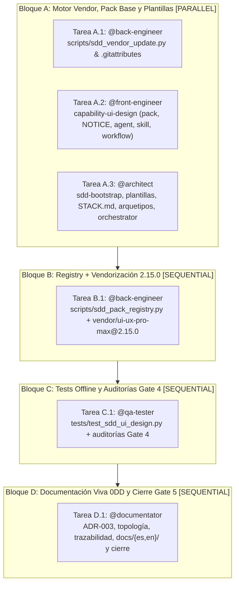

# Tareas de Implementación: Pack `capability-ui-design` (UI UX Pro Max)

- **ID del Expediente**: `FWK-002-capability-ui-design`
- **RFC de Origen**: [`RFC-001` v2](../../rfcs/RFC-001-ui-ux-pro-max.md)
- **Orquestador Principal**: `@orchestrator`
- **Agentes Especialistas Asignados**: [`@back-engineer`, `@front-engineer`, `@architect`, `@qa-tester`, `@documentator`]
- **Especificaciones de Referencia**:
  - Funcional (Qué): [`01-spec.md`](01-spec.md) (Gate 1 Aprobado)
  - Técnica (Cómo): [`02-tech-spec.md`](02-tech-spec.md) (Gate 2 Aprobado — `<PIN_APROBADO> = "2.15.0"`)

---

## 🗺️ Grafo de Ejecución de Tareas (DAG / OpenSpec)

---

## 📋 Desglose Operativo por Bloques de Ejecución

### 🔹 Bloque A: Motor Vendor, Pack Base y Plantillas [PARALLEL]
> *Tareas concurrentes sobre conjuntos de archivos completamente disjuntos. Cero solapamiento de rutas.*

- [x] **Tarea A.1** [`@back-engineer`]: Crear módulo `scripts/sdd_vendor_update.py` (verificación `VENDOR.lock.json` y actualizador aislado vía `npx` temporal con normalización LF, exclusión de skills hermanas/tests y diff previo a `--apply`) y `.gitattributes` (`eol=lf` para `.sdd/catalog/packs/capability-ui-design/**` y `.agents/**`)
  - *Ámbito permitido*: `scripts/`, `.gitattributes`
  - *Archivos exactos*: `scripts/sdd_vendor_update.py`, `.gitattributes`
  - *Contrato de referencia*: `02-tech-spec.md` §0, §1, §3.2, §3.3
  - *Comando de verificación DoD*: `uv run python -m py_compile scripts/sdd_vendor_update.py && uv run python scripts/sdd_vendor_update.py --help`

- [x] **Tarea A.2** [`@front-engineer`]: Crear los artefactos propios del pack `.sdd/catalog/packs/capability-ui-design/` (sin `vendor/`, que lo genera la Tarea B.1)
  - *Ámbito permitido*: `.sdd/catalog/packs/capability-ui-design/` (excepto `vendor/`)
  - *Archivos exactos*: `.sdd/catalog/packs/capability-ui-design/pack.json`, `.sdd/catalog/packs/capability-ui-design/NOTICE.md`, `.sdd/catalog/packs/capability-ui-design/agents/ui-ux-designer.md`, `.sdd/catalog/packs/capability-ui-design/skills/sdd-ui-design/SKILL.md`, `.sdd/catalog/packs/capability-ui-design/workflows/ui-design-review.md`
  - *Contrato de referencia*: `02-tech-spec.md` §2.1, §3.1, §4.1, §4.2, §4.3
  - *Comando de verificación DoD*: `uv run python -c "import json, pathlib; p=pathlib.Path('.sdd/catalog/packs/capability-ui-design'); d=json.loads((p/'pack.json').read_text(encoding='utf-8')); assert d['id']=='capability:ui-design' and d['upstream']['version']=='2.15.0' and all((p/x).exists() for x in ['NOTICE.md','agents/ui-ux-designer.md','skills/sdd-ui-design/SKILL.md','workflows/ui-design-review.md'])"`

- [x] **Tarea A.3** [`@architect`]: Actualizar `sdd-bootstrap`, plantillas `00-stack` y `02-technical-spec`, `specs/STACK.md`, los 3 arquetipos frontend y `.agents/agents/orchestrator.md`
  - *Ámbito permitido*: `specs/`, `.agents/skills/sdd-bootstrap/`, `.sdd/catalog/archetypes/`, `.agents/agents/orchestrator.md`
  - *Archivos exactos*: `.agents/skills/sdd-bootstrap/SKILL.md`, `specs/templates/00-stack.template.md`, `specs/templates/02-technical-spec.template.md`, `specs/STACK.md`, `.sdd/catalog/archetypes/front-ui.archetype.md`, `.sdd/catalog/archetypes/front-engineer.archetype.md`, `.sdd/catalog/archetypes/tier-frontend.archetype.md`, `.agents/agents/orchestrator.md`
  - *Contrato de referencia*: `02-tech-spec.md` §5
  - *Comando de verificación DoD*: `uv run python -c "from pathlib import Path; from scripts.sdd_pack_registry import parse_stack_config; cfg, eff = parse_stack_config(Path('specs/STACK.md')); assert not eff and cfg.packs == () and 'Visual Sign-off (Human)' in Path('specs/templates/02-technical-spec.template.md').read_text(encoding='utf-8') and 'sdd:stack-config' in Path('specs/templates/00-stack.template.md').read_text(encoding='utf-8')"`

---

### 🔹 Bloque B: Integración Registry & Vendorización `2.15.0` [SEQUENTIAL - Requiere Bloque A]
> *Conecta `sdd_pack_registry.py` con `sdd_vendor_update.py` e instala el vendor fijado `2.15.0` verificando toda la cadena.*

- [x] **Tarea B.1** [`@back-engineer`]:
  1. Extender `scripts/sdd_pack_registry.py` (`<= 500` líneas) con validación del esquema `uiux`, coherencia *fail-closed* `uiux.enabled` ↔ `packs` (rechazando `api-only` + `uiux.enabled: true`), metadatos `targets`/`upstream` en `PackManifest` y verificación `verify_vendor_lock()` en `resolve_pack_assets()`.
  2. Ejecutar `uv run python scripts/sdd_vendor_update.py --version 2.15.0 --apply --yes` para generar `.sdd/catalog/packs/capability-ui-design/vendor/ui-ux-pro-max/` (49 ficheros runtime + `LICENSE` MIT + `VENDOR.lock.json`), verificar `validate_data.py`, `sdd_agent_generator.py --list` y `sdd_agent_generator.py --materialize` (manteniendo plantilla base con `active_packs: []` y EOL LF coherente).
  - *Ámbito permitido*: `scripts/sdd_pack_registry.py`, `.sdd/catalog/packs/capability-ui-design/vendor/`, `.agents/` (vía `--materialize`)
  - *Archivos exactos*: `scripts/sdd_pack_registry.py`, `.sdd/catalog/packs/capability-ui-design/vendor/ui-ux-pro-max/**`
  - *Contrato de referencia*: `02-tech-spec.md` §1, §2.1, §3.1, §3.2, §3.3, §3.4
  - *Comando de verificación DoD*: `uv run python -m py_compile scripts/sdd_pack_registry.py && uv run python scripts/sdd_vendor_update.py --verify && uv run python .sdd/catalog/packs/capability-ui-design/vendor/ui-ux-pro-max/scripts/validate_data.py && uv run python scripts/sdd_agent_generator.py --list && uv run python scripts/sdd_agent_generator.py --materialize`

---

### 🔹 Bloque C: Tests Offline y Auditorías Gate 4 [SEQUENTIAL - Requiere Bloque B]
> *Validación determinista 100% offline de todos los escenarios `#6`–`#12`, límites `<= 500` líneas y auditorías de calidad.*

- [x] **Tarea C.1** [`@qa-tester`]: Implementar suite offline en `tests/test_sdd_ui_design.py` (`<= 500` líneas, cubriendo los 7 grupos de `02-tech-spec.md` §6), actualizar los 2 fixtures heredados `uiux` en `tests/test_sdd_pack_materialization.py` (`L202` y `L242–L247`) al esquema estricto aprobado (`<= 500` líneas), y ejecutar suite completa + auditorías Gate 4 (`sdd-test-quality-audit`, `sdd-silent-failure-audit`, `sdd-spec-compliance-audit`, `verify_architecture_boundaries.py`, `sdd_healthcheck.py`)
  - *Ámbito permitido*: `tests/`
  - *Archivos exactos*: `tests/test_sdd_ui_design.py`, `tests/test_sdd_pack_materialization.py` (solo fixtures `uiux` L202 y L242–L247)
  - *Contrato de referencia*: `02-tech-spec.md` §6 y `01-spec.md` §5
  - *Comando de verificación DoD*: `uv run python -m unittest discover tests -v && uv run python .agents/scripts/verify_architecture_boundaries.py && uv run python .agents/scripts/sdd_healthcheck.py`

---

### 🔹 Bloque D: Documentación Viva (0DD) y Cierre Gate 5 [SEQUENTIAL - Requiere Bloque C]
> *Consolidación de ADRs, topología, modelos de datos, trazabilidad, living docs bilingües y cierre final de `FWK-002`.*

- [x] **Tarea D.1** [`@documentator`]: Registrar `ADR-003` (vendorización aislada `capability-ui-design`, ciclo semver `docs/design-system/` y separación `sdd_vendor_update.py`), actualizar `docs/knowledge/`, `docs/traceability/TRACEABILITY-MATRIX.md`, documentación bilingüe `docs/es/` y `docs/en/` (sin crear `docs/design-system/` vacío en la plantilla) y cerrar `FWK-002` en `.sdd/framework/BACKLOG.md` y `.agents/ACTIVE_STATE.md`
  - *Ámbito permitido*: `docs/`, `.sdd/framework/BACKLOG.md`, `.agents/ACTIVE_STATE.md`
  - *Archivos exactos*: `docs/knowledge/ADRS.md`, `docs/knowledge/SYSTEM_TOPOLOGY.md`, `docs/knowledge/DATA_MODELS.md`, `docs/traceability/TRACEABILITY-MATRIX.md`, `docs/es/**`, `docs/en/**`, `.sdd/framework/BACKLOG.md`, `.agents/ACTIVE_STATE.md`
  - *Contrato de referencia*: `02-tech-spec.md` §2–§5 y `.agents/rules/06-functional-doc-0dd.md`
  - *Comando de verificación DoD*: `uv run python .agents/scripts/sdd_healthcheck.py && uv run python -m unittest discover tests -v`

---

## 🚦 Aprobación Formal Gate 3 (`RN-SDD-HUMAN-GATE-OWNERSHIP`)
> ⚠️ **Exclusivo para el Stakeholder Humano**:
- [x] **Gate 3 Aprobado por el Usuario**: El grafo de dependencias, bloques paralelos, rutas exactas y comandos de verificación DoD están autorizados para iniciar la ejecución mediante subagentes en Gate 4 (aprobación expresa en chat 2026-11-11: *"Apruebo y espera"*).
