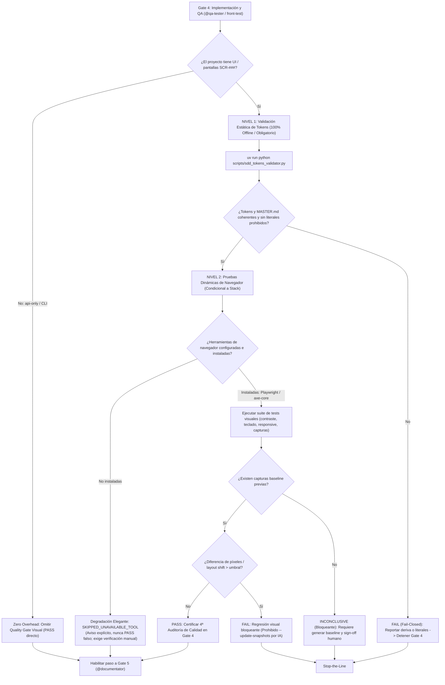

# Especificación Técnica: Quality Gates Visuales Condicionales

- **ID de la Feature (Work Item del Framework)**: `FWK-003-conditional-visual-gates`
- **RFC de Origen**: [`RFC-001` v2](../../rfcs/RFC-001-ui-ux-pro-max.md)
- **Especificación Funcional Asociada**: [`01-spec.md`](./01-spec.md) (Gate 1 Aprobado)
- **Estado**: `Aprobado` (Gate 2 aprobado por el usuario el 2026-11-13)
- **Tech Lead / Arquitecto**: `@orchestrator` / `@architect`
- **Fecha de Creación**: 2026-11-13
- **Última Actualización**: 2026-11-13

---

## 0. Inventario *Research-First* y Fronteras de Propiedad (`ecc` & `rea`)

- **Activos y Librerías Reutilizadas del Workspace**:
  - Exclusivamente librería estándar de Python 3.12+ (`argparse`, `dataclasses`, `enum`, `json`, `os`, `pathlib`, `re`, `sys`, `typing`); cero dependencias externas añadidas.
  - [`scripts/sdd_pack_registry.py`](../../../../scripts/sdd_pack_registry.py): reutiliza la inspección de `StackConfig`, `uiux` y `packs` activos para saber si un proyecto tiene UI/Design System.
  - [`scripts/sdd_agent_generator.py`](../../../../scripts/sdd_agent_generator.py): mantiene la materialización existente sin mutaciones innecesarias.
  - [`.sdd/catalog/packs/capability-ui-design/`](../../../../.sdd/catalog/packs/capability-ui-design/): pack formalizado en `FWK-002` con especificaciones de `docs/design-system/` (`MASTER.md`, `design-tokens.json`, `CHANGELOG.md`, `pages/SCR-XXX.md`).
  - [`.sdd/catalog/packs/capability-web-frontend/`](../../../../.sdd/catalog/packs/capability-web-frontend/): provee `@a11y-architect` y las skills de accesibilidad/QA.
- **Frontera Productora Única (*Producing-Boundary Ownership*)**:
  - Nuevo módulo [`scripts/sdd_tokens_validator.py`](../../../../scripts/sdd_tokens_validator.py): dueño único de (1) parsear y validar la estructura de `design-tokens.json`, (2) cotejar coherencia bidireccional contra `docs/design-system/MASTER.md`, (3) escanear ficheros fuente frontend (`--check-sources`) para detectar colores y estilos literales hardcodeados donde existan tokens normativos, y (4) proveer una API programática para tests y scripts de CI. Mantendrá un límite estricto de `<= 500` líneas de código.
  - [`.agents/agents/qa-tester.md`](../../../../.agents/agents/qa-tester.md): dueño único del protocolo de calidad en Gate 4, incorporando formalmente la **4ª Auditoría Obligatoria: "Quality Gate Visual y Coherencia de Tokens"** y las reglas de baselines `INCONCLUSIVE` sin auto-aprobación por IA.
  - [`.sdd/catalog/archetypes/front-test.archetype.md`](../../../../.sdd/catalog/archetypes/front-test.archetype.md): dueño único de los contratos DoR y DoD para tareas de pruebas visuales frontend.
  - [`.agents/agents/a11y-architect.md`](../../../../.agents/agents/a11y-architect.md) y [`.sdd/catalog/packs/capability-web-frontend/agents/a11y-architect.md`](../../../../.sdd/catalog/packs/capability-web-frontend/agents/a11y-architect.md): dueños únicos de la arquitectura de accesibilidad y del protocolo de dictamen especializado en Gate 4.
  - [`specs/templates/02-technical-spec.template.md`](../../../../specs/templates/02-technical-spec.template.md) y [`specs/templates/03-tasks.template.md`](../../../../specs/templates/03-tasks.template.md): dueños de las cláusulas normativas de testing visual y del Bloque D del DAG en expedientes reales.
  - [`.github/workflows/ci.yml`](../../../../.github/workflows/ci.yml): dueño único de la integración continua del starter.
  - [`tests/test_sdd_visual_gates.py`](../../../../tests/test_sdd_visual_gates.py): dueño único de la suite de pruebas offline del framework para visual gates (`<= 500` líneas).
- **Plan de Limpieza de Código Obsoleto (*Zero Zombie Code*)**:
  - `sdd_tokens_validator.py` no duplica parsing de YAML ni reemplaza a ningún script existente.
  - El escaneo estático de literales usa expresiones regulares optimizadas y acotadas a extensiones frontend (`.css`, `.scss`, `.tsx`, `.jsx`, `.vue`, `.html`), ignorando líneas con el comentario de escape `/* sdd-token-ignore */` o `// sdd-token-ignore`.

---

## 1. Arquitectura General y Flujo de Verificación Bi-Nivel



---

## 2. Contratos de Datos y Esquemas

### 2.1. Estructura Canónica de `design-tokens.json`
El validador inspecciona la jerarquía normalizada de tokens basada en el estándar W3C Community Group / DTCG:

```json
{
  "$schema": "https://design-tokens.github.io/community-group/format/",
  "version": "1.0.0",
  "color": {
    "brand": {
      "primary": { "value": "#2563eb", "type": "color", "description": "Color principal de marca" },
      "secondary": { "value": "#475569", "type": "color" }
    },
    "feedback": {
      "error": { "value": "#dc2626", "type": "color" },
      "success": { "value": "#16a34a", "type": "color" },
      "warning": { "value": "#f59e0b", "type": "color" }
    },
    "background": {
      "default": { "value": "#ffffff", "type": "color" },
      "subtle": { "value": "#f8fafc", "type": "color" }
    },
    "text": {
      "primary": { "value": "#0f172a", "type": "color" },
      "muted": { "value": "#64748b", "type": "color" }
    }
  },
  "typography": {
    "fontFamily": {
      "base": { "value": "Inter, sans-serif", "type": "fontFamily" },
      "heading": { "value": "Inter, sans-serif", "type": "fontFamily" }
    },
    "fontSize": {
      "sm": { "value": "0.875rem", "type": "dimension" },
      "base": { "value": "1rem", "type": "dimension" },
      "lg": { "value": "1.125rem", "type": "dimension" },
      "xl": { "value": "1.25rem", "type": "dimension" }
    }
  },
  "spacing": {
    "1": { "value": "0.25rem", "type": "dimension" },
    "2": { "value": "0.5rem", "type": "dimension" },
    "4": { "value": "1rem", "type": "dimension" },
    "6": { "value": "1.5rem", "type": "dimension" },
    "8": { "value": "2rem", "type": "dimension" }
  }
}
```

### 2.2. Modelo de Trazabilidad y Reporte de Validación (`TokenValidationResult`)
En Python stdlib:

```python
from dataclasses import dataclass, field
from enum import Enum


class ValidationSeverity(str, Enum):
    ERROR = "ERROR"
    WARNING = "WARNING"
    INFO = "INFO"


@dataclass
class TokenViolation:
    severity: ValidationSeverity
    category: str
    message: str
    file_path: str = ""
    line_number: int = 0
    token_name: str = ""
    literal_value: str = ""


@dataclass
class TokenValidationResult:
    is_valid: bool
    total_tokens_checked: int = 0
    total_sources_scanned: int = 0
    missing_in_master: list[str] = field(default_factory=list)
    missing_in_json: list[str] = field(default_factory=list)
    violations: list[TokenViolation] = field(default_factory=list)
    skipped_reason: str | None = None
```

### 2.3. Estados de Ejecución del Quality Gate Visual
Los resultados posibles para un check visual dinámico en Gate 4 son:
- **`PASS`**: Todas las comprobaciones visuales, contraste, foco y comparación de capturas están dentro del umbral de tolerancia (`< 0.1%` diferencia de píxeles).
- **`FAIL`**: Violación explícita de contraste WCAG 2.2 AA (`< 4.5:1`), ausencia de indicador de foco, desbordamiento horizontal en algún viewport o regresión de píxeles (`>= 0.1%`). Bloqueante.
- **`INCONCLUSIVE`**: No existe archivo de captura baseline previo para la pantalla/componente en la ruta designada. Bloqueante para Gate 4 hasta sign-off humano.
- **`SKIPPED_UNAVAILABLE_TOOL`**: El proyecto requiere pruebas de navegador pero los binarios/herramientas no están instalados. No bloquea automáticamente el pipeline si el nivel estático está verde, pero emite advertencia explícita y exige verificación visual manual.
- **`SKIPPED_NO_UI`**: El proyecto no tiene UI (`api-only` / CLI). Salida exitosa directa sin coste.

---

## 3. Especificación Detallada de `scripts/sdd_tokens_validator.py`

### 3.1. Interfaz de Línea de Comandos (CLI)
```text
usage: sdd_tokens_validator.py [-h] [--tokens TOKENS_PATH] [--master MASTER_PATH]
                              [--check-sources SOURCES_DIR] [--allow-missing]
                              [--format {text,json}] [--strict]

Validador Determinista de Tokens de Diseño y Anti-Deriva Estilística SDD.

options:
  -h, --help            Muestra esta ayuda y finaliza.
  --tokens TOKENS_PATH  Ruta al archivo design-tokens.json (por defecto: docs/design-system/design-tokens.json).
  --master MASTER_PATH  Ruta al archivo MASTER.md (por defecto: docs/design-system/MASTER.md).
  --check-sources DIR   Directorio de código frontend a escanear en busca de literales prohibidos.
  --allow-missing       Si design-tokens.json no existe, finaliza con éxito (código 0) e informa skip.
  --format {text,json}  Formato de salida de los resultados (por defecto: text).
  --strict              Trata advertencias como errores bloqueantes.
```

### 3.2. Lógica de Cotejo Bidireccional (`JSON` ↔ `MASTER.md`)
1. **Aplanamiento de Tokens**: `flatten_tokens(json_data)` extrae todos los identificadores en notación de puntos (ej. `color.brand.primary`, `spacing.4`) junto a sus valores normalizados (hex en minúsculas, dimensiones).
2. **Extracción en `MASTER.md`**: `extract_master_tokens(master_text)` escanea tablas y bloques en `MASTER.md` extrayendo tokens citados con sintaxis de código (ej. `` `color.brand.primary` `` o identificadores en tablas de especificación).
3. **Cotejo Bidireccional**:
   - `missing_in_master`: tokens presentes en el JSON pero nunca mencionados en `MASTER.md`.
   - `missing_in_json`: tokens citados en `MASTER.md` pero no declarados en el JSON.
   - Si cualquiera de las dos listas no está vacía, se emite una violación de severidad `ERROR`.

### 3.3. Detección Inteligente de Literales Prohibidos (`--check-sources`)
- **Filtro de Extensiones**: `.css`, `.scss`, `.sass`, `.less`, `.tsx`, `.jsx`, `.vue`, `.html`, `.svelte`.
- **Exclusiones de Directorio**: `node_modules/`, `.git/`, `dist/`, `build/`, `vendor/`, `__pycache__/`, `tests/fixtures/`.
- **Filtro de Escape**: Líneas que contengan `/* sdd-token-ignore */` o `// sdd-token-ignore` son ignoradas.
- **Patrones de Detección**:
  - Colores hexadecimales: `(?<![a-zA-Z0-9_-])#(?:[0-9a-fA-F]{3,4}|[0-9a-fA-F]{6}|[0-9a-fA-F]{8})\b` en contextos de asignación de estilo (`color:`, `background:`, `border:`, `fill:`, `stroke:`, etc. o propiedades style en JSX).
  - Si el color literal detectado coincide con el valor de un token normativo registrado en `design-tokens.json` (ej. `#2563eb` cuando existe `color.brand.primary: #2563eb`), se genera un error indicando: *"Literal '#2563eb' detectado en <fichero>:<línea>; utilice el token 'color.brand.primary'"*.

---

## 4. Modificaciones en Agentes y Arquetipos

### 4.1. `.agents/agents/qa-tester.md`
Se actualiza la Sección 3 para incorporar formalmente la 4ª auditoría de calidad:

```markdown
### 3.4. Quality Gate Visual y Coherencia de Tokens (Features con UI)
Cuando la feature toca pantallas (`SCR-###`) con `capability-ui-design` o interfaz web activa:
1. **Coherencia de Tokens**: Ejecutar `uv run python scripts/sdd_tokens_validator.py --check-sources <frontend_dir>`. No se admiten colores literales hardcodeados ni discrepancias con `MASTER.md`.
2. **Contraste WCAG 2.2 AA**: Verificar ratios mínimos de contraste (`4.5:1` texto normal / `3:1` texto grande y componentes UI) mediante suites axe-core o inspección calculada.
3. **Navegación por Teclado**: Comprobar que todos los elementos interactivos son accesibles vía `Tab`, con indicador de foco visible (`SC 2.4.11`) y sin trampas de teclado.
4. **Responsive en 3 Viewports**: Comprobar renderizado limpio en `375px` (móvil), `768px` (tablet) y `1440px` (escritorio), sin desbordamiento horizontal inesperado.
5. **Baselines Visuales y Regresiones**:
   - Si falta captura de baseline: dictaminar `INCONCLUSIVE` (bloqueante para Gate 4; prohibido `PASS` silencioso).
   - Si hay regresión visual (> 0.1%): fallar el test.
   - **PROHIBICIÓN ESTRICTA**: Queda prohibido ejecutar `--update-snapshots` o sobreescribir baselines de forma autónoma sin consentimiento humano explícito en el chat.
```

Y en la Sección 4 (Definition of Done para Gate 4):
- Se amplía el requisito 2 para incluir la 4ª auditoría en proyectos con UI.

### 4.2. `.sdd/catalog/archetypes/front-test.archetype.md`
- **Definition of Ready (DoR)**:
  - Ticket en `.agent-inbox/front-test/` con Criterios de Aceptación visuales de `01-spec.md`, componentes implementados por `@front-ui`, y referencias a pantallas `SCR-XXX`, `MASTER@versión` y tokens de `docs/design-system/design-tokens.json`.
- **Definition of Done (DoD)**:
  - Ejecutar el comando oficial de pruebas de frontend: `{{FRONTEND_TEST_CMD}}`.
  - Ejecutar `uv run python scripts/sdd_tokens_validator.py --check-sources {{FRONTEND_DIR}}` sin discrepancias de tokens ni literales prohibidos.
  - Verificar contraste WCAG 2.2 AA y navegación por teclado en componentes interactivos.
  - El 100% de los tests pasan en verde. Si hay pruebas de captura visual, baselines intactos y cero falsos verdes (`INCONCLUSIVE` ante capturas ausentes).

### 4.3. `.agents/agents/a11y-architect.md`
Se añade la sección de rol operativo en Gate 4:
- Si `@qa-tester` detecta violaciones WCAG 2.2 AA complejas durante la ejecución de tests (fallos de árbol ARIA, focos no contenidos en modales, contrastes complejos en estados dinámicos), `@a11y-architect` interviene para formular la corrección técnica recomendada a `@front-engineer` y certificar el dictamen final de accesibilidad.

---

## 5. Actualización de Plantillas y CI/CD

### 5.1. `specs/templates/02-technical-spec.template.md`
En la Sección 7 (*Pruebas, Auditoría Semántica y Criterios de Verificación*), se añade la subsección condicional:
```markdown
- **Quality Gates Visuales (Features con pantallas `SCR-###`)**:
  - Coherencia de tokens: `uv run python scripts/sdd_tokens_validator.py --check-sources frontend/` (cero literales hardcodeados).
  - Accesibilidad WCAG 2.2 AA: Contraste >= 4.5:1 y navegación por teclado certificada.
  - Responsive: Verificación en 375px, 768px y 1440px.
  - Regresión visual: Baselines aprobados; falta de captura catalogada como `INCONCLUSIVE` (prohibida auto-actualización por IA).
  *(Indicar `N/A` si la feature no toca pantallas).*
```

### 5.2. `specs/templates/03-tasks.template.md`
En el Bloque D (*Calidad & Documentación*), se formaliza la tarea condicional:
```markdown
- [ ] **Tarea D.X** [`@front-test` / `@qa-tester`]: Certificar Quality Gate Visual y Coherencia de Tokens
  - *Ámbito permitido*: `frontend/tests/`, `specs/features/<feat>/`
  - *Archivos exactos*: `frontend/tests/visual/test_[pantalla].test.ts`
  - *Contrato de referencia*: `02-tech-spec.md` Sección 6.1 y 7
  - *Comando de verificación DoD*: `uv run python scripts/sdd_tokens_validator.py --check-sources frontend/ && npm run test:visual`
```

### 5.3. `.github/workflows/ci.yml`
Se añade el paso determinista en el pipeline del starter:
```yaml
      - name: Validate Design Tokens Consistency (Offline)
        run: |
          uv run python scripts/sdd_tokens_validator.py --allow-missing
```

---

## 6. Estrategia de Pruebas Offline (`tests/test_sdd_visual_gates.py`)

La suite `tests/test_sdd_visual_gates.py` contendrá al menos 8 tests deterministas 100% offline (`<= 500` líneas):
1. `test_valid_tokens_and_master_coherence_passes`: JSON canónico y `MASTER.md` coherente devuelven `exit 0`.
2. `test_token_missing_in_master_fails_closed`: Token en JSON ausente en `MASTER.md` devuelve `exit 1` con error detallado.
3. `test_token_missing_in_json_fails_closed`: Token en `MASTER.md` ausente en JSON devuelve `exit 1`.
4. `test_hardcoded_literal_detected_in_sources`: Archivo con `#2563eb` existiendo `color.brand.primary` es detectado con línea exacta.
5. `test_ignore_comment_skips_literal`: Línea con `/* sdd-token-ignore */` no emite error.
6. `test_allow_missing_flag_for_no_ui_projects`: Sin archivos de diseño, `--allow-missing` devuelve `0` con mensaje de skip.
7. `test_json_output_format`: `--format json` produce salida estructurada según `TokenValidationResult`.
8. `test_modularity_line_limit_500`: Verifica que `scripts/sdd_tokens_validator.py` no supere las 500 líneas de código.

---

## 7. Aprobación Formal Gate 2 (`RN-SDD-HUMAN-GATE-OWNERSHIP`)
> ⚠️ **Exclusivo para el Stakeholder Humano** (Los agentes de IA tienen estrictamente prohibido marcar esta casilla por su cuenta):
- [x] **Gate 2 Aprobado por el Usuario**: El diseño técnico, contratos de tokens, arquitectura bi-nivel, especificación de `sdd_tokens_validator.py` y actualizaciones de agentes/plantillas han sido validados (Aprobado expresamente en chat por el usuario el 2026-11-13).
- [x] **Visual Sign-off (Human)**: [N/A — Work item de infraestructura del framework].
