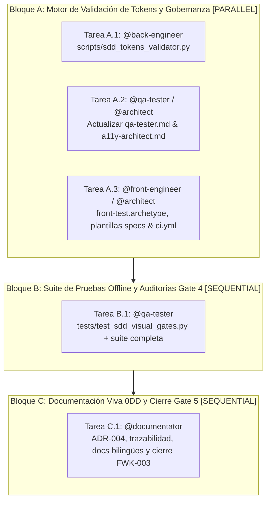

# Tareas de Implementación: Quality Gates Visuales Condicionales

- **ID del Expediente**: `FWK-003-conditional-visual-gates`
- **RFC de Origen**: [`RFC-001` v2](../../rfcs/RFC-001-ui-ux-pro-max.md)
- **Orquestador Principal**: `@orchestrator`
- **Agentes Especialistas Asignados**: [`@back-engineer`, `@front-engineer`, `@architect`, `@qa-tester`, `@documentator`]
- **Especificaciones de Referencia**:
  - Funcional (Qué): [`01-spec.md`](01-spec.md) (Gate 1 Aprobado)
  - Técnica (Cómo): [`02-tech-spec.md`](02-tech-spec.md) (Gate 2 Aprobado)
- **Estado**: `Completado` (Gates 1 a 5 completados al 100%; Bloques A, B y C finalizados el 2026-11-13)

---

## 🗺️ Grafo de Ejecución de Tareas (DAG / OpenSpec)

---

## 📋 Desglose Operativo por Bloques de Ejecución

### 🔹 Bloque A: Motor de Validación de Tokens y Gobernanza [PARALLEL]
> *Tareas concurrentes sobre conjuntos disjuntos de archivos. Cero colisión de rutas.*

- [x] **Tarea A.1** [`@back-engineer`]: Crear módulo `scripts/sdd_tokens_validator.py` en Python 3.12 stdlib (validación de esquema DTCG, cotejo bidireccional JSON ↔ `MASTER.md`, escaneo de código `--check-sources`, flags `--allow-missing` y `--format json`, límite `<= 500` líneas)
  - *Ámbito permitido*: `scripts/`
  - *Archivos exactos*: `scripts/sdd_tokens_validator.py`
  - *Contrato de referencia*: `02-tech-spec.md` §0, §2, §3
  - *Comando de verificación DoD*: `uv run python -m py_compile scripts/sdd_tokens_validator.py && uv run python scripts/sdd_tokens_validator.py --help`

- [x] **Tarea A.2** [`@qa-tester` / `@architect`]: Actualizar `.agents/agents/qa-tester.md`, `.agents/agents/a11y-architect.md` y `.sdd/catalog/packs/capability-web-frontend/agents/a11y-architect.md` incorporando la 4ª auditoría obligatoria de calidad (*Quality Gate Visual y Coherencia de Tokens*), las directrices de degradación bi-nivel y la gobernanza de baselines visuales (`INCONCLUSIVE` ante ausencias, prohibición de auto-actualización agéntica).
  - *Ámbito permitido*: `.agents/agents/`, `.sdd/catalog/packs/capability-web-frontend/agents/`
  - *Archivos exactos*: `.agents/agents/qa-tester.md`, `.agents/agents/a11y-architect.md`, `.sdd/catalog/packs/capability-web-frontend/agents/a11y-architect.md`
  - *Contrato de referencia*: `02-tech-spec.md` §4.1, §4.3
  - *Comando de verificación DoD*: `uv run python -c "for f in ['.agents/agents/qa-tester.md', '.agents/agents/a11y-architect.md', '.sdd/catalog/packs/capability-web-frontend/agents/a11y-architect.md']: assert 'Quality Gate Visual' in open(f, encoding='utf-8').read() or 'WCAG 2.2' in open(f, encoding='utf-8').read()"`

- [x] **Tarea A.3** [`@front-engineer` / `@architect`]: Actualizar `.sdd/catalog/archetypes/front-test.archetype.md` (DoR y DoD visual/tokens), las plantillas `specs/templates/02-technical-spec.template.md` (Sección 7) y `specs/templates/03-tasks.template.md` (Bloque D), y `.github/workflows/ci.yml` (paso determinista de validación de tokens).
  - *Ámbito permitido*: `.sdd/catalog/archetypes/`, `specs/templates/`, `.github/workflows/`
  - *Archivos exactos*: `.sdd/catalog/archetypes/front-test.archetype.md`, `specs/templates/02-technical-spec.template.md`, `specs/templates/03-tasks.template.md`, `.github/workflows/ci.yml`
  - *Contrato de referencia*: `02-tech-spec.md` §4.2, §5.1, §5.2, §5.3
  - *Comando de verificación DoD*: `uv run python -c "assert 'sdd_tokens_validator' in open('.sdd/catalog/archetypes/front-test.archetype.md', encoding='utf-8').read() and 'Quality Gate Visual' in open('specs/templates/03-tasks.template.md', encoding='utf-8').read() and 'sdd_tokens_validator' in open('.github/workflows/ci.yml', encoding='utf-8').read()"`

---

### 🔹 Bloque B: Suite de Pruebas Offline y Auditorías Gate 4 [SEQUENTIAL - Requiere Bloque A]
> *Ejecución de la suite completa de pruebas unitarias del framework y certificación de calidad.*

- [x] **Tarea B.1** [`@qa-tester`]: Crear `tests/test_sdd_visual_gates.py` (`<= 500` líneas, 100% offline, cubriendo los 8 escenarios de prueba) y validar la ejecución conjunta de la suite del starter.
  - *Ámbito permitido*: `tests/`
  - *Archivos exactos*: `tests/test_sdd_visual_gates.py`
  - *Contrato de referencia*: `02-tech-spec.md` §6
  - *Comando de verificación DoD*: `uv run python -m unittest discover tests -v`

---

### 🔹 Bloque C: Documentación Viva 0DD y Cierre Gate 5 [SEQUENTIAL - Requiere Bloque B]
> *Consolidación de conocimiento, trazabilidad y documentación técnica bilingüe.*

- [x] **Tarea C.1** [`@documentator`]: Registrar `ADR-004` (*Quality Gates Visuales Condicionales y Anti-Deriva de Design Tokens*) en `docs/knowledge/ADRS.md`, actualizar `docs/knowledge/{SYSTEM_TOPOLOGY,DATA_MODELS,API_CATALOG}.md`, actualizar `docs/traceability/TRACEABILITY-MATRIX.md`, actualizar documentación bilingüe en `docs/{es,en}/` (`MOD-002`, `README.md`, `DOCUMENTATION-INDEX.md`), marcar `FWK-003` como `Done` en `.sdd/framework/BACKLOG.md` y preparar la rama para pull request hacia `develop`.
  - *Ámbito permitido*: `docs/`, `.sdd/framework/BACKLOG.md`, `.agents/ACTIVE_STATE.md`
  - *Archivos exactos*: `docs/knowledge/ADRS.md`, `docs/knowledge/SYSTEM_TOPOLOGY.md`, `docs/knowledge/DATA_MODELS.md`, `docs/knowledge/API_CATALOG.md`, `docs/traceability/TRACEABILITY-MATRIX.md`, `docs/es/**`, `docs/en/**`, `.sdd/framework/BACKLOG.md`, `.agents/ACTIVE_STATE.md`
  - *Contrato de referencia*: `01-spec.md`, `02-tech-spec.md`, `AGENTS.md` §1.7 (`RN-SDD-0DD`)
  - *Comando de verificación DoD*: `uv run python .agents/scripts/sdd_healthcheck.py`

---

## 🎯 Criterios de Aceptación del Grafo Completo (DoD Global)
1. El módulo `scripts/sdd_tokens_validator.py` implementa el validador en Python stdlib cumpliendo la regla de modularidad (`<= 500` líneas).
2. Los contratos de calidad en `.agents/agents/qa-tester.md` y `.sdd/catalog/archetypes/front-test.archetype.md` incorporan el Quality Gate Visual condicional.
3. El 100% de la suite de tests en `tests/` pasa en verde de forma determinista y offline (`uv run python -m unittest discover tests -v`).
4. La documentación viva bilingüe y la base de conocimiento quedan totalmente sincronizadas sin deuda técnica (0DD).
