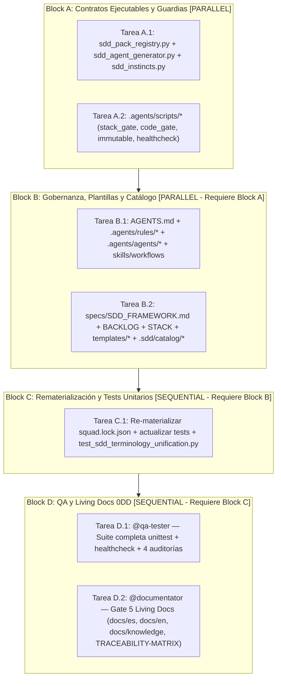

# Tareas de Implementación: Unificación de Terminología de Gates, Estados y Ejecución DAG (`FWK-004`)

- **ID del Work Item:** `FWK-004-gate-terminology-unification`
- **Estado:** `Done` (Gate 5 completado — 2026-11-13)
- **Orquestador:** `@orchestrator`
- **Especificaciones de Referencia:**
  - Funcional (Gate 1): [`01-spec.md`](01-spec.md) (`Approved`)
  - Técnica (Gate 2): [`02-tech-spec.md`](02-tech-spec.md) (`Approved`)
- **Comando de verificación global DoD:** `uv run python -m unittest discover -s tests -q`

---

## Grafo de Ejecución de Tareas (DAG)

---

## Desglose Operativo por Bloques de Ejecución

### Block A: Contratos Ejecutables y Guardias `[PARALLEL]`

- [x] **Tarea A.1** [`@back-engineer`]: Implementar soporte dual-accept `Gate S0` / `Gate 00` y `stack_approved` / `gate00_approved` con detección de conflictos en scripts núcleo.
  - *Archivos exactos*: `scripts/sdd_pack_registry.py`, `scripts/sdd_agent_generator.py`, `scripts/sdd_instincts.py`
  - *Contrato de referencia*: `02-tech-spec.md` §1.1, §1.2 y §1.5 (mantener `sdd_pack_registry.py <= 500` líneas).
  - *Comando de verificación DoD*: `uv run python -m unittest tests.test_sdd_pack_materialization -q`

- [x] **Tarea A.2** [`@back-engineer`]: Actualizar guardias `.agents/scripts/` para dual-accept `Gate S0`/`Gate 00` y estados `Draft`/`Proposed`/`Done`/`Completado`.
  - *Archivos exactos*: `.agents/scripts/sdd_stack_gate_guard.py`, `.agents/scripts/sdd_code_gate_guard.py`, `.agents/scripts/sdd_immutable_feature_guard.py`, `.agents/scripts/sdd_healthcheck.py`
  - *Contrato de referencia*: `02-tech-spec.md` §1.3 y §1.4.
  - *Comando de verificación DoD*: `uv run python .agents/scripts/sdd_healthcheck.py`

---

### Block B: Gobernanza, Plantillas y Catálogo `[PARALLEL - Requiere Block A]`

- [x] **Tarea B.1** [`@architect`]: Normalizar terminología canónica (`Gate S0`, `Gate 0..5`, `Block`, `Session Phase`, estados) en gobernanza y escuadrón `.agents/`.
  - *Archivos exactos*: `AGENTS.md`, `.agents/rules/*.md`, `.agents/agents/*.md`, `.agents/skills/{sdd-bootstrap,sdd-change-gate,sdd-spec-compliance-audit,sdd-test-quality-audit,sdd-silent-failure-audit,pipeline-run,strategic-compact,gan-style-harness,santa-method}/SKILL.md`, `.agents/workflows/{continue,gate5,gan-build,santa-loop}.md`, `.agents/contexts/*.md`, `.agents/instincts.json`
  - *Contrato de referencia*: `02-tech-spec.md` §2.1 y §2.2 (punto 1).
  - *Comando de verificación DoD*: `uv run python -m unittest tests.test_sdd_governance -q`

- [x] **Tarea B.2** [`@architect`]: Normalizar `specs/`, consolidar plantilla CR duplicada y actualizar `.sdd/catalog/`.
  - *Archivos exactos*: `specs/SDD_FRAMEWORK.md`, `specs/BACKLOG.md`, `specs/STACK.md`, `.sdd/framework/BACKLOG.md`, `specs/templates/{00-stack,01-functional-spec,02-technical-spec,03-tasks,04-change-request-spec}.template.md` (y eliminar `specs/templates/04-change-spec.template.md`), `.sdd/catalog/archetypes/*.archetype.md`, `.sdd/catalog/packs/capability-ui-design/**` (excluyendo `vendor/`), `.sdd/catalog/packs/capability-web-frontend/agents/a11y-architect.md`
  - *Contrato de referencia*: `02-tech-spec.md` §2.2 (punto 2).
  - *Comando de verificación DoD*: `uv run python scripts/sdd_pack_registry.py --help` (o verificación de parseo con `uv run python -c "import pathlib; from scripts.sdd_pack_registry import parse_stack_config; print(parse_stack_config(pathlib.Path('specs/STACK.md')))"`)

---

### Block C: Rematerialización y Tests Unitarios `[SEQUENTIAL - Requiere Block B]`

- [x] **Tarea C.1** [`@qa-tester`]: Re-materializar `.agents/` con `sdd_agent_generator.py --materialize`, actualizar aserciones contractuales en `test_sdd_ui_design.py` y crear `tests/test_sdd_terminology_unification.py`.
  - *Archivos exactos*: `.agents/squad.lock.json`, `.agents/agents/*.md` (generados), `tests/test_sdd_ui_design.py`, `tests/test_sdd_terminology_unification.py`
  - *Contrato de referencia*: `02-tech-spec.md` §1.2 y §3.
  - *Comando de verificación DoD*: `uv run python -m unittest discover -s tests -v`

---

### Block D: Verificación QA (Gate 4) y Documentación Viva 0DD (Gate 5) `[SEQUENTIAL - Requiere Block C]`

- [x] **Tarea D.1** [`@qa-tester`]: Ejecutar suite completa de regresión offline, `sdd_healthcheck.py`, `sdd_tokens_validator.py --allow-missing` y auditorías de cumplimiento y fallos silenciosos (Gate 4).
  - *Contrato de referencia*: `01-spec.md` §5 y `02-tech-spec.md` §3.
  - *Comando de verificación DoD*: `uv run python -m unittest discover -s tests -q && uv run python .agents/scripts/sdd_healthcheck.py && uv run python scripts/sdd_tokens_validator.py --allow-missing`

- [x] **Tarea D.2** [`@documentator`]: Normalizar documentación viva bilingüe y cerrar trazabilidad (Gate 5 — 0DD).
  - *Archivos exactos*: `docs/standards/*.md`, `docs/es/**`, `docs/en/**`, `docs/knowledge/{SYSTEM_TOPOLOGY,DATA_MODELS,API_CATALOG,ADRS}.md` (añadir `ADR-005`), `docs/traceability/TRACEABILITY-MATRIX.md`, `.sdd/framework/BACKLOG.md`
  - *Contrato de referencia*: `02-tech-spec.md` §2.2 (punto 3).
  - *Comando de verificación DoD*: `uv run python -m unittest discover -s tests -q && uv run python .agents/scripts/sdd_healthcheck.py`

---

## Aprobación Formal Gate 3 (`RN-SDD-HUMAN-GATE-OWNERSHIP`)

- [x] **Gate 3 Approved (Human Sign-off):** El grafo DAG, los bloques paralelos/secuenciales y los comandos de verificación DoD están autorizados para iniciar Gate 4.
