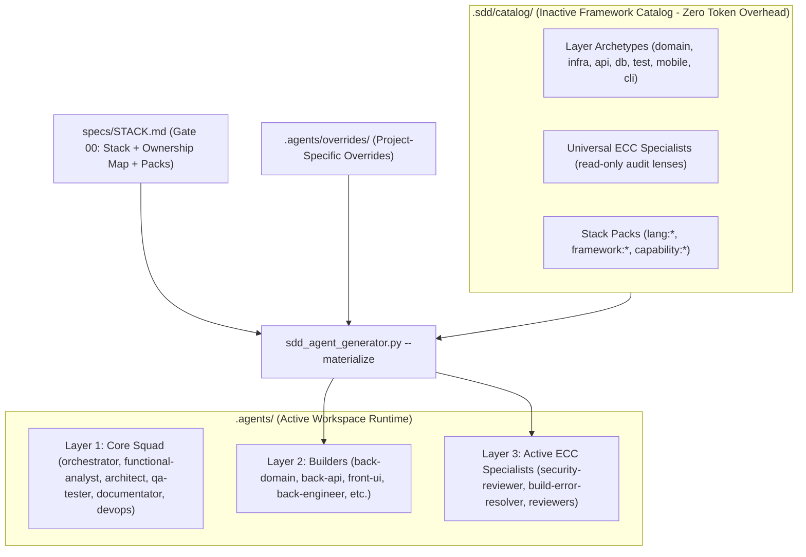

# SDD Agentic Starter Template

[ 🇬🇧 English (EN-GB)](#-english-en-gb) | [ 🇪🇸 Español (ES-ES)](#-español-es-es)

---

## 🇬🇧 English (EN-GB)

Universal software development starter template governed by **Spec-Driven Development (SDD)** and multi-agent orchestration, integrating high-rigour engineering patterns from **Everything Claude Code (ECC)** under the MIT License.

### 🚀 Getting Started with a New Project

#### 1. Clone or Use this Template
Create a new repository on GitHub by clicking **"Use this template"** or via the GitHub CLI:
```bash
gh repo create my-new-project --template <your-username>/sdd-agentic-starter --private
cd my-new-project
```

#### 2. Initial Repository Lock (`Gate 00: Stack Lock`)
To guarantee architectural consistency and prevent premature coding, **production code in `src/` is strictly locked** by rule `RN-SDD-GATE00-STACK-LOCK`. No production code or tests may be created until the technology stack, hosting topology, Ownership Map, and agent squad are formally agreed upon.

#### 3. Converse with `@orchestrator` in your AI Assistant (Antigravity / Cursor / Claude Code)
Send this prompt to start the project:
> *"Hello @orchestrator. We are starting a new project based on `sdd-agentic-starter`. Please launch the interactive Gate 00 Bootstrap Wizard to define the system topology, architecture, technology stack, agent squad, and conventions."*

The `@orchestrator` will:
1. Deploy the interactive **Gate 00 Bootstrap Wizard (`sdd-bootstrap`)** with dynamic decision tree pruning:
   - **Infrastructure & Hosting**: Public Cloud (AWS/Azure/GCP), Docker Containers, or modern PaaS (**Vercel**, Netlify, Railway).
   - **Scope & Pruning**: Automatically prunes irrelevant questions (e.g. omits UI styling for API-only projects, or backend questions for client-only SPAs).
   - **Ownership Map (§3.2)**: Configures deterministic boundaries, mapping code paths to specific builder agents with forbidden imports and verification commands.
   - **Stack Pack Activation**: Dynamically activates language, framework, and capability packs from `.sdd/catalog/packs/`.
   - **Deterministic DoD Commands (§2.5)**: Freezes verified commands for linting, fast in-memory unit tests (<1s), integration tests, and production builds to eliminate agent discovery overhead.
   - **Local Environment**: Generates `docker-compose.yml` or `vercel.json` dev setup.
2. Complete **`specs/STACK.md`** and compile the squad using `python scripts/sdd_agent_generator.py --materialize`.
3. Request your explicit human sign-off: `[x] Gate 00 Approved (Human Sign-off)`.
4. Once approved, `src/` unlocks and the normal SDD development lifecycle begins (Gate 0 -> Gate 5).

---

### 🏛️ The 3-Layer Agentic Architecture

The framework organizes multi-agent development into three strictly decoupled layers:



#### Layer 1: Core Governance Squad (Stack-Agnostic, Fixed)
The fixed leadership and quality custodians that govern the SDD lifecycle regardless of technology stack:
- **`@orchestrator`** (Primary): Tech Lead and SDD Master. Plans the DAG, dispatches orders to `.agent-inbox/`, and verifies quality gates. **Zero direct code writing in `src/`**.
- **`@functional-analyst`** (Gate 1): Formulates functional requirements in strict formal **EARS** syntax with Given-When-Then BDD acceptance criteria.
- **`@architect`** (Gate 2): Designs API contracts (OpenAPI/gRPC), DTO schemas, persistence schemas, and registers Architecture Decision Records (**ADRs**).
- **`@qa-tester`** (Gate 4): Audits test suites, mutation coverage, and runs quality audit skills (`sdd-test-quality-audit`, `santa-method`).
- **`@documentator`** (Gate 5): Custodian of bilingual living documentation (`docs/es/`, `docs/en/`), API catalog, and traceability matrix (`RN-SDD-0DD`).
- **`@devops`**: Manages containerization, CI/CD pipelines, environments, and deployment configs.

#### Layer 2: Builders & The Ownership Map (Write Permissions)
Builders are the **only agents permitted to write production code**. Each builder is assigned an exclusive zone of the codebase in `specs/STACK.md §3.2`:
- **Single Source of Truth**: The Ownership Map maps file globs to owner agents, forbidden imports, and DoD commands.
- **Mechanical Enforcement**: Hook `sdd_code_gate_guard.py` mechanically blocks any builder from modifying files outside its assigned zone.
- **Presets & Custom Topologies**: Choose from `compact` (7 roles), `granular` (12 atomic roles), `api-only`, `spa-only`, `monorepo`, or custom combinations (e.g. granular backend + compact frontend).

#### Layer 3: Ultra-Specialists ECC (Read-Only Audit Lenses & Surgical Resolvers)
Adapted from `affaan-m/ecc` under the MIT License. Specialists operate with **Zero Trust Prompt Defense** and read-only tools (`tools: bash, read, grep, glob`; write permissions are disabled except for resolvers with minimal-diff constraints):
- **Universal Specialists (20)**: `@security-reviewer`, `@silent-failure-hunter`, `@code-explorer`, `@spec-miner`, `@code-architect`, `@type-design-analyzer`, `@build-error-resolver`, `@tdd-guide`, `@performance-optimizer`, `@e2e-runner`, `@code-simplifier`, `@refactor-cleaner`, `@gan-planner`, `@gan-generator`, `@gan-evaluator`, `@conversation-analyzer`, `@docs-lookup`, `@pr-test-analyzer`, `@comment-analyzer`, `@opensource-sanitizer`.
- **Stack-Specific Specialists**: Activated dynamically via Stack Packs (e.g. `@python-reviewer`, `@fastapi-reviewer`, `@csharp-reviewer`, `@react-reviewer`, `@go-reviewer`, `@java-reviewer`).

---

### 📦 Inactive Catalog vs. Active Workspace Runtime

To prevent context bloat and eliminate token overhead:
1. **`.sdd/catalog/` (Inactive Catalog)**: Contains clean recipes, 20 universal specialists, archetypes, and 18+ stack packs (`lang-python`, `framework-fastapi`, `lang-typescript`, `framework-react`, `lang-csharp`, `lang-go`, `lang-rust`, `lang-java`, `capability-database`, `capability-devops`, `capability-web-frontend`, `capability-ai-llm`). Because it resides outside `.agents/`, the AI assistant ignores it, consuming **0 tokens** during normal sessions.
2. **`.agents/` (Active Workspace Runtime)**: Only houses the active squad (Core + materialized builders + active specialists).
3. **`.agents/overrides/` (Project Customizations)**: Allows customizing any generated builder with project-specific domain knowledge without modifying catalog archetypes or dirtying the upstream template.

---

### 🔄 The 12 Slash Command Workflows

| Category | Command | Description |
| :--- | :--- | :--- |
| **Lifecycle & Execution** | `/pipeline-run` | Executes the autonomous SDD development pipeline for an approved feature. |
| | `/opsx-delegate` | Tech Lead delegates an atomic task to a specialist's inbox (`.agent-inbox/<agent>/`). |
| | `/opsx-pickup` | Specialist picks up task ticket, audits DoR, implements code, and validates DoD. |
| | `/gate5` | Launches dedicated closing session for `@documentator` to sync living docs and push. |
| **Session & Handoff** | `/checkpoint` | Captures session state into `.agents/ACTIVE_STATE.md` and prepares safe handoff. |
| | `/continue` | Resumes work in a fresh session with bounded context, resetting turns to `1/15`. |
| **Quality & Verification** | `/santa-loop` | Dual-reviewer independent convergence audit (Santa Method: "Checking It Twice"). |
| | `/gan-build` | Generator-Evaluator adversarial loop (`gan-planner` → `gan-generator` → `gan-evaluator`). |
| | `/build-fix` | Surgical build resolver that repairs compiler/type/test errors with minimal diff. |
| | `/harness-audit` | Audits harness health, rule integrity, and boundary compliance. |
| **Continuous Learning** | `/learn` | Extracts atomic instincts (`continuous-learning-v2`) from session into memory. |
| | `/evolve` | Clusters high-confidence instincts (>=0.75) into reusable skills or rules. |

---

### 🛡️ Mechanical Hooks & Code Guards

The framework installs deterministic hooks in `.agents/hooks.json` executed before any tool call (`PreToolUse` on `edit_file` / `write_file`):
1. **`sdd_immutable_feature_guard.py`**: Enforces `RN-SDD-IMMUTABLE-DONE`. Prevents editing specs of features already marked `Done`.
2. **`sdd_code_gate_guard.py`**: Enforces `RN-SDD-GATE00-STACK-LOCK` (blocks code editing before Gate 00 approval), `RN-SDD-GATE2-CODE-LOCK` (blocks code editing without human-signed Gates 1, 2, and 3), and `RN-ECC-MAX-FILE-LINES` (blocks creating or expanding files beyond 800 lines).

---

### ⚡ Deterministic Tooling (Zero Discovery Overhead)

- **Universal Multi-Language AST Repo-Map (`sdd_repo_map.py`)**: Extracts classes, signatures, interfaces, and methods across 20+ languages (Python, TypeScript, C#, Go, Rust, Java, Kotlin, Swift, Dart, C/C++, PHP, Ruby, etc.) without external dependencies.
- **Deterministic Terminal Trimmer (`sdd_trim_exec.py`)**: Wraps test and build commands, compressing green passes into a single summary line and isolating critical stack traces on failure.
- **Universal Multi-IDE Token Telemetry (`sdd_token_usage.py`)**: Measures token consumption, context depth, and cache hit ratio across Antigravity, Claude Code, Cursor, Codex, Windsurf, and Roo Code.
- **Boundary Verifier (`verify_architecture_boundaries.py`)**: Audits layer isolation and imports according to the Ownership Map.

---

### ⚖️ Third-Party Notices & Attribution

This starter template incorporates, adapts, or is inspired by open-source works under permissive licenses:
- **Everything Claude Code (ECC)**: Copyright (c) 2026 Affaan Mustafa ([https://github.com/affaan-m/ecc](https://github.com/affaan-m/ecc)), licensed under the **MIT License**. Reviewer agents, prompt defense baselines, build resolvers, continuous learning v2, and language pattern packs are adapted from ECC. Full legal notice in [`THIRD_PARTY_NOTICES.md`](file:///c:/Projects/sdd-agentic-starter/THIRD_PARTY_NOTICES.md).
- **REA Framework**: Inspired by `morluto/rea` for Fail-Closed governance and Human Gate Ownership.

---
---

## 🇪🇸 Español (ES-ES)

Plantilla universal de desarrollo de software guiada por especificaciones (**Spec-Driven Development - SDD**) y orquestación multi-agente, integrando patrones de alta ingeniería de **Everything Claude Code (ECC)** bajo Licencia MIT.

### 🚀 Cómo Iniciar un Nuevo Proyecto a partir de este Template

#### 1. Clonar o Usar este Template
Crea un nuevo repositorio en GitHub haciendo clic en **"Use this template"** o mediante la CLI de GitHub:
```bash
gh repo create mi-nuevo-proyecto --template <tu-usuario>/sdd-agentic-starter --private
cd mi-nuevo-proyecto
```

#### 2. El Repositorio Inicia BLOQUEADO (`Gate 00: Stack Lock`)
Para garantizar orden arquitectónico y compatibilidad, **el código de producción en `src/` está estrictamente bloqueado** por la regla `RN-SDD-GATE00-STACK-LOCK`. No se puede escribir código de producción ni tests hasta definir formalmente las tecnologías, el hosting, el Ownership Map y el escuadrón agéntico.

#### 3. Habla con el `@orchestrator` en tu asistente IA (Antigravity / Cursor / Claude Code)
Envía este mensaje para iniciar el proyecto:
> *"Hola @orchestrator. Iniciamos un nuevo proyecto en `sdd-agentic-starter`. Activa el asistente interactivo de Gate 00 para definir la topología, arquitectura, stack, agentes y convenciones."*

El `@orchestrator`:
1. Desplegará el **Asistente Interactivo de Gate 00 (`sdd-bootstrap`)** con poda dinámica en árbol:
   - **Infraestructura y Hosting**: Cloud Pública (AWS/Azure/GCP), Contenedores Docker o PaaS modernas (**Vercel**, Netlify, Railway).
   - **Alcance y Poda Dinámica**: Omite automáticamente preguntas irrelevantes (ej: sin estilos si es solo API, o sin backend si es SPA estática).
   - **Ownership Map (§3.2)**: Configura las fronteras deterministas de código, asignando cada zona física a un agente constructor con sus imports prohibidos y comandos DoD.
   - **Activación de Stack Packs**: Activa bajo demanda los paquetes de lenguaje, framework y capacidad desde `.sdd/catalog/packs/`.
   - **Comandos Deterministas de DoD (§2.5)**: Congela los comandos verificados de linting, pruebas unitarias acotadas (<1s en memoria), integración y build para eliminar el overhead de descubrimiento.
   - **Entorno Local**: Genera la configuración inicial de `docker-compose.yml` o `vercel.json`.
2. Completará formalmente **`specs/STACK.md`** y compilará el escuadrón con `python scripts/sdd_agent_generator.py --materialize`.
3. Te solicitará tu firma humana expresa: `[x] Gate 00 Approved (Human Sign-off)`.
4. Una vez aprobada, el código en `src/` se desbloqueará y comenzará el ciclo normal de desarrollo (Gate 0 -> Gate 5).

---

### 🏛️ La Arquitectura Agéntica de 3 Capas

El framework organiza el desarrollo multi-agente en tres capas estrictamente desacopladas:

#### Capa 1: Escuadrón Core de Gobernanza (Agnóstico al Stack, Fijo)
Líderes y custodios de calidad que gobiernan el ciclo SDD independientemente de la tecnología:
- **`@orchestrator`** (Primary): Tech Lead y Scrum Master SDD. Planifica el DAG, despacha órdenes a `.agent-inbox/` y verifica compuertas. **Cero código directo en `src/`**.
- **`@functional-analyst`** (Gate 1): Redacta los requisitos funcionales en sintaxis formal **EARS** con criterios de aceptación BDD Given-When-Then.
- **`@architect`** (Gate 2): Diseña contratos de API (OpenAPI/gRPC), schemas DTO, esquemas de persistencia y registra **ADRs**.
- **`@qa-tester`** (Gate 4): Audita la suite de pruebas, cobertura de mutación y ejecuta skills de calidad (`sdd-test-quality-audit`, `santa-method`).
- **`@documentator`** (Gate 5): Custodio de la documentación viva bilingüe (`docs/es/`, `docs/en/`), catálogo de APIs y matriz de trazabilidad (`RN-SDD-0DD`).
- **`@devops`**: Especialista en infraestructura, contenedores Docker, CI/CD y despliegue.

#### Capa 2: Constructores y el Ownership Map (Permisos de Escritura)
Los agentes constructores son los **únicos autorizados para escribir código de producción**. Cada constructor tiene asignada una zona exclusiva en `specs/STACK.md §3.2`:
- **Fuente Única de Verdad**: El Ownership Map asocia globs de archivos con agentes dueños, imports prohibidos y comandos DoD.
- **Control Mecánico**: El hook `sdd_code_gate_guard.py` bloquea físicamente a cualquier agente que intente editar ficheros fuera de su zona asignada.
- **Presets y Topologías Flexibles**: Escoge entre `compact` (7 roles), `granular` (12 roles atómicos), `api-only`, `spa-only`, `monorepo` o combinaciones híbridas (ej: backend granular + frontend compacto).

#### Capa 3: Ultra-Especialistas ECC (Lentes de Auditoría de Solo Lectura y Resolvers Quirúrgicos)
Adaptados de `affaan-m/ecc` bajo Licencia MIT. Operan con **Prompt Defense de Confianza Cero** y herramientas de solo lectura (`tools: bash, read, grep, glob`; permisos de escritura deshabilitados salvo para resolvers con diff mínimo):
- **Especialistas Universales (20)**: `@security-reviewer`, `@silent-failure-hunter`, `@code-explorer`, `@spec-miner`, `@code-architect`, `@type-design-analyzer`, `@build-error-resolver`, `@tdd-guide`, `@performance-optimizer`, `@e2e-runner`, `@code-simplifier`, `@refactor-cleaner`, `@gan-planner`, `@gan-generator`, `@gan-evaluator`, `@conversation-analyzer`, `@docs-lookup`, `@pr-test-analyzer`, `@comment-analyzer`, `@opensource-sanitizer`.
- **Especialistas de Stack**: Activados dinámicamente según los Stack Packs del proyecto (ej: `@python-reviewer`, `@fastapi-reviewer`, `@csharp-reviewer`, `@react-reviewer`, `@go-reviewer`, `@java-reviewer`).

---

### 📦 Catálogo Inerte vs. Runtime Activo de Sesión

Para erradicar la saturación de contexto y eliminar el gasto innecesario de tokens:
1. **`.sdd/catalog/` (Catálogo Inerte)**: Contiene recetas puras, 20 especialistas universales, arquetipos y 18+ stack packs (`lang-python`, `framework-fastapi`, `lang-typescript`, `framework-react`, `lang-csharp`, `lang-go`, `lang-rust`, `lang-java`, `capability-database`, `capability-devops`, `capability-web-frontend`, `capability-ai-llm`). Al residir fuera de `.agents/`, el asistente IA lo ignora, consumiendo **0 tokens** en sesiones normales.
2. **`.agents/` (Runtime Activo)**: Solo contiene el escuadrón activo del proyecto (Core + constructores materializados + especialistas activados).
3. **`.agents/overrides/` (Personalizaciones del Proyecto)**: Permite añadir conocimiento de negocio específico a un constructor generado sin ensuciar los arquetipos del catálogo ni la plantilla upstream.

---

### 🔄 Los 12 Workflows de Comandos Slash

| Categoría | Comando | Descripción |
| :--- | :--- | :--- |
| **Ciclo de Vida y Ejecución** | `/pipeline-run` | Ejecuta el pipeline desatendido completo de desarrollo SDD para una feature aprobada. |
| | `/opsx-delegate` | El Tech Lead delega una tarea atómica al buzón de un especialista (`.agent-inbox/<agente>/`). |
| | `/opsx-pickup` | El especialista recoge su tarea, audita DoR, implementa y valida DoD. |
| | `/gate5` | Sesión dedicada y económica para que `@documentator` actualice living docs y sincronice Git. |
| **Sesión y Handoff** | `/checkpoint` | Guarda el estado activo en `.agents/ACTIVE_STATE.md` y prepara un traspaso de sesión limpio. |
| | `/continue` | Reanuda el trabajo en un hilo limpio con contexto acotado, reiniciando turnos a `1/15`. |
| **Calidad y Verificación** | `/santa-loop` | Doble revisión independiente convergente (Santa Method: "Checking It Twice"). |
| | `/gan-build` | Bucle adversario Generador-Evaluador (`gan-planner` → `gan-generator` → `gan-evaluator`). |
| | `/build-fix` | Reparador quirúrgico de errores de compilación/tipos/tests con el diff mínimo. |
| | `/harness-audit` | Audita la salud del arnés de agentes, integridad de reglas y fronteras arquitectónicas. |
| **Aprendizaje Continuo** | `/learn` | Extrae instintos atómicos (`continuous-learning-v2`) de la sesión hacia la memoria. |
| | `/evolve` | Agrupa instintos de alta confianza (>=0.75) y los evoluciona hacia nuevas skills o reglas. |

---

### 🛡️ Guardias Mecánicas y Hooks

El framework instala hooks deterministas en `.agents/hooks.json` ejecutados antes de cualquier mutación de fichero (`PreToolUse` en `edit_file` / `write_file`):
1. **`sdd_immutable_feature_guard.py`**: Aplica `RN-SDD-IMMUTABLE-DONE`. Bloquea la edición de especificaciones de features ya completadas (`Done`).
2. **`sdd_code_gate_guard.py`**: Aplica `RN-SDD-GATE00-STACK-LOCK` (bloquea código antes de aprobar Gate 00), `RN-SDD-GATE2-CODE-LOCK` (bloquea código sin Gates 1, 2 y 3 aprobados por el usuario) y `RN-ECC-MAX-FILE-LINES` (bloquea la creación o expansión de ficheros más allá de 800 líneas).

---

### ⚡ Herramientas Deterministas (Cero Sobrecarga de Descubrimiento)

- **Generador Universal de Mapa AST (`sdd_repo_map.py`)**: Extrae clases, interfaces y firmas en más de 20 lenguajes sin dependencias externas.
- **Recortador Determinista de Terminal (`sdd_trim_exec.py`)**: Comprime salidas exitosas de tests y builds a una sola línea y aísla la traza exacta en caso de fallo.
- **Telemetría de Tokens Multi-IDE (`sdd_token_usage.py`)**: Monitoriza consumo de tokens y tasa de prompt cache en Antigravity, Claude Code, Cursor, Windsurf, Codex y Roo Code.
- **Verificador de Fronteras (`verify_architecture_boundaries.py`)**: Audita el aislamiento de capas e imports prohibidos según el Ownership Map.

---

### ⚖️ Avisos de Terceros y Atribución Open Source

Esta plantilla incorpora, adapta o se inspira en proyectos de código abierto bajo licencias permisivas:
- **Everything Claude Code (ECC)**: Copyright (c) 2026 Affaan Mustafa ([https://github.com/affaan-m/ecc](https://github.com/affaan-m/ecc)), publicado bajo **Licencia MIT**. Los agentes revisores, baselines de prompt defense, build resolvers, motor de aprendizaje continuo v2 y paquetes de patrones han sido adaptados de ECC. Consulta el aviso legal completo en [`THIRD_PARTY_NOTICES.md`](file:///c:/Projects/sdd-agentic-starter/THIRD_PARTY_NOTICES.md).
- **Framework REA**: Inspiración en `morluto/rea` para las compuertas de gobernanza Fail-Closed y Human Gate Ownership.
