<div align="center">

# 🛡️ Spec-Driven Development (SDD) — Agentic Engineering Framework

**Governance-First, Multi-Agent, Stack-Agnostic Software Delivery Architecture**

[](#sdd-lifecycle-en)
[](CHANGELOG.md)
[](#agent-squad-en)
[-emerald)](#stack-packs-en)
[](#skills-workflows-en)
[](#rfc003-hardening-en)
[](#credits-en)

[**🇬🇧 English (EN-GB)**](#en-gb) &nbsp;|&nbsp; [**🇪🇸 Español (ES-ES)**](#es-es)

</div>

---

<a id="en-gb"></a>

## 🇬🇧 English Documentation (EN-GB)

### Table of Contents
- [1. Overview & Philosophy](#overview-en)
- [2. The Golden SDD Lifecycle (Gate S0 -> Gate 6)](#sdd-lifecycle-en)
- [3. Hardening, CI-Agnostic Verification, Gate 6 (`v1.2.0`), Brownfield (`v1.3.0`) & Portfolio / Epics (`v1.4.0`)](#rfc003-hardening-en)
- [4. Multi-Agent Squad & Opt-In Catalog](#agent-squad-en)
- [5. Stack Packs & Layer Archetypes](#stack-packs-en)
- [6. Base Skills, Workflows, Brownfield & Fast-Track Flows](#skills-workflows-en)
- [7. On-Demand Domain Context (`domains/`)](#domains-en)
- [8. Quick Start & CLI Reference](#quickstart-en)
- [9. Repository Architecture](#repo-arch-en)
- [10. Credits & Attribution](#credits-en)

---

<a id="overview-en"></a>

### 1. Overview & Philosophy

**SDD Agentic Starter** transforms AI-assisted development from ad-hoc prompting into a deterministic, auditable, **Spec-Driven Development (SDD)** pipeline. Production code under `src/` cannot be edited until the technology stack (`Gate S0`), functional requirements (`Gate 1`), technical contracts (`Gate 2` + optional visual `Sub-Gate 2V`), and atomic DAG task plan (`Gate 3`) receive explicit human approval.

Key principles:
1. **Zero Code Without Approved Specs (`RN-SDD-GATE-S0-STACK-LOCK` & `RN-SDD-GATE2-CODE-LOCK`):** Production edits fail closed when `specs/STACK.md` or the active work item's `Gate 1/2/3` sign-offs are missing.
2. **Immutable Done History (`RN-SDD-IMMUTABLE-DONE`):** Once a feature reaches `Done`, `specs/features/FEAT-XXX-*/` becomes read-only; evolutions require a `1:1` Change Request (`specs/changes/CR-XXX-*/`).
3. **Zero Documentation Debt (`RN-SDD-0DD`):** No work item reaches `Done` until `@documentator` synchronizes `docs/es/`, `docs/en/`, `docs/knowledge/`, `domains/`, and `docs/traceability/TRACEABILITY-MATRIX.md`.
4. **Compact Starter Context:** Only **9 active base agents**, **8 governance rules**, and **14 core skills** load by default; stack packs, **19 opt-in specialists**, and `domains/` cards materialize strictly on demand.
5. **Release, Brownfield & Portfolio Governance (`v1.2.0`–`v1.4.0`):** Supports PR-first `Gate 6` release readiness (`./sdd release`), portable CI-agnostic checks (`./sdd ci-verify`), non-destructive brownfield adoption (`./sdd adopt` + `/brownfield-adopt`), *Strangler Fig* `legacy-readonly` zone locking, offline *Spec Drift* detection (`./sdd drift`), and Portfolio/Epics roadmap + feature dependency DAGs (`./sdd portfolio`).

---

<a id="sdd-lifecycle-en"></a>

### 2. The Golden SDD Lifecycle (`Gate S0` -> `Gate 6`)

Canonical backlog states across `specs/BACKLOG.md`: **`Candidate` -> `Backlog` -> `In Progress` -> `In Review` -> `Done`** (plus **`Blocked`**).
Canonical document states: **`Draft` -> `In Review` -> `Approved` -> `Done`**.

```mermaid
flowchart LR
    GS0["Gate S0: Stack Lock\n(specs/STACK.md)"] --> G0["Gate 0: Backlog Triage\n(Candidate / Backlog)"]
    G0 --> G1["Gate 1: Functional Spec\n(EARS / Bug Report)"]
    G1 --> G2["Gate 2: Tech Spec\n(+ Sub-Gate 2V UI)"]
    G2 --> G3["Gate 3: Atomic DAG\n(03-tasks.md)"]
    G3 --> G4["Gate 4: Code Execution\n(Worktrees & Guards)"]
    G4 --> G5["Gate 5: 0DD Closure\n(Docs, Domains & Push)"]
    G5 --> G6["Gate 6: Release Readiness\n(REL-vX.Y.Z & PR to main)"]
```



| Gate | Artefact / Action | Human Sign-off Marker | Blocking Rule |
| :--- | :--- | :--- | :--- |
| **Gate S0** | `specs/STACK.md` (`sdd-bootstrap` / `sdd adopt`) | `[x] Gate S0 Approved` *(legacy alias: `Gate 00`)* | `RN-SDD-GATE-S0-STACK-LOCK` |
| **Gate 0** | Register `FEAT-XXX`, `CR-XXX`, `BUG-XXX`, `HOTFIX-XXX`, or `SPIKE-XXX` | Backlog prioritization | Single SSOT for IDs & status |
| **Gate 1** | `01-spec.md` (EARS + Given-When-Then) or `01-bug-report.md` | `[x] Gate 1 Approved` | Fail-closed ambiguity check |
| **Gate 2** | `02-tech-spec.md` or `02-fix-spec.md` (`+ Sub-Gate 2V` if UI) | `[x] Gate 2 Approved` *(+ `Gate 2 Visual Sign-off`)* | Typed contracts before code |
| **Gate 3** | `03-tasks.md` with DAG dependencies, `ALLOWED_FILES` & DoD *(exempt only under `Origin: brownfield-mined` baseline)* | `[x] Gate 3 Approved` | `RN-SDD-GATE2-CODE-LOCK` |
| **Gate 4** | Isolated implementation (`opsx-delegate` / `opsx-pickup`) + TDD & audits | Gate 4 verification passes | `sdd_code_gate_guard.py` |
| **Gate 5** | Bilingual docs, `docs/knowledge/`, `domains/`, traceability & `git push` | `Done` sign-off | `RN-SDD-0DD` & branch sync |
| **Gate 6** | `specs/releases/REL-vX.Y.Z.md` (`./sdd release prepare`) + `CHANGELOG.md` + PR to `main` | `[x] Gate 6 Approved (Human Sign-off)` | `sdd_release.py` & `RN-SDD-BRANCH-SYNC` |

---

<a id="rfc003-hardening-en"></a>

### 3. Hardening, CI-Agnostic Verification, Gate 6 (`v1.2.0`), Brownfield (`v1.3.0`) & Portfolio / Epics (`v1.4.0`)

The framework enforces engineering discipline through verifiable Python tooling under `.agents/scripts/` and `scripts/` (`RFC-003`..`RFC-009`):

- **Fail-Closed `PreToolUse` & Git Hooks (`RFC-003`–`RFC-005`):**
  - `sdd_code_gate_guard.py` & `sdd_gate_seal.py` (`./sdd approve-gate`, `./sdd verify-gates`): Blocks writes to `src/` unless `Gate S0` is approved, `specs/BACKLOG.md` tracks an active `In Progress` work item, `01..03` documents carry valid `[x] Gate 1/2/3 Approved` markers and intact SHA-256 cryptographic gate seals (`gate_seals`), and the target path is not inside a `legacy-readonly` zone.
  - `sdd_immutable_feature_guard.py`: Enforces `RN-SDD-IMMUTABLE-DONE` against edits to `Done` feature specs and rejects POSIX drive-path bypasses.
  - `sdd_trim_exec.py`: Runs test/lint subcommands with `shell=False`, allowlisted executables, and path containment.
  - `sdd_healthcheck.py`: Validates directory structure, spec triads (`features`, `changes`, `bugs`/`HOTFIX-*`, `spikes/*/SPIKE_REPORT.md`, `Origin: brownfield-mined`), prompt-injection hygiene, and catalog integrity.
- **Declarative `sdd:ownership-map` & Transactional Squad Compiler:** `sdd_agent_generator.py` and `sdd_pack_registry.py` materialize stack specialists and update `.agents/squad.lock.json` transactionally with SHA-256 verification and automatic rollback on error.
- **Executable DAG Scheduler (`sdd_dag.py`):** Parses `03-tasks.md`, detects dependency cycles and parallel-wave `Write-Set` overlaps (`DagWriteSetCollisionError`, `--auto-split`), validates `ALLOWED_FILES`, and computes parallel execution batches for `/opsx-delegate`.
- **Multi-Worktree Isolation (`sdd_git.py` & `sdd_dev.py`):** Allocates isolated worktrees and deterministic per-worktree dev ports, plus PR-first `release-finish` / `hotfix-finish` (`RN-SDD-BRANCH-SYNC`) and `./sdd work-item show|set` (`PENDING_APPROVAL`).
- **Modularity, Polyglot Boundaries & AST Context:** `verify_architecture_boundaries.py` enforces polyglot `forbid_imports` across Python, TS/JS, C#, Go, Rust, Java, and Kotlin, plus **`<= 800` lines hard ceiling / `<= 500` warning** in `src/`, and **`<= 500` lines** across framework scripts and tests. `sdd_repo_map.py` builds compressed structural maps across **20+ languages**.
- **Portable CI-Agnostic Engine (`RFC-007` / `FWK-013`):** `scripts/sdd_ci.py` (`./sdd ci-verify --mode auto`) unifies hooks, healthcheck, 0DD compliance, boundaries, catalog/lock, DAGs, gate seals, git/instincts, design tokens, Spec Drift (`check_spec_drift`), and safe `shell=False` execution of `STACK.md §2.5` (`--run-stack-if-approved`), with templates for GitHub Actions, GitLab CI, Bitbucket Pipelines, and POSIX shell (`specs/templates/ci/`).
- **`Gate 6` Release Readiness (`RFC-007` / `FWK-014`, `v1.2.0`):** `scripts/sdd_release.py` (`./sdd release prepare|changelog|verify`) instantiates `specs/releases/REL-vX.Y.Z.md` from `08-release-readiness.template.md` without auto-approving `Gate 6`, builds deterministic `CHANGELOG.md` entries from `<prev_tag>..HEAD`, and enforces fail-closed preflight in `sdd_git.py` (`release-start` / `release-finish`).
- **Brownfield Adoption, *Strangler Fig* & Spec Drift (`RFC-008` / `FWK-015`–`FWK-016`, `v1.3.0`):**
  - `scripts/sdd_brownfield.py` (`./sdd adopt --dry-run|--apply`, `--with-repo-map`) performs 100% offline discovery of manifests, ecosystems, candidate ownership zones, and safe DoD commands, creating non-destructive draft `specs/STACK.md` (with `Gate S0` locked), `docs/knowledge/BROWNFIELD_INVENTORY.md`, and `specs/BACKLOG.md` for `/brownfield-adopt` + `@spec-miner`.
  - `scripts/sdd_drift.py` (`./sdd drift`) detects `UNCOVERED_FILE`, `MISSING_SOURCE_FILE`, `MISSING_SYMBOL`, and `UNLINKED_CODE_DRIFT` offline across `governed` zones and `SRC-###` citations; `sdd:ownership-map` supports `governance: governed | legacy-readonly` (*Strangler Fig* lock enforced by `sdd_code_gate_guard.py`); and `Origin: brownfield-mined` allows light retroactive baselines with mandatory human `Gate 1` & `Gate 2` sign-offs.
- **Portfolio, Epics (`EPIC-XXX`) & Feature Dependency DAG (`RFC-009` / `FWK-017`, `v1.4.0`):** `scripts/sdd_portfolio.py` (`./sdd portfolio init|status|graph|validate`) manages atomic epic dossiers under `specs/epics/` (`09-epic-roadmap.template.md`), *MoSCoW*/*RICE* prioritisation, deterministic progress rollups, fail-closed feature DAG cycle detection, critical-path calculation, and CI integration (`check_portfolio` in `sdd_ci.py`).

---

<a id="agent-squad-en"></a>

### 4. Multi-Agent Squad & Opt-In Catalog

The starter keeps **9 active base agents** loaded by default (`1` default universal reviewer `@security-reviewer` from `.sdd/catalog/specialists/`) and stores **19 opt-in universal specialists** in `.sdd/catalog/specialists-optin/` (`20` universal specialists total across the catalog, plus `30` stack-specific specialists in `.sdd/catalog/packs/`).

| Group | Agents | Mode |
| :--- | :--- | :--- |
| **Core Governance (6)** | `@orchestrator`, `@functional-analyst`, `@architect`, `@qa-tester`, `@documentator`, `@devops` | Always active in `.agents/agents/` |
| **Compact Builders (2)** | `@back-engineer`, `@front-engineer` | Starter `compact` templates compiled/replaced from `specs/STACK.md` (`sdd:ownership-map`) |
| **Default Security Reviewer (1)** | `@security-reviewer` | Active universal reviewer from `.sdd/catalog/specialists/` |
| **Opt-In Universal Specialists (19)** | `build-error-resolver`, `code-architect`, `code-explorer`, `code-simplifier`, `comment-analyzer`, `conversation-analyzer`, `docs-lookup`, `e2e-runner`, `gan-evaluator`, `gan-generator`, `gan-planner`, `opensource-sanitizer`, `performance-optimizer`, `pr-test-analyzer`, `refactor-cleaner`, `silent-failure-hunter`, `spec-miner`, `tdd-guide`, `type-design-analyzer` | Stored in `.sdd/catalog/specialists-optin/`; activated on demand (e.g. `@spec-miner` for `/brownfield-adopt`) |

---

<a id="stack-packs-en"></a>

### 5. Stack Packs & Layer Archetypes

`specs/STACK.md` declares active technologies from **19 Stack Packs** (`.sdd/catalog/packs/`), which materialize **30 dynamic specialists** and **70 specialized pack skills (`SKILL.md`)** along with **12 unique canonical layer archetypes** in `.sdd/catalog/archetypes/` (`cli-tool`, `front-logic`, `front-test`, `front-ui`, `layer-api`, `layer-db`, `layer-domain`, `layer-infra`, `layer-test`, `mobile-app`, `tier-backend`, `tier-frontend`).

- **Languages (`lang-*`):** Python, TypeScript, Go, Rust, Java, C#.
- **Frameworks (`framework-*`):** FastAPI, Django, Next.js, React, Spring Boot, Angular, Vue, NestJS, Astro, Flutter, React Native.
- **Capabilities (`capability-*`):** UI Design (Stitch MCP & Sub-Gate 2V), DevOps CI/CD & Containers.

---

<a id="skills-workflows-en"></a>

### 6. Base Skills, Workflows, Brownfield & Fast-Track Flows

#### 14 Base Starter Skills (`.agents/skills/`)
1. `sdd-bootstrap` — Guided Gate S0 stack & ownership configuration (`specs/STACK.md`).
2. `sdd-change-gate` — Enforces `RN-SDD-IMMUTABLE-DONE` and 1:1 `CR-XXX` creation.
3. `pipeline-run` — Autonomous DAG lifecycle execution (`Gate 0` -> `Gate 5`).
4. `opsx-delegate` — Dispatches isolated task tickets with `ALLOWED_FILES` to `.agent-inbox/`.
5. `opsx-pickup` — Picks up inbox tickets, checks DoR, and verifies DoD.
6. `search-first` — Consults `docs/knowledge/` and `domains/` before authoring code.
7. `strategic-compact` — Context hygiene and `/continue` handoff at gate boundaries.
8. `sdd-silent-failure-audit` — Hunts swallowed exceptions and silent fallback defaults.
9. `sdd-spec-compliance-audit` — Verifies 1:1 contract parity against `02-tech-spec.md`.
10. `sdd-test-quality-audit` — Audits tests for assertion quality and tautological mocks.
11. `santa-method` — Modular dual-reviewer adversarial verification (`Pre-Gate 2`, `Gate 4`, `Gate 5` binary rubrics, fresh isolated reviewers per round, objective risk & volume triggers).
12. `gan-style-harness` — Generator-evaluator harness for high-complexity deliverables.
13. `continuous-learning-v2` — Instincts capture and reusable workflow evolution.
14. `sdd-execution-guardrails` — Operational guardrails for Python on Windows, worktree isolation, branch checks, and human gate ownership.

#### 15 Slash Command Workflows (`.agents/workflows/`)
`/pipeline-run` · `/opsx-delegate` · `/opsx-pickup` · `/bug-fast-track` · `/brownfield-adopt` · `/gate6-release` · `/build-fix` · `/checkpoint` · `/continue` · `/gate5` · `/harness-audit` · `/santa-loop` · `/gan-build` · `/learn` · `/evolve`

#### Fast-Track Bug, Hotfix, Spike, Brownfield & Release Workflows
- **Scoped Bugs & S1 Hotfixes (`/bug-fast-track`):** `BUG-XXX` and `HOTFIX-XXX` use `specs/bugs/<ID>-<slug>/` (`05-bug-fast-track.template.md` / `07-hotfix-fast-track.template.md`) with `01-bug-report.md`, `02-fix-spec.md`, and `03-tasks.md`, preserving `Gate S0`, `specs/BACKLOG.md` as SSOT, SHA-256 gate seals, `[x] Gate 1/2/3 Approved`, and Test-First (`Red -> Fix -> Green`). Timeboxed PoCs use `specs/spikes/SPIKE-XXX-<slug>/SPIKE_REPORT.md` (`06-spike-report.template.md`).
- **Brownfield Adoption (`/brownfield-adopt`):** Combines `./sdd adopt --dry-run|--apply` with `./sdd repo-map` and `@spec-miner` to scaffold `specs/STACK.md` (locked), `docs/knowledge/BROWNFIELD_INVENTORY.md`, and `Origin: brownfield-mined` specs alongside `legacy-readonly` *Strangler Fig* zones and `./sdd drift` checks.
- **Release Readiness (`/gate6-release`):** Orchestrates `./sdd git release-start`, `./sdd release prepare|changelog|verify` (`REL-vX.Y.Z.md`), human `Gate 6` sign-off, and PR-first `./sdd git release-finish` toward `main`.

---

<a id="domains-en"></a>

### 7. On-Demand Domain Context (`domains/`)

To prevent bloating always-on `.agents/rules/` (`8` rules total), domain knowledge lives in **`domains/<domain-slug>/`** using two concise templates (`domains/_template/overview.md` and `domains/_template/decisions.md`):
- **Loaded on demand** during `Gate 1/2`, `/bug-fast-track`, and `/brownfield-adopt` strictly for the `Affected Domains`.
- **Synchronized at Gate 5** by `@documentator` without duplicating `docs/knowledge/DATA_MODELS.md` or `API_CATALOG.md`.

---

<a id="quickstart-en"></a>

### 8. Quick Start & CLI Reference

```bash
# 1. Verify framework integrity, spec triads & hooks (CI-agnostic engine)
uv run python scripts/sdd_cli.py ci-verify --mode auto --run-stack-if-approved --format text

# 2. Adopt an existing brownfield repository (offline discovery & non-destructive draft)
uv run python scripts/sdd_cli.py adopt --dry-run
uv run python scripts/sdd_cli.py adopt --apply

# 3. Audit Spec Drift & Strangler Fig zones in governed projects
uv run python scripts/sdd_cli.py drift --format text

# 4. Prepare & verify a Gate 6 release dossier + deterministic CHANGELOG.md
uv run python scripts/sdd_cli.py release prepare --version X.Y.Z
uv run python scripts/sdd_cli.py release verify --version X.Y.Z --stage finish

# 5. Manage Portfolio Epics (EPIC-XXX), MoSCoW/RICE rollups & feature dependency DAGs
uv run python scripts/sdd_cli.py portfolio status
uv run python scripts/sdd_cli.py portfolio validate

# 6. Inspect all CLI subcommands & run the full 174-test offline suite (16 modules)
uv run python scripts/sdd_cli.py --help
uv run python -m unittest discover -s tests -v
```

*(Convenience wrappers `./sdd` on POSIX and `.\sdd.ps1` / `sdd.cmd` on Windows invoke `scripts/sdd_cli.py` directly.)*

Inside your AI coding session:
1. Run **`sdd-bootstrap`** (greenfield) or **`/brownfield-adopt`** (existing repo) to configure `specs/STACK.md` and sign off **`[x] Gate S0 Approved`**.
2. Use **`/pipeline-run`** for features/changes (`FEAT-XXX` / `CR-XXX`) or **`/bug-fast-track`** for scoped defects (`BUG-XXX` / `HOTFIX-XXX`).
3. Keep sessions bounded with **`/checkpoint`**, **`/continue`**, and **`/gate5`**, and ship releases via **`/gate6-release`**.

---

<a id="repo-arch-en"></a>

### 9. Repository Architecture

```text
├── AGENTS.md                       # Global mandatory SDD governance directives
├── CHANGELOG.md                    # Deterministic SemVer release changelog (sdd release)
├── .agents/
│   ├── agents/                     # 9 active base agents (compiled via STACK.md)
│   ├── rules/                      # 8 always-on governance rules (00..07)
│   ├── skills/                     # 14 base starter skills (SKILL.md)
│   ├── workflows/                  # 15 slash command workflows (incl. /brownfield-adopt, /gate6-release)
│   ├── scripts/                    # Guards (PreToolUse, Strangler Fig), healthcheck, repo-map, token usage
│   ├── hooks.json                  # PreToolUse & git hook configuration
│   └── squad.lock.json             # SHA-256 lockfile for materialized packs/specialists
├── .sdd/
│   ├── catalog/                    # Opt-in catalog: 19 universal specialists, 19 packs, 12 canonical archetypes
│   └── framework/                  # Internal framework governance (RFC-001..009, FWK-001..017)
├── scripts/                        # Unified CLI (sdd_cli.py), ci-verify, release, adopt, drift, portfolio, dag, git
├── domains/                        # On-demand bounded-context docs & _template/
├── specs/
│   ├── STACK.md                    # Gate S0 technology & ownership contract
│   ├── BACKLOG.md                  # Sole SSOT for FEAT, CR, and BUG state
│   ├── templates/                  # Canonical SDD templates (00..09 + ci/ Multi-CI templates)
│   ├── epics/                      # EPIC-XXX-* Portfolio roadmap & feature dependency dossiers
│   ├── features/                   # FEAT-XXX-* triads (immutable once Done; brownfield-mined optional)
│   ├── changes/                    # CR-XXX-* triads (1:1 per affected Done feature)
│   ├── bugs/                       # BUG-XXX-* and HOTFIX-XXX-* fast-track triads
│   ├── spikes/                     # Timeboxed SPIKE-XXX-* reports
│   └── releases/                   # REL-vX.Y.Z Gate 6 Release Readiness dossiers
├── docs/                           # Bilingual guides (es/, en/), knowledge/, standards/, traceability/
└── tests/                          # 174 offline regression, security, CI, release, brownfield & portfolio tests (16 modules)
```

---

<a id="credits-en"></a>

### 10. Credits & Attribution

Released under the **MIT License**. Built with curated governance, verification, and workflow patterns credited in [`THIRD_PARTY_NOTICES.md`](THIRD_PARTY_NOTICES.md).

---

<a id="es-es"></a>

## 🇪🇸 Documentación en Español (ES-ES)

### Tabla de Contenidos
- [1. Visión General y Filosofía](#overview-es)
- [2. Ciclo de Vida SDD (`Gate S0` -> `Gate 6`)](#sdd-lifecycle-es)
- [3. Endurecimiento, Verificación CI-Agnóstica, `Gate 6` (`v1.2.0`), Brownfield (`v1.3.0`) y Portfolio / Épicas (`v1.4.0`)](#rfc003-hardening-es)
- [4. Escuadrón Base y Catálogo Opt-In](#agent-squad-es)
- [5. Stack Packs y Arquetipos de Capa](#stack-packs-es)
- [6. Skills Base, Workflows, Brownfield y Flujos Fast-Track](#skills-workflows-es)
- [7. Contexto de Dominio Bajo Demanda (`domains/`)](#domains-es)
- [8. Inicio Rápido y Referencia CLI](#quickstart-es)
- [9. Arquitectura del Repositorio](#repo-arch-es)
- [10. Créditos y Atribuciones](#credits-es)

---

<a id="overview-es"></a>

### 1. Visión General y Filosofía

**SDD Agentic Starter** convierte el desarrollo asistido por IA en un flujo determinista y auditable de **Spec-Driven Development (SDD)**. El código en `src/` permanece bloqueado hasta que el stack (`Gate S0`), los requisitos funcionales (`Gate 1`), el diseño técnico (`Gate 2` y `Sub-Gate 2V` si hay UI) y el plan DAG atómico (`Gate 3`) cuentan con aprobación humana expresa.

Pilares clave:
1. **Cero Código sin Especificación Aprobada (`RN-SDD-GATE-S0-STACK-LOCK` y `RN-SDD-GATE2-CODE-LOCK`):** Los hooks bloquean ediciones en `src/` si falta `Gate S0` o las firmas `Gate 1/2/3` del work item activo.
2. **Inmutabilidad de Features Completadas (`RN-SDD-IMMUTABLE-DONE`):** Al pasar a `Done`, `specs/features/FEAT-XXX-*/` es de solo lectura; cualquier evolución exige un `CR-XXX` independiente (`1:1`).
3. **Deuda Cero de Documentación (`RN-SDD-0DD`):** Ningún work item cierra en `Done` sin que `@documentator` actualice `docs/es/`, `docs/en/`, `docs/knowledge/`, `domains/` y `docs/traceability/TRACEABILITY-MATRIX.md`.
4. **Contexto Base Compacto:** Por defecto solo se activan **9 agentes base**, **8 reglas de gobernanza** y **14 skills base**; los packs, **19 especialistas opt-in** y las fichas en `domains/` se cargan estrictamente bajo demanda.
5. **Gobernanza de Release, Brownfield y Portfolio (`v1.2.0`–`v1.4.0`):** Soporta *Release Readiness* PR-first en `Gate 6` (`./sdd release`), verificación CI-agnóstica portable (`./sdd ci-verify`), adopción brownfield no destructiva (`./sdd adopt` + `/brownfield-adopt`), bloqueo de zonas *Strangler Fig* `legacy-readonly`, detección offline de *Spec Drift* (`./sdd drift`) y gestión de Portfolio/Épicas y grafo DAG entre features (`./sdd portfolio`).

---

<a id="sdd-lifecycle-es"></a>

### 2. Ciclo de Vida SDD (`Gate S0` -> `Gate 6`)

Estados canónicos en `specs/BACKLOG.md`: **`Candidate` -> `Backlog` -> `In Progress` -> `In Review` -> `Done`** (más **`Blocked`**).
Estados documentales: **`Draft` -> `In Review` -> `Approved` -> `Done`**.

| Gate | Artefacto / Acción | Marcador Humano | Regla de Bloqueo |
| :--- | :--- | :--- | :--- |
| **Gate S0** | `specs/STACK.md` (`sdd-bootstrap` / `sdd adopt`) | `[x] Gate S0 Approved` *(alias legacy: `Gate 00`)* | `RN-SDD-GATE-S0-STACK-LOCK` |
| **Gate 0** | Alta en `specs/BACKLOG.md` (`FEAT-XXX`, `CR-XXX`, `BUG-XXX`, `HOTFIX-XXX`, `SPIKE-XXX`) | Priorización en Backlog | SSOT único de IDs y estados |
| **Gate 1** | `01-spec.md` (EARS + Given-When-Then) o `01-bug-report.md` | `[x] Gate 1 Approved` | Parada *fail-closed* ante ambigüedad |
| **Gate 2** | `02-tech-spec.md` o `02-fix-spec.md` (`+ Sub-Gate 2V` si hay UI) | `[x] Gate 2 Approved` *(+ `Gate 2 Visual Sign-off`)* | Contratos tipados antes de codificar |
| **Gate 3** | `03-tasks.md` con grafo DAG, `ALLOWED_FILES` y DoD *(exento solo bajo baseline `Origin: brownfield-mined`)* | `[x] Gate 3 Approved` | `RN-SDD-GATE2-CODE-LOCK` |
| **Gate 4** | Ejecución aislada (`opsx-delegate` / `opsx-pickup`) + TDD y auditorías | Verificación Gate 4 | `sdd_code_gate_guard.py` |
| **Gate 5** | Docs bilingües, `docs/knowledge/`, `domains/`, trazabilidad y `git push` | Cierre `Done` | `RN-SDD-0DD` y sincronización Git |
| **Gate 6** | `specs/releases/REL-vX.Y.Z.md` (`./sdd release prepare`) + `CHANGELOG.md` + PR a `main` | `[x] Gate 6 Approved (Human Sign-off)` | `sdd_release.py` y `RN-SDD-BRANCH-SYNC` |

---

<a id="rfc003-hardening-es"></a>

### 3. Endurecimiento, Verificación CI-Agnóstica, `Gate 6` (`v1.2.0`), Brownfield (`v1.3.0`) y Portfolio / Épicas (`v1.4.0`)

El framework verifica el cumplimiento mediante herramientas Python deterministas en `.agents/scripts/` y `scripts/` (`RFC-003`..`RFC-009`):

- **Hooks `PreToolUse` y Guardias *Fail-Closed* (`RFC-003`–`RFC-005`):**
  - `sdd_code_gate_guard.py` y `sdd_gate_seal.py` (`./sdd approve-gate`, `./sdd verify-gates`): Impiden modificar `src/` sin `Gate S0` aprobado, work item `In Progress` en `specs/BACKLOG.md`, marcadores `[x] Gate 1/2/3 Approved` y sellos criptográficos SHA-256 intactos (`gate_seals`), o si la ruta pertenece a una zona `legacy-readonly`.
  - `sdd_immutable_feature_guard.py`: Protege especificaciones de features `Done` frente a mutaciones directas y bloquea evasiones con rutas de unidad en POSIX.
  - `sdd_trim_exec.py`: Ejecuta subcomandos permitidos con `shell=False` y contención estricta al workspace.
  - `sdd_healthcheck.py`: Audita estructura, triadas documentales (`features`, `changes`, `bugs`/`HOTFIX-*`, `spikes/*/SPIKE_REPORT.md`, `Origin: brownfield-mined`), riesgos de *prompt injection* y consistencia del catálogo.
- **Compilador Declarativo `sdd:ownership-map`:** `sdd_agent_generator.py` y `sdd_pack_registry.py` materializan especialistas desde `specs/STACK.md` de forma transaccional con validación SHA-256 en `.agents/squad.lock.json` y rollback automático ante errores.
- **Planificador DAG (`sdd_dag.py`):** Valida dependencias, ciclos y colisiones de escritura en olas paralelas (`DagWriteSetCollisionError`, `--auto-split`) en `03-tasks.md` para despachar bloques paralelos sin colisiones de `ALLOWED_FILES`.
- **Aislamiento Multi-Worktree (`sdd_git.py` y `sdd_dev.py`):** Worktrees Git contenidos en el workspace con aislamiento determinista de puertos, flujo PR-first en `release-finish` / `hotfix-finish` (`RN-SDD-BRANCH-SYNC`) y `./sdd work-item show|set` (`PENDING_APPROVAL`).
- **Techo de Modularidad, Fronteras Políglotas y Mapa AST:** `verify_architecture_boundaries.py` valida `forbid_imports` en Python, TS/JS, C#, Go, Rust, Java y Kotlin junto al límite duro de **`<= 800` líneas (`<= 500` aviso)** en `src/` y **`<= 500` líneas** en scripts/tests del framework. `sdd_repo_map.py` indexa símbolos en **más de 20 lenguajes**.
- **Motor CI-Agnóstico Portable (`RFC-007` / `FWK-013`):** `scripts/sdd_ci.py` (`./sdd ci-verify --mode auto`) unifica hooks, healthcheck, cumplimiento 0DD, fronteras, catálogo/lock, DAGs, sellos SHA-256, git/instintos, tokens de diseño, *Spec Drift* (`check_spec_drift`) y ejecución segura `shell=False` de `STACK.md §2.5` (`--run-stack-if-approved`), con plantillas para GitHub Actions, GitLab CI, Bitbucket Pipelines y shell POSIX (`specs/templates/ci/`).
- **`Gate 6` de Release Readiness (`RFC-007` / `FWK-014`, `v1.2.0`):** `scripts/sdd_release.py` (`./sdd release prepare|changelog|verify`) instancia `specs/releases/REL-vX.Y.Z.md` desde `08-release-readiness.template.md` sin autoaprobar `Gate 6`, genera bloques deterministas en `CHANGELOG.md` desde `<prev_tag>..HEAD` e integra preflight *fail-closed* en `sdd_git.py` (`release-start` / `release-finish`).
- **Adopción Brownfield, *Strangler Fig* y *Spec Drift* (`RFC-008` / `FWK-015`–`FWK-016`, `v1.3.0`):**
  - `scripts/sdd_brownfield.py` (`./sdd adopt --dry-run|--apply`, `--with-repo-map`) ejecuta descubrimiento 100% offline de manifiestos, ecosistemas, zonas candidatas y comandos DoD seguros, creando borradores no destructivos de `specs/STACK.md` (con `Gate S0` bloqueado), `docs/knowledge/BROWNFIELD_INVENTORY.md` y `specs/BACKLOG.md` para `/brownfield-adopt` + `@spec-miner`.
  - `scripts/sdd_drift.py` (`./sdd drift`) detecta offline `UNCOVERED_FILE`, `MISSING_SOURCE_FILE`, `MISSING_SYMBOL` y `UNLINKED_CODE_DRIFT` en zonas `governed` y citas `SRC-###`; `sdd:ownership-map` admite `governance: governed | legacy-readonly` (bloqueado por `sdd_code_gate_guard.py`); y `Origin: brownfield-mined` habilita baselines retroactivas ligeras con firma humana obligatoria en `Gate 1` y `Gate 2`.
- **Portfolio, Épicas (`EPIC-XXX`) y Grafo DAG entre Features (`RFC-009` / `FWK-017`, `v1.4.0`):** `scripts/sdd_portfolio.py` (`./sdd portfolio init|status|graph|validate`) gestiona expedientes atómicos de épicas bajo `specs/epics/` (`09-epic-roadmap.template.md`), priorización *MoSCoW*/*RICE*, *rollups* deterministas de progreso, detección *fail-closed* de ciclos en el DAG, ruta crítica e integración CI (`check_portfolio` en `sdd_ci.py`).

---

<a id="agent-squad-es"></a>

### 4. Escuadrón Base y Catálogo Opt-In

El starter arranca con **9 agentes base activos** (`1` revisor universal por defecto `@security-reviewer` en `.sdd/catalog/specialists/`) y mantiene **19 especialistas universales opt-in** en `.sdd/catalog/specialists-optin/` (**20** especialistas universales en total, además de **30** especialistas de stack en `.sdd/catalog/packs/`):

- **Núcleo de Gobernanza (6):** `@orchestrator`, `@functional-analyst`, `@architect`, `@qa-tester`, `@documentator`, `@devops`.
- **Constructores Compactos (2):** `@back-engineer`, `@front-engineer` (compilados/reemplazados mediante `sdd:ownership-map` en `specs/STACK.md`).
- **Revisor de Seguridad por Defecto (1):** `@security-reviewer`.
- **Especialistas Universales Opt-In (19 en `.sdd/catalog/specialists-optin/`):** `build-error-resolver`, `code-architect`, `code-explorer`, `code-simplifier`, `comment-analyzer`, `conversation-analyzer`, `docs-lookup`, `e2e-runner`, `gan-evaluator`, `gan-generator`, `gan-planner`, `opensource-sanitizer`, `performance-optimizer`, `pr-test-analyzer`, `refactor-cleaner`, `silent-failure-hunter`, `spec-miner`, `tdd-guide`, `type-design-analyzer` (p. ej. `@spec-miner` en `/brownfield-adopt`).

---

<a id="stack-packs-es"></a>

### 5. Stack Packs y Arquetipos de Capa

Al completar `specs/STACK.md`, el motor materializa bajo demanda desde **19 Stack Packs** (`.sdd/catalog/packs/`):
- **30 especialistas dinámicos de stack** (Python, TypeScript, Go, Rust, Java, C#, FastAPI, Django, Next.js, React, Spring Boot, Angular, Vue, NestJS, Astro, Flutter, React Native, UI Design y DevOps).
- **70 skills especializadas de pack (`SKILL.md`)**.
- **12 arquetipos canónicos únicos de capa** en `.sdd/catalog/archetypes/` (`cli-tool`, `front-logic`, `front-test`, `front-ui`, `layer-api`, `layer-db`, `layer-domain`, `layer-infra`, `layer-test`, `mobile-app`, `tier-backend`, `tier-frontend`).

---

<a id="skills-workflows-es"></a>

### 6. Skills Base, Workflows, Brownfield y Flujos Fast-Track

- **14 Skills Base (`.agents/skills/`):** `sdd-bootstrap`, `sdd-change-gate`, `pipeline-run`, `opsx-delegate`, `opsx-pickup`, `search-first`, `strategic-compact`, `sdd-silent-failure-audit`, `sdd-spec-compliance-audit`, `sdd-test-quality-audit`, `santa-method`, `gan-style-harness`, `continuous-learning-v2` y `sdd-execution-guardrails`.
- **15 Slash Command Workflows (`.agents/workflows/`):** `/pipeline-run`, `/opsx-delegate`, `/opsx-pickup`, `/bug-fast-track`, `/brownfield-adopt`, `/gate6-release`, `/build-fix`, `/checkpoint`, `/continue`, `/gate5`, `/harness-audit`, `/santa-loop`, `/gan-build`, `/learn`, `/evolve`.
- **Flujo `/bug-fast-track` (`BUG-XXX` / `HOTFIX-XXX`) y `SPIKE-XXX`:** Utiliza `specs/bugs/<ID>-<slug>/` (`05-bug-fast-track.template.md` / `07-hotfix-fast-track.template.md`) con `01-bug-report.md`, `02-fix-spec.md` y `03-tasks.md` Test-First (`Red -> Fix -> Green`), preservando `Gate S0`, `specs/BACKLOG.md`, sellos SHA-256 y firmas humanas `[x] Gate 1/2/3 Approved`. Los PoCs acotados usan `specs/spikes/SPIKE-XXX-<slug>/SPIKE_REPORT.md` (`06-spike-report.template.md`).
- **Adopción Brownfield (`/brownfield-adopt`):** Combina `./sdd adopt --dry-run|--apply` con `./sdd repo-map` y `@spec-miner` para generar `specs/STACK.md` (bloqueado), `docs/knowledge/BROWNFIELD_INVENTORY.md` y specs `Origin: brownfield-mined` junto a zonas *Strangler Fig* `legacy-readonly` y auditoría `./sdd drift`.
- **Release Readiness (`/gate6-release`):** Orquesta `./sdd git release-start`, `./sdd release prepare|changelog|verify` (`REL-vX.Y.Z.md`), firma humana en `Gate 6` y apertura PR-first hacia `main` vía `./sdd git release-finish`.

---

<a id="domains-es"></a>

### 7. Contexto de Dominio Bajo Demanda (`domains/`)

Cada dominio activo puede documentarse en `domains/<domain-slug>/` a partir de `domains/_template/overview.md` y `domains/_template/decisions.md` (`DOM-<slug>.D-01`), cargándose bajo demanda en **Gate 1/2**, `/bug-fast-track` o `/brownfield-adopt` y sincronizándose en **Gate 5** por `@documentator`. Ver índice en [`domains/README.md`](domains/README.md).

---

<a id="quickstart-es"></a>

### 8. Inicio Rápido y Referencia CLI

```bash
# 1. Verificación integral CI-agnóstica (hooks, salud, 0DD, fronteras, DAGs, sellos)
uv run python scripts/sdd_cli.py ci-verify --mode auto --run-stack-if-approved --format text

# 2. Adopción no destructiva de repositorios brownfield (descubrimiento y borrador)
uv run python scripts/sdd_cli.py adopt --dry-run
uv run python scripts/sdd_cli.py adopt --apply

# 3. Auditoría de Spec Drift y zonas Strangler Fig en proyectos gobernados
uv run python scripts/sdd_cli.py drift --format text

# 4. Preparación y verificación de Release Readiness (Gate 6) y CHANGELOG.md
uv run python scripts/sdd_cli.py release prepare --version X.Y.Z
uv run python scripts/sdd_cli.py release verify --version X.Y.Z --stage finish

# 5. Gestión de Portfolio, Épicas (EPIC-XXX), MoSCoW/RICE y Grafo DAG de Features
uv run python scripts/sdd_cli.py portfolio status
uv run python scripts/sdd_cli.py portfolio validate

# 6. Consultar todos los subcomandos CLI y ejecutar la suite de 174 tests offline (16 módulos)
uv run python scripts/sdd_cli.py --help
uv run python -m unittest discover -s tests -v
```

*(Los lanzadores `./sdd` en POSIX y `.\sdd.ps1` / `sdd.cmd` en Windows delegan directamente en `scripts/sdd_cli.py`.)*

---

<a id="repo-arch-es"></a>

### 9. Arquitectura del Repositorio

Consulta el árbol completo en la [sección inglesa](#repo-arch-en). Las reglas globales residen en [`AGENTS.md`](AGENTS.md), la especificación metodológica en [`specs/SDD_FRAMEWORK.md`](specs/SDD_FRAMEWORK.md), el historial de versiones en [`CHANGELOG.md`](CHANGELOG.md) y las plantillas canónicas (`00..09` + `ci/`) en `specs/templates/`.

---

<a id="credits-es"></a>

### 10. Créditos y Atribuciones

Licencia **MIT**. Consulta el detalle completo de fuentes externas y atribuciones en [`THIRD_PARTY_NOTICES.md`](THIRD_PARTY_NOTICES.md).
