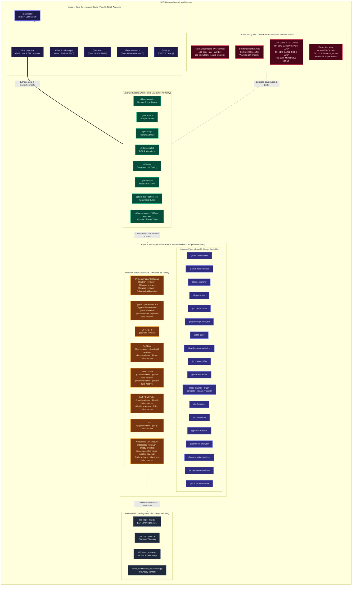
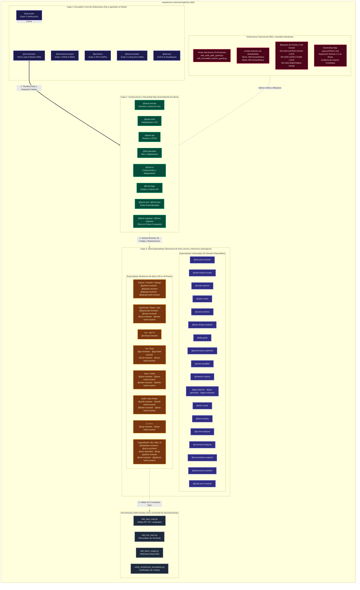

# SDD Agentic Starter Template

[ 🇬🇧 English (EN-GB)](#-english-en-gb) | [ 🇪🇸 Español (ES-ES)](#-español-es-es)

---

## 🇬🇧 English (EN-GB)

Universal, production-ready software development starter template governed by **Spec-Driven Development (SDD)** and multi-agent orchestration. Integrates high-rigour software engineering patterns from **Everything Claude Code (ECC)** under the MIT License.

---

### 🏛️ System Architecture Overview

The framework structures software development into a clean, layered architecture inspired by modern Clean/Hexagonal principles, separating high-level orchestration, bounded domain construction, specialized code auditing, and mechanical enforcement hooks.



---

### 🚀 Getting Started with a New Project

#### Step 1: Clone or Use this Template
Create a new private repository on GitHub from this starter:
```bash
gh repo create my-new-project --template serchodm/sdd-agentic-starter --private
cd my-new-project
```

#### Step 2: Initial Repository Lock (`Gate 00: Stack Lock`)
To guarantee architectural consistency and prevent premature coding, **production code in `src/` is strictly locked** by rule `RN-SDD-GATE00-STACK-LOCK`. No production code or tests may be created until the technology stack, hosting topology, Ownership Map, and agent squad are formally agreed upon.

#### Step 3: Converse with `@orchestrator` in your AI Assistant
Launch your AI programming assistant (Antigravity, Cursor, Claude Code, Windsurf, or Codex) and start with:
> *"Hello @orchestrator. We are starting a new project based on `sdd-agentic-starter`. Please launch the interactive Gate 00 Bootstrap Wizard to define the system topology, architecture, technology stack, agent squad, and conventions."*

The `@orchestrator` will:
1. Run the interactive **Gate 00 Bootstrap Wizard (`sdd-bootstrap`)** with dynamic decision tree pruning:
   - **Infrastructure & Hosting**: Public Cloud (AWS/Azure/GCP), Docker Containers, or modern PaaS (**Vercel**, Netlify, Railway).
   - **Scope & Pruning**: Automatically prunes irrelevant questions (e.g. omits UI styling for API-only projects, or backend questions for client-only SPAs).
   - **Ownership Map (§3.2)**: Configures deterministic boundaries, mapping code paths to specific builder agents with forbidden imports and verification commands.
   - **Stack Pack Activation**: Dynamically activates language, framework, and capability packs from `.sdd/catalog/packs/`.
   - **Deterministic DoD Commands (§2.5)**: Freezes verified commands for linting, fast in-memory unit tests (<1s), integration tests, and production builds to eliminate agent discovery overhead.
   - **Local Environment**: Generates `docker-compose.yml` or `vercel.json` dev setup.
2. Complete **`specs/STACK.md`** and compile the squad using `python scripts/sdd_agent_generator.py --materialize`.
3. Request your explicit human sign-off: `[x] Gate 00 Approved (Human Sign-off)`.
4. Once approved, `src/` unlocks and the normal SDD development lifecycle begins (Gate 0 -> Gate 5).

---

### 🏛️ The SDD Lifecycle (Gate 00 to Gate 5)

Development follows a strict, step-by-step quality gate progression. No code is written before Gate 2 and Gate 3 approvals, and no task is considered complete without living documentation.

```mermaid
flowchart TD
    classDef gateStyle fill:#1e1b4b,stroke:#6366f1,stroke-width:2px,color:#e0e7ff;
    classDef humanStyle fill:#78350f,stroke:#f59e0b,stroke-width:2px,color:#fef3c7;
    classDef execStyle fill:#064e3b,stroke:#10b981,stroke-width:2px,color:#d1fae5;
    classDef doneStyle fill:#4c0519,stroke:#f43f5e,stroke-width:2px,color:#ffe4e6;

    G00["Gate 00: Stack Lock (specs/STACK.md)<br>• Topology & Hosting<br>• Ownership Map & DoD Commands<br>• Stack Packs Materialization"]:::gateStyle
    H00{"Human Sign-off<br>[x] Gate 00 Approved"}:::humanStyle
    G0["Gate 0: Backlog Intake<br>• Register FEAT-XXX in specs/BACKLOG.md<br>• Initialize specs/features/FEAT-XXX/"]:::gateStyle
    G1["Gate 1: Functional Spec (01-spec.md)<br>• Written by @functional-analyst<br>• Strict formal EARS syntax<br>• Given-When-Then BDD Acceptance Criteria"]:::gateStyle
    H1{"Human Sign-off<br>[x] Gate 1 Approved"}:::humanStyle
    G2["Gate 2: Technical Spec (02-tech-spec.md)<br>• Designed by @architect<br>• Symmetric API & DTO Contracts<br>• Architecture Decision Records (ADRs)"]:::gateStyle
    H2{"Human Sign-off<br>[x] Gate 2 Approved"}:::humanStyle
    G3["Gate 3: Atomic Task DAG (03-tasks.md)<br>• Planned by @orchestrator<br>• [PARALLEL] & [SEQUENTIAL] blocks<br>• Strict DoR: Agent, Zone Path, DoD command"]:::gateStyle
    H3{"Human Sign-off<br>[x] Gate 3 Approved"}:::humanStyle
    G4["Gate 4: Execution & Verification<br>• Despatched via .agent-inbox/<br>• Builders implement code in assigned zones<br>• ECC Specialists review & resolve errors<br>• @qa-tester runs regression suites"]:::execStyle
    G5["Gate 5: Zero Document Debt (0DD)<br>• Executed by @documentator<br>• Bilingual living docs (docs/es/ & docs/en/)<br>• API Catalog & Data Models updated<br>• TRACEABILITY-MATRIX.md synchronized"]:::gateStyle
    DONE["DONE: Feature Completed<br>• specs/features/FEAT-XXX/ locked as READ-ONLY<br>• RN-SDD-IMMUTABLE-DONE baseline<br>• git push origin main (RN-SDD-GIT-SYNC)"]:::doneStyle

    G00 --> H00 --> G0 --> G1 --> H1 --> G2 --> H2 --> G3 --> H3 --> G4 --> G5 --> DONE
```



---

### 📦 Inactive Catalog vs. Active Workspace Runtime (Zero Token Overhead)

To protect the model's context window from token exhaustion while retaining access to 49+ specialized roles, the framework uses an **inert catalog separation**:

```mermaid
flowchart LR
    classDef catStyle fill:#1e293b,stroke:#64748b,stroke-width:2px,color:#94a3b8;
    classDef genStyle fill:#78350f,stroke:#f59e0b,stroke-width:2px,color:#fef3c7;
    classDef liveStyle fill:#064e3b,stroke:#10b981,stroke-width:2px,color:#d1fae5;

    subgraph INERT [".sdd/catalog/ (INACTIVE CATALOG - 0 TOKENS)"]
        direction TB
        ARQC["18 Layer Archetypes<br>(domain, infra, api, db, test, tier, mobile, cli)"]:::catStyle
        SPECC["20 Universal ECC Specialists<br>(security, silent failures, TDD, explorers, GAN)"]:::catStyle
        PACKC["18 Stack Packs<br>(Python, TS, C#, Go, Rust, Java, React, Vue, DB, AI)"]:::catStyle
    end

    GEN["sdd_agent_generator.py<br>--materialize"]:::genStyle

    subgraph RUNTIME [".agents/ (ACTIVE RUNTIME - DISCOVERED BY IDE)"]
        direction TB
        COREA["Layer 1 Core Agents<br>(orchestrator, functional-analyst, architect, qa-tester, documentator, devops)"]:::liveStyle
        BUILDA["Layer 2 Materialized Builders<br>(compiled strictly from Ownership Map)"]:::liveStyle
        SPECA["Layer 3 Active Specialists<br>(universals + selected stack pack reviewers)"]:::liveStyle
        OVERA[".agents/overrides/<br>(project-specific domain rules)"]:::liveStyle
    end

    INERT -->|"Reads Recipes"| GEN
    GEN -->|"Generates & Locks (squad.lock.json)"| RUNTIME
```



1. **`.sdd/catalog/` (Inactive Catalog)**: Resides outside `.agents/`. AI assistants (Antigravity, Cursor, Claude Code) do not discover it, meaning **0 tokens** are consumed in your chat turns.
2. **`.agents/` (Active Workspace Runtime)**: Only houses the materialized squad needed for your specific project.
3. **`.agents/overrides/` (Project Customizations)**: Place custom instructions here (e.g. `.agents/overrides/back-domain.md`). The generator respects overrides without dirtying the upstream starter template.

---

### 👥 Complete Catalog of Agents & Specialists (49 Specialists)

#### 1. Core Governance Squad (6 Agents)
| Agent | Role | Authority Boundary | Consultation |
| :--- | :--- | :--- | :--- |
| **`@orchestrator`** | Tech Lead, Scrum Master & SDD Gatekeeper | Plans DAG, dispatches to `.agent-inbox/`. **Zero code in `src/`**. | `specs/BACKLOG.md`, `specs/STACK.md` |
| **`@functional-analyst`**| Product Strategist & Requirements Engineer | Redacts `01-spec.md` with formal EARS and Given-When-Then BDD. | `specs/SYSTEM_VISION.md` |
| **`@architect`** | Solution Architect & API Designer | Designs `02-tech-spec.md`, symmetric DTOs, schemas, and ADRs. | `specs/STACK.md`, `docs/knowledge/` |
| **`@qa-tester`** | QA Lead & Quality Auditor | Executes test suites, audits mutation coverage, and runs quality gates. | Gate 1 Given-When-Then |
| **`@documentator`** | 0DD Living Documentation Custodian | Maintains bilingual docs (`docs/es/`, `docs/en/`), API catalog, and traceability matrix. | `docs/`, `specs/` |
| **`@devops`** | DevOps, Containers & CI/CD Specialist | Manages Docker, Kubernetes, Vercel/PaaS configs, and deploy scripts. | `.github/`, `docker-compose.yml` |

#### 2. Universal ECC Specialists (20 Agents — Always Available)
| Agent | Lifecycle Phase | Specialization & Mission |
| :--- | :--- | :--- |
| **`@code-explorer`** | Discovery (Gate 0/1) | Read-only end-to-end execution flow tracer and surgical file discovery. |
| **`@spec-miner`** | Discovery (Gate 0/1) | Extracts latent requirements and constraints from legacy codebases. |
| **`@docs-lookup`** | Discovery (Gate 0/1) | Fast, targeted documentation search across official framework libraries. |
| **`@code-architect`** | Design (Gate 2) | Implementation blueprint designer, module boundary planner, and compilation order architect. |
| **`@type-design-analyzer`**| Design (Gate 2) | Static type system auditor; eliminates unsafe casts, `any`, and boundary leaks. |
| **`@tdd-guide`** | Execution (Gate 4) | Test-Driven Development mentor; enforces strict Red-Green-Refactor cycles. |
| **`@build-error-resolver`**| Execution (Gate 4) | Surgical build error resolver; fixes compiler/test errors with the absolute minimal diff. |
| **`@security-reviewer`** | Audit (Gate 4) | OWASP Top 10 auditor, zero-secrets enforcer, and path-traversal blocker. |
| **`@silent-failure-hunter`**| Audit (Gate 4) | Hunts swallowed exceptions (`catch {}`, `except: pass`), dangerous fallbacks, and missing telemetry. |
| **`@performance-optimizer`**| Audit (Gate 4) | Memory leak detector, async I/O profiler, and bottleneck eliminator. |
| **`@e2e-runner`** | Audit (Gate 4) | Playwright and CLI End-to-End critical path test runner; eliminates flaky tests. |
| **`@pr-test-analyzer`** | Audit (Gate 4) | Analyzes pull request test coverage and mutation resilience. |
| **`@comment-analyzer`** | Audit (Gate 4) | Detects obsolete comments, misleading documentation, and rotting TODOs. |
| **`@code-simplifier`** | Hygiene (Gate 4) | Post-implementation simplifier; eliminates dead code and reduces cyclomatic complexity. |
| **`@refactor-cleaner`** | Hygiene (Gate 4) | Cleans unused imports, unreferenced helpers, and legacy syntax constructs. |
| **`@gan-planner`** | GAN Harness | Decomposes high-complexity deliverables into adversarial generator tasks. |
| **`@gan-generator`** | GAN Harness | Produces hardened implementations under adversarial critique. |
| **`@gan-evaluator`** | GAN Harness | Evaluates deliverable quality against a weighted rubric (pass mark >= 8.5/10). |
| **`@conversation-analyzer`**| Learning | Extracts atomic instincts (`continuous-learning-v2`) from sessions for `/learn` and `/evolve`. |
| **`@opensource-sanitizer`** | Hygiene | Sanitizes proprietary names, credentials, and local paths before framework sync. |

#### 3. Dynamic Stack Specialists (29 Agents Across 18 Packs)
| Stack Pack | Agents Included | Focus & Responsibilities |
| :--- | :--- | :--- |
| **`lang-python`** | `@python-reviewer` | Python 3.12+, static typing (`mypy`), `asyncio` safety, `dataclass(frozen=True)`. |
| **`framework-fastapi`** | `@fastapi-reviewer` | FastAPI async routers, `Depends` injection, Pydantic v2 camelCase DTOs, SSE/WebSocket lifespan. |
| **`framework-django`** | `@django-reviewer`<br>`@django-build-resolver` | Django ORM N+1 prevention, CSRF/auth security, Celery async tasks, migration healing. |
| **`lang-typescript`** | `@typescript-reviewer` | TypeScript strict flags, Node/Bun runtime, interface segregation, modern `tsconfig`. |
| **`framework-react`** | `@react-reviewer`<br>`@react-build-resolver` | React 19, hook dependencies (`useCallback`/`useMemo`), 60 FPS rendering, Vite build repairs. |
| **`framework-vue`** | `@vue-reviewer` | Vue 3 Composition API, Pinia stores, Nuxt 4 SSR hydration, Vue Router guards. |
| **`lang-csharp`** | `@csharp-reviewer` | C# .NET 9, Nullable Reference Types, EF Core `AsNoTracking`, async `ValueTask`, DI scoping. |
| **`lang-go`** | `@go-reviewer`<br>`@go-build-resolver` | Idiomatic Go, table-driven tests, goroutine leak checks, `go.mod` dependency conflict resolution. |
| **`lang-rust`** | `@rust-reviewer`<br>`@rust-build-resolver` | Rust borrow checker, memory safety, `Result`/`Option` handling, `cargo` build and lifetime repairs. |
| **`lang-java`** | `@java-reviewer`<br>`@java-build-resolver` | Java 21+, Spring Boot 3, Hibernate/JPA queries, Gradle/Maven build failure resolution. |
| **`lang-kotlin`** | `@kotlin-reviewer`<br>`@kotlin-build-resolver` | Kotlin coroutines/flows, Ktor, Exposed ORM, Compose Multiplatform, Gradle Kotlin repairs. |
| **`lang-swift`** | `@swift-reviewer`<br>`@swift-build-resolver` | Swift 6+, Actor isolation, `Sendable` types, SwiftUI lifecycle, `xcodebuild` compilation repairs. |
| **`lang-dart`** | `@flutter-reviewer`<br>`@dart-build-resolver` | Flutter widget trees, reactive state (Riverpod/Bloc), 60 FPS layouts, `dart analyze` repairs. |
| **`lang-cpp`** | `@cpp-reviewer`<br>`@cpp-build-resolver` | C++20 standards, RAII, smart pointers (`std::unique_ptr`), memory leaks, CMake build repairs. |
| **`capability-database`** | `@database-reviewer` | SQL queries, HNSW/GIN/B-Tree indexing, N+1 query prevention, async connection pooling, DDL migrations. |
| **`capability-web-frontend`**| `@a11y-architect`<br>`@seo-specialist` | WCAG 2.1 AA accessibility, keyboard navigation, WAI-ARIA roles, OpenGraph, Core Web Vitals, JSON-LD. |
| **`capability-ai-llm`** | `@rag-pipeline-reviewer`<br>`@mle-reviewer`<br>`@pytorch-build-resolver` | RAG chunking/re-ranking, hallucination mitigation, ML reproducible training, PyTorch tensor repair. |

---

### 🗺️ The Ownership Map (Mechanical Boundary Isolation)

Configured in `specs/STACK.md §3.2`, the Ownership Map is the **single source of truth** for code permissions. It maps code directories to single builder owners:

```yaml
ownership:
  preset: granular-backend+compact-frontend
  zones:
    - id: backend-domain
      paths: ["src/backend/domain/**", "src/backend/application/**"]
      owner: back-domain
      archetype: layer-domain
      forbid_imports: ["fastapi", "sqlalchemy", "sqlmodel", "infrastructure", "api"]
      dod: { typecheck: "uv run mypy src/backend/domain", unit: "uv run pytest tests/unit/domain -q" }
    - id: backend-infra
      paths: ["src/backend/infrastructure/**"]
      owner: back-infra
      archetype: layer-infra
      dod: { integration: "uv run pytest tests/integration -q" }
    - id: backend-api
      paths: ["src/backend/api/**"]
      owner: back-api
      archetype: layer-api
      forbid_imports: ["sqlalchemy", "sqlmodel"]
      dod: { unit: "uv run pytest tests/unit/api -q" }
    - id: frontend
      paths: ["src/frontend/**"]
      owner: front-engineer
      archetype: tier-frontend
      dod: { typecheck: "npx tsc --noEmit", build: "npm run build" }
  unowned_policy: fail-closed
```

- **Mechanical Hook Guard**: PreToolUse hook `sdd_code_gate_guard.py` checks `.agents/active_work_item.json`. If an agent attempts to edit files outside its assigned zone, the operation is **immediately denied**.
- **Architectural Boundary Verification**: Run `python .agents/scripts/verify_architecture_boundaries.py` to audit forbidden imports across layers via AST inspection.

---

### 🔄 The 12 Slash Command Workflows

| Category | Command | Dispatches To | Description |
| :--- | :--- | :--- | :--- |
| **Lifecycle** | `/pipeline-run` | Orchestrator & Specialists | Autonomous, end-to-end execution of an approved feature from Gate 3 to Gate 5. |
| | `/opsx-delegate` | Orchestrator | Tech Lead deposits atomic task tickets in `.agent-inbox/<agent>/` enforcing strict DoR. |
| | `/opsx-pickup` | Builder Specialist | Picks up assigned task ticket, audits DoR, implements code, and validates DoD. |
| | `/gate5` | `@documentator` | Dedicated, cost-effective closing session for bilingual living documentation and Git sync. |
| **Session** | `/checkpoint` | Session State | Snapshots pending tasks into `.agents/ACTIVE_STATE.md` and prepares clean handoff. |
| | `/continue` | Clean Session | Resumes execution in a fresh session with bounded context (max 4 files), resetting turns to `1/15`. |
| **Quality** | `/santa-loop` | Dual Independent Reviewers | Santa Method ("Checking It Twice"): loops until two isolated reviewers reach unanimous NICE verdict. |
| | `/gan-build` | `@gan-planner` → `@gan-generator` → `@gan-evaluator` | Adversarial Generator-Evaluator loop for complex deliverables with weighted scoring (>= 8.5/10). |
| | `/build-fix` | Build Error Resolvers | Repairs compiler, linter, or test failures using the minimal surgical diff. |
| | `/harness-audit` | Harness Auditor | Audits health of rules, agent definitions, inbox tickets, and architectural boundaries. |
| **Learning** | `/learn` | Continuous Learning v2 | Extracts atomic instincts from session reasoning into `skills/` or `rules/`. |
| | `/evolve` | Instinct Engine | Clusters high-confidence instincts (>= 0.75) and evolves them into permanent rules or skills. |

---

### 🚦 Context Health Semaphore & Token Telemetry (`RN-SDD-CONTEXT-SEMAPHORE`)

To prevent hallucination loops and context degradation in long-running tasks, the `@orchestrator` monitors turn depth and tokens on every turn:

```text
---
🟢/🟡/🔴 Context Health: Turn X/15 | Blocks: Y/2 | Gate: Z
    ↳ Tokens (Last Turn): In X.Xk · Out X.Xk · Cache X.Xk
    ↳ Tokens (Session Total): In X.Xk · Out X.Xk · Cache X.Xk (Hit: XX.X%)
```

- 🟢 **Green (`Turn 1-10` | `Blocks 0-1`)**: Optimal execution window.
- 🟡 **Yellow (`Turn 11-14` | `Blocks 2`)**: Warning threshold. The agent prepares for handoff.
- 🔴 **Red (`Turn 15+` | `Blocks 3+`)**: **Strict Stop-the-Line**. The agent halts subagent dispatch and triggers `/checkpoint` to force a clean `/continue` handoff.

Inspect token usage across Antigravity, Claude Code, Cursor, Codex, Windsurf, or Roo Code at any time:
```bash
python .agents/scripts/sdd_token_usage.py
```

---

### ⚡ Deterministic Tooling (Zero Discovery Overhead)

1. **Universal Multi-Language AST Repo-Map (`sdd_repo_map.py`)**:
   Extracts class hierarchies, method signatures, interfaces, and types across 20+ languages without dumping full implementations:
   - TypeScript/JavaScript, Python, C# (.NET), Go, Rust, Java, Kotlin, Swift, Dart, C/C++, PHP, Ruby, etc.
   ```bash
   python .agents/scripts/sdd_repo_map.py src/
   ```
2. **Deterministic Terminal Trimmer (`sdd_trim_exec.py`)**:
   Shields the context window from terminal log pollution:
   - On success (`exit 0`): Compresses 100+ lines into a single clean summary line (`✅ [DoD OK] ...`).
   - On failure (`exit != 0`): Strips ANSI noise, isolating only the stack trace, failure assertion, and file/line.
   ```bash
   python .agents/scripts/sdd_trim_exec.py pytest tests/unit/
   python .agents/scripts/sdd_trim_exec.py npm test
   ```

---

### 🛡️ Framework Healthcheck

Audit the mechanical integrity of agent definitions, rules, and governance scripts at any time:
```bash
uv run python .agents/scripts/sdd_healthcheck.py
```

---

### ⚖️ Third-Party Notices & Attribution

This project incorporates, adapts, or is inspired by open-source works under permissive licenses:
- **Everything Claude Code (ECC)**: Copyright (c) 2026 Affaan Mustafa ([https://github.com/affaan-m/ecc](https://github.com/affaan-m/ecc)), licensed under the **MIT License**. Reviewer agents, prompt defense baselines, build resolvers, continuous learning v2, and language pattern packs are adapted from ECC. Full legal notice in [`THIRD_PARTY_NOTICES.md`](file:///c:/Projects/sdd-agentic-starter/THIRD_PARTY_NOTICES.md).
- **REA Framework**: Inspired by `morluto/rea` for Fail-Closed governance, Boundary Ownership, and Human Gate Ownership.

---
---

## 🇪🇸 Español (ES-ES)

Plantilla universal de desarrollo de software lista para producción, gobernada por **Spec-Driven Development (SDD)** y orquestación multi-agente. Integra patrones de alta rigurosidad en ingeniería de software provenientes de **Everything Claude Code (ECC)** bajo Licencia MIT.

---

### 🏛️ Visión General de la Arquitectura del Sistema

El framework estructura el desarrollo de software en una arquitectura por capas nítida inspirada en principios Hexagonales y Clean Architecture, separando la gobernanza de alto nivel, la construcción con límites de dominio, la auditoría especializada de código y las guardias mecánicas.



---

### 🚀 Cómo Iniciar un Nuevo Proyecto a partir de este Template

#### Paso 1: Clonar o Usar este Template
Crea un nuevo repositorio privado en GitHub a partir de esta plantilla:
```bash
gh repo create mi-nuevo-proyecto --template serchodm/sdd-agentic-starter --private
cd mi-nuevo-proyecto
```

#### Paso 2: El Repositorio Inicia BLOQUEADO (`Gate 00: Stack Lock`)
Para garantizar orden arquitectónico y compatibilidad, **el código de producción en `src/` está estrictamente bloqueado** por la regla `RN-SDD-GATE00-STACK-LOCK`. No se puede escribir código de producción ni tests hasta definir formalmente las tecnologías, el hosting, el Ownership Map y el escuadrón agéntico.

#### Paso 3: Habla con el `@orchestrator` en tu Asistente IA
Abre tu asistente de programación (Antigravity, Cursor, Claude Code, Windsurf o Codex) y comienza con:
> *"Hola @orchestrator. Iniciamos un nuevo proyecto en `sdd-agentic-starter`. Activa el asistente interactivo de Gate 00 para definir la topología, arquitectura, stack, agentes y convenciones."*

El `@orchestrator`:
1. Desplegará el **Asistente Interactivo de Gate 00 (`sdd-bootstrap`)** con poda dinámica en árbol:
   - **Infraestructura y Hosting**: Cloud Pública (AWS/Azure/GCP), Contenedores Docker o PaaS modernas (**Vercel**, Netlify, Railway).
   - **Alcance y Poda Dinámica**: Omite automáticamente preguntas irrelevantes (ej: sin estilos si es solo API, o sin backend si es SPA estática).
   - **Ownership Map (§3.2)**: Configura las fronteras deterministas de código, asignando cada zona física a un agente constructor con sus imports prohibidos y comandos DoD.
   - **Activación de Stack Packs**: Activa bajo demanda los paquetes de lenguaje, framework y capacidad desde `.sdd/catalog/packs/`.
   - **Comandos Deterministas de DoD (§2.5)**: Congela los comandos verificados de linting, pruebas unitarias acotadas (<1s en memoria), integración y build para eliminar el overhead de descubrimiento.
   - **Entorno Local**: Genera la configuración inicial de `docker-compose.yml` o `vercel.json`.
2. Rellenará formalmente **`specs/STACK.md`** y compilará el escuadrón con `python scripts/sdd_agent_generator.py --materialize`.
3. Te solicitará tu firma humana expresa: `[x] Gate 00 Approved (Human Sign-off)`.
4. Una vez aprobada, el código en `src/` se desbloqueará y comenzará el ciclo normal de desarrollo (Gate 0 -> Gate 5).

---

### 🏛️ El Ciclo de Vida SDD (Gate 00 a Gate 5)

El desarrollo sigue una progresión rigurosa de compuertas de calidad. Queda prohibido escribir código antes de aprobar Gate 2 y Gate 3, y ninguna tarea se considera terminada sin documentación viva.

```mermaid
flowchart TD
    classDef gateStyle fill:#1e1b4b,stroke:#6366f1,stroke-width:2px,color:#e0e7ff;
    classDef humanStyle fill:#78350f,stroke:#f59e0b,stroke-width:2px,color:#fef3c7;
    classDef execStyle fill:#064e3b,stroke:#10b981,stroke-width:2px,color:#d1fae5;
    classDef doneStyle fill:#4c0519,stroke:#f43f5e,stroke-width:2px,color:#ffe4e6;

    G00["Gate 00: Stack Lock (specs/STACK.md)<br>• Topología y Hosting<br>• Ownership Map y Comandos DoD<br>• Materialización de Stack Packs"]:::gateStyle
    H00{"Firma Humana<br>[x] Gate 00 Approved"}:::humanStyle
    G0["Gate 0: Backlog Intake<br>• Registro de FEAT-XXX en specs/BACKLOG.md<br>• Creación de specs/features/FEAT-XXX/"]:::gateStyle
    G1["Gate 1: Especificación Funcional (01-spec.md)<br>• Redactado por @functional-analyst<br>• Sintaxis formal EARS estricta<br>• Criterios de Aceptación BDD Given-When-Then"]:::gateStyle
    H1{"Firma Humana<br>[x] Gate 1 Approved"}:::humanStyle
    G2["Gate 2: Especificación Técnica (02-tech-spec.md)<br>• Diseñado por @architect<br>• Contratos simétricos API y DTOs<br>• Registro de Decisiones de Arquitectura (ADRs)"]:::gateStyle
    H2{"Firma Humana<br>[x] Gate 2 Approved"}:::humanStyle
    G3["Gate 3: Grafo de Tareas DAG (03-tasks.md)<br>• Planificado por @orchestrator<br>• Bloques [PARALLEL] y [SEQUENTIAL]<br>• DoR Estricto: Agente, Ruta de Zona, Comando DoD"]:::gateStyle
    H3{"Firma Humana<br>[x] Gate 3 Approved"}:::humanStyle
    G4["Gate 4: Ejecución y Verificación<br>• Despacho vía .agent-inbox/<br>• Constructores implementan en sus zonas exclusivas<br>• Especialistas ECC auditan y corrigen fallos<br>• @qa-tester ejecuta baterías de regresión"]:::execStyle
    G5["Gate 5: Deuda Cero de Documentación (0DD)<br>• Ejecutado por @documentator<br>• Living docs bilingüe (docs/es/ y docs/en/)<br>• Catálogo de APIs y Modelos de Datos al día<br>• Sincronización de TRACEABILITY-MATRIX.md"]:::gateStyle
    DONE["DONE: Funcionalidad Completada<br>• specs/features/FEAT-XXX/ queda en SOLO LECTURA<br>• Línea base inmutable RN-SDD-IMMUTABLE-DONE<br>• git push origin main (RN-SDD-GIT-SYNC)"]:::doneStyle

    G00 --> H00 --> G0 --> G1 --> H1 --> G2 --> H2 --> G3 --> H3 --> G4 --> G5 --> DONE
```



---

### 📦 Catálogo Inerte vs. Runtime Activo (Cero Sobrecarga de Tokens)

Para blindar la ventana de contexto del modelo frente al agotamiento de tokens y mantener disponibles más de 49 roles especializados, el framework utiliza una **separación inerte de catálogo**:

```mermaid
flowchart LR
    classDef catStyle fill:#1e293b,stroke:#64748b,stroke-width:2px,color:#94a3b8;
    classDef genStyle fill:#78350f,stroke:#f59e0b,stroke-width:2px,color:#fef3c7;
    classDef liveStyle fill:#064e3b,stroke:#10b981,stroke-width:2px,color:#d1fae5;

    subgraph INERT [".sdd/catalog/ (CATÁLOGO INERTE - 0 TOKENS)"]
        direction TB
        ARQC["18 Arquetipos de Capa<br>(domain, infra, api, db, test, tier, mobile, cli)"]:::catStyle
        SPECC["20 Especialistas Universales ECC<br>(seguridad, fallos silenciosos, TDD, explorers, GAN)"]:::catStyle
        PACKC["18 Stack Packs<br>(Python, TS, C#, Go, Rust, Java, React, Vue, BD, IA)"]:::catStyle
    end

    GEN["sdd_agent_generator.py<br>--materialize"]:::genStyle

    subgraph RUNTIME [".agents/ (RUNTIME ACTIVO - DESCUBIERTO POR EL IDE)"]
        direction TB
        COREA["Agentes Core Capa 1<br>(orchestrator, functional-analyst, architect, qa-tester, documentator, devops)"]:::liveStyle
        BUILDA["Constructores Materializados Capa 2<br>(compilados estrictamente según el Ownership Map)"]:::liveStyle
        SPECA["Especialistas Activos Capa 3<br>(universales + revisores de packs seleccionados)"]:::liveStyle
        OVERA[".agents/overrides/<br>(reglas de dominio específicas del proyecto)"]:::liveStyle
    end

    INERT -->|"Lee Recetas"| GEN
    GEN -->|"Genera y Bloquea (squad.lock.json)"| RUNTIME
```



1. **`.sdd/catalog/` (Catálogo Inerte)**: Reside fuera de `.agents/`. Los asistentes IA no lo inspeccionan de forma recursiva, consumiendo **0 tokens** durante las sesiones normales de trabajo.
2. **`.agents/` (Runtime Activo de Sesión)**: Contiene únicamente el escuadrón materializado para tu proyecto.
3. **`.agents/overrides/` (Personalizaciones del Proyecto)**: Coloca aquí instrucciones de dominio específicas (ej: `.agents/overrides/back-domain.md`). El generador respetará tus overrides sin ensuciar la plantilla upstream.

---

### 👥 Catálogo Completo de Agentes y Especialistas (49 Especialistas)

#### 1. Escuadrón Core de Gobernanza (6 Agentes Fijos)
| Agente | Rol Principal | Límite de Autoridad | Consulta Obligatoria |
| :--- | :--- | :--- | :--- |
| **`@orchestrator`** | Tech Lead, Scrum Master y Gatekeeper SDD | Planifica el DAG, despacha a `.agent-inbox/`. **Cero código en `src/`**. | `specs/BACKLOG.md`, `specs/STACK.md` |
| **`@functional-analyst`**| Estratega de Producto e Ingeniero de Requisitos | Redacta `01-spec.md` con EARS formal y BDD Given-When-Then. | `specs/SYSTEM_VISION.md` |
| **`@architect`** | Arquitecto de Software y Diseñador de APIs | Diseña `02-tech-spec.md`, contratos DTO, schemas DDL y ADRs. | `specs/STACK.md`, `docs/knowledge/` |
| **`@qa-tester`** | QA Lead y Auditor de Calidad | Ejecuta suites de pruebas, audita cobertura de mutación y verifica compuertas. | Gate 1 Given-When-Then |
| **`@documentator`** | Custodio de Living Docs 0DD | Mantiene la documentación viva bilingüe (`docs/es/`, `docs/en/`), catálogo de APIs y matriz. | `docs/`, `specs/` |
| **`@devops`** | Especialista en DevOps, Contenedores y CI/CD | Gestiona Docker, Kubernetes, Vercel/PaaS y scripts de despliegue. | `.github/`, `docker-compose.yml` |

#### 2. Especialistas Universales ECC (20 Agentes — Siempre Disponibles)
| Agente | Fase del SDD | Especialización y Misión |
| :--- | :--- | :--- |
| **`@code-explorer`** | Descubrimiento (Gate 0/1) | Trazador de flujos de ejecución end-to-end en solo lectura y mapa de dependencias. |
| **`@spec-miner`** | Descubrimiento (Gate 0/1) | Extractor de especificaciones latentes y restricciones en código existente. |
| **`@docs-lookup`** | Descubrimiento (Gate 0/1) | Búsqueda quirúrgica y lectura en documentación oficial de frameworks. |
| **`@code-architect`** | Diseño (Gate 2) | Diseñador de blueprints de implementación, límites de módulos y orden de compilación. |
| **`@type-design-analyzer`**| Diseño (Gate 2) | Auditor de tipado estricto; elimina `any`, casts inseguros y fugas de tipos en fronteras. |
| **`@tdd-guide`** | Ejecución (Gate 4) | Guía de Test-Driven Development; asegura ciclos Red-Green-Refactor rigurosos. |
| **`@build-error-resolver`**| Ejecución (Gate 4) | Reparador quirúrgico de errores de compilación y tests mediante el diff mínimo absoluto. |
| **`@security-reviewer`** | Auditoría (Gate 4) | Auditor OWASP Top 10, política de cero secretos y prevención de path-traversal. |
| **`@silent-failure-hunter`**| Auditoría (Gate 4) | Caza de errores silenciados (`catch {}`, `except: pass`), fallbacks engañosos y promesas huérfanas. |
| **`@performance-optimizer`**| Auditoría (Gate 4) | Detección de fugas de memoria, optimización de I/O asíncrono y eliminación de cuellos de botella. |
| **`@e2e-runner`** | Auditoría (Gate 4) | Ejecutor de flujos críticos End-to-End con Playwright/CLI; erradicación de tests flaky. |
| **`@pr-test-analyzer`** | Auditoría (Gate 4) | Análisis de cobertura y resiliencia de tests en pull requests. |
| **`@comment-analyzer`** | Auditoría (Gate 4) | Detección de comentarios obsoletos, documentación engañosa y TODOs podridos. |
| **`@code-simplifier`** | Higiene (Gate 4) | Simplificador post-implementación; eliminación de código muerto y reducción de complejidad. |
| **`@refactor-cleaner`** | Higiene (Gate 4) | Limpieza de imports no usados, helpers huérfanos y sintaxis obsoleta. |
| **`@gan-planner`** | Arnés GAN | Descompone entregables complejos en especificaciones para el generador adversarial. |
| **`@gan-generator`** | Arnés GAN | Produce implementaciones robustas respondiendo a la crítica adversarial. |
| **`@gan-evaluator`** | Arnés GAN | Evalúa entregables frente a una rúbrica ponderada (puntuación mínima de pase >= 8.5/10). |
| **`@conversation-analyzer`**| Aprendizaje | Extrae instintos atómicos (`continuous-learning-v2`) de las sesiones para `/learn` y `/evolve`. |
| **`@opensource-sanitizer`** | Higiene | Sanitiza nombres propietarios, credenciales y rutas locales antes de sincronizar con el framework. |

#### 3. Especialistas Dinámicos de Stack (29 Agentes en 18 Packs)
| Stack Pack | Agentes Incluidos | Misión y Responsabilidades |
| :--- | :--- | :--- |
| **`lang-python`** | `@python-reviewer` | Python 3.12+, tipado estático (`mypy`), seguridad con `asyncio`, inmutabilidad `dataclass(frozen=True)`. |
| **`framework-fastapi`** | `@fastapi-reviewer` | Routers asíncronos FastAPI, inyección `Depends`, DTOs Pydantic v2 camelCase, SSE/WebSocket lifespan. |
| **`framework-django`** | `@django-reviewer`<br>`@django-build-resolver` | Prevención de N+1 en Django ORM, seguridad CSRF/auth, tareas Celery, reparación de migraciones. |
| **`lang-typescript`** | `@typescript-reviewer` | TypeScript estricto, runtime Node/Bun, segregación de interfaces, `tsconfig` moderno. |
| **`framework-react`** | `@react-reviewer`<br>`@react-build-resolver` | React 19, dependencias de hooks (`useCallback`/`useMemo`), fluidez a 60 FPS, reparación de builds Vite. |
| **`framework-vue`** | `@vue-reviewer` | Vue 3 Composition API, stores Pinia, hidratación SSR en Nuxt 4, guardias en Vue Router. |
| **`lang-csharp`** | `@csharp-reviewer` | C# .NET 9, Nullable Reference Types, EF Core `AsNoTracking`, `ValueTask` asíncrono, scopes de DI. |
| **`lang-go`** | `@go-reviewer`<br>`@go-build-resolver` | Go idiomático, table-driven tests, prevención de fugas de goroutines, resolución de conflictos en `go.mod`. |
| **`lang-rust`** | `@rust-reviewer`<br>`@rust-build-resolver` | Borrow checker, seguridad de memoria en Rust, `Result`/`Option`, reparación de compilación en `cargo`. |
| **`lang-java`** | `@java-reviewer`<br>`@java-build-resolver` | Java 21+, Spring Boot 3, consultas Hibernate/JPA, resolución de fallos en Gradle/Maven. |
| **`lang-kotlin`** | `@kotlin-reviewer`<br>`@kotlin-build-resolver` | Corrutinas/flujos Kotlin, Ktor, Exposed ORM, Compose Multiplatform, reparación de Gradle Kotlin. |
| **`lang-swift`** | `@swift-reviewer`<br>`@swift-build-resolver` | Swift 6+, aislamiento de Actores, tipos `Sendable`, ciclo de vida SwiftUI, reparaciones en `xcodebuild`. |
| **`lang-dart`** | `@flutter-reviewer`<br>`@dart-build-resolver` | Árboles de widgets Flutter, estado reactivo (Riverpod/Bloc), layouts a 60 FPS, reparación en `dart analyze`. |
| **`lang-cpp`** | `@cpp-reviewer`<br>`@cpp-build-resolver` | C++20, RAII, punteros inteligentes (`std::unique_ptr`), prevención de fugas, reparación de builds CMake. |
| **`capability-database`** | `@database-reviewer` | Consultas SQL, índices HNSW/GIN/B-Tree, prevención de N+1, pooling asíncrono, migraciones DDL idempotentes. |
| **`capability-web-frontend`**| `@a11y-architect`<br>`@seo-specialist` | Accesibilidad WCAG 2.1 AA, navegación por teclado, roles WAI-ARIA, OpenGraph, Core Web Vitals, JSON-LD. |
| **`capability-ai-llm`** | `@rag-pipeline-reviewer`<br>`@mle-reviewer`<br>`@pytorch-build-resolver` | Chunking/re-ranking en RAG, mitigación de alucinaciones, entrenamiento ML reproducible, reparación de tensores PyTorch. |

---

### 🗺️ El Ownership Map (Aislamiento Mecánico de Fronteras)

Definido en `specs/STACK.md §3.2`, el Ownership Map es la **fuente única de verdad** de permisos de código. Asigna cada directorio de código a un único agente constructor:

```yaml
ownership:
  preset: granular-backend+compact-frontend
  zones:
    - id: backend-domain
      paths: ["src/backend/domain/**", "src/backend/application/**"]
      owner: back-domain
      archetype: layer-domain
      forbid_imports: ["fastapi", "sqlalchemy", "sqlmodel", "infrastructure", "api"]
      dod: { typecheck: "uv run mypy src/backend/domain", unit: "uv run pytest tests/unit/domain -q" }
    - id: backend-infra
      paths: ["src/backend/infrastructure/**"]
      owner: back-infra
      archetype: layer-infra
      dod: { integration: "uv run pytest tests/integration -q" }
    - id: backend-api
      paths: ["src/backend/api/**"]
      owner: back-api
      archetype: layer-api
      forbid_imports: ["sqlalchemy", "sqlmodel"]
      dod: { unit: "uv run pytest tests/unit/api -q" }
    - id: frontend
      paths: ["src/frontend/**"]
      owner: front-engineer
      archetype: tier-frontend
      dod: { typecheck: "npx tsc --noEmit", build: "npm run build" }
  unowned_policy: fail-closed
```

- **Guardia Mecánica por Hook**: El hook `PreToolUse` (`sdd_code_gate_guard.py`) consulta `.agents/active_work_item.json`. Si un agente intenta editar ficheros fuera de su zona asignada, la acción es **inmediatamente bloqueada**.
- **Verificación de Fronteras Arquitectónicas**: Ejecuta `python .agents/scripts/verify_architecture_boundaries.py` para auditar imports prohibidos entre capas mediante inspección AST.

---

### 🔄 Los 12 Workflows de Comandos Slash

| Categoría | Comando | Agentes Asignados | Descripción |
| :--- | :--- | :--- | :--- |
| **Ciclo de Vida** | `/pipeline-run` | Orchestrator y Especialistas | Ejecuta de forma autónoma el pipeline de desarrollo SDD para una feature aprobada. |
| | `/opsx-delegate` | Orchestrator | El Tech Lead delega tareas atómicas a `.agent-inbox/<agente>/` aplicando DoR estricto. |
| | `/opsx-pickup` | Especialista Constructor | Recoge su tarea asignada, audita DoR, implementa código y valida DoD. |
| | `/gate5` | `@documentator` | Sesión dedicada y económica para living docs bilingüe y sincronización Git. |
| **Sesión** | `/checkpoint` | Estado de Sesión | Guarda las tareas pendientes en `.agents/ACTIVE_STATE.md` y prepara un traspaso de sesión limpio. |
| | `/continue` | Sesión Limpia | Reanuda el trabajo en un hilo limpio con contexto acotado (máx 4 ficheros), reiniciando turnos a `1/15`. |
| **Calidad** | `/santa-loop` | Revisores Independientes | Método Santa ("Checking It Twice"): bucle de revisión hasta lograr veredicto unánime NICE de dos revisores aislados. |
| | `/gan-build` | `@gan-planner` → `@gan-generator` → `@gan-evaluator` | Bucle adversarial Generador-Evaluador para entregables complejos con rúbrica ponderada (>= 8.5/10). |
| | `/build-fix` | Build Error Resolvers | Repara errores de compilación, linter o tests aplicando el diff mínimo quirúrgico. |
| | `/harness-audit` | Auditor del Arnés | Audita la salud de reglas, agentes, tickets en inbox y cumplimiento de fronteras. |
| **Aprendizaje** | `/learn` | Continuous Learning v2 | Extrae instintos atómicos de la sesión hacia `skills/` o `rules/`. |
| | `/evolve` | Motor de Instintos | Agrupa instintos de alta confianza (>= 0.75) y los evoluciona hacia reglas o skills permanentes. |

---

### 🚦 Semáforo de Salud de Contexto y Telemetría de Tokens (`RN-SDD-CONTEXT-SEMAPHORE`)

Para erradicar bucles de alucinación y degradación de contexto en tareas extensas, el `@orchestrator` monitoriza turnos y tokens en cada turno:

```text
---
🟢/🟡/🔴 Context Health: Turn X/15 | Blocks: Y/2 | Gate: Z
    ↳ Tokens (Last Turn): In X.Xk · Out X.Xk · Cache X.Xk
    ↳ Tokens (Session Total): In X.Xk · Out X.Xk · Cache X.Xk (Hit: XX.X%)
```

- 🟢 **Verde (`Turno 1-10` | `Bloques 0-1`)**: Ventana de ejecución óptima.
- 🟡 **Amarillo (`Turno 11-14` | `Bloques 2`)**: Umbral de aviso. Preparar traspaso de sesión.
- 🔴 **Rojo (`Turno 15+` | `Bloques 3+`)**: **Parada Obligatoria (*Stop-the-Line*)**. Detiene el despacho y ejecuta `/checkpoint` para forzar un `/continue` en hilo limpio.

Inspecciona el consumo de tokens en Antigravity, Claude Code, Cursor, Windsurf, Codex o Roo Code en cualquier momento:
```bash
python .agents/scripts/sdd_token_usage.py
```

---

### ⚡ Herramientas Deterministas (Cero Sobrecarga de Descubrimiento)

1. **Generador Universal de Mapa AST (`sdd_repo_map.py`)**:
   Extrae jerarquías de clases, firmas de métodos, interfaces y tipos en más de 20 lenguajes sin descargar implementaciones completas:
   - TypeScript/JavaScript, Python, C# (.NET), Go, Rust, Java, Kotlin, Swift, Dart, C/C++, PHP, Ruby, etc.
   ```bash
   python .agents/scripts/sdd_repo_map.py src/
   ```
2. **Recortador Determinista de Terminal (`sdd_trim_exec.py`)**:
   Protege la ventana de contexto de la contaminación de logs de terminal:
   - En éxito (`exit 0`): Comprime más de 100 líneas a un resumen limpio de una sola línea (`✅ [DoD OK] ...`).
   - En fallo (`exit != 0`): Elimina ruido ANSI, aislando únicamente la traza del error, la aserción fallida y fichero/línea.
   ```bash
   python .agents/scripts/sdd_trim_exec.py pytest tests/unit/
   python .agents/scripts/sdd_trim_exec.py npm test
   ```

---

### 🛡️ Verificación de Salud del Framework

Audita la integridad mecánica de los agentes, reglas y scripts de gobernanza en cualquier momento:
```bash
uv run python .agents/scripts/sdd_healthcheck.py
```

---

### ⚖️ Avisos de Terceros y Atribución Open Source

Este proyecto incorpora, adapta o se inspira en obras de código abierto bajo licencias permisivas:
- **Everything Claude Code (ECC)**: Copyright (c) 2026 Affaan Mustafa ([https://github.com/affaan-m/ecc](https://github.com/affaan-m/ecc)), publicado bajo **Licencia MIT**. Los agentes revisores, baselines de prompt defense, build resolvers, motor de aprendizaje continuo v2 y paquetes de patrones han sido adaptados de ECC. Consulta el aviso legal completo en [`THIRD_PARTY_NOTICES.md`](file:///c:/Projects/sdd-agentic-starter/THIRD_PARTY_NOTICES.md).
- **Framework REA**: Inspiración en `morluto/rea` para las compuertas de gobernanza Fail-Closed, Boundary Ownership y Human Gate Ownership.
