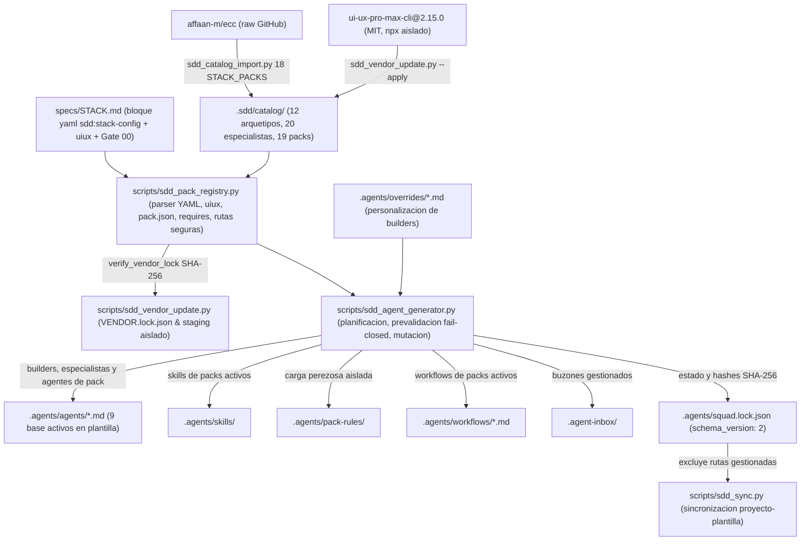
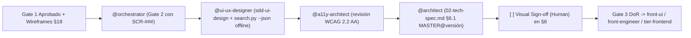
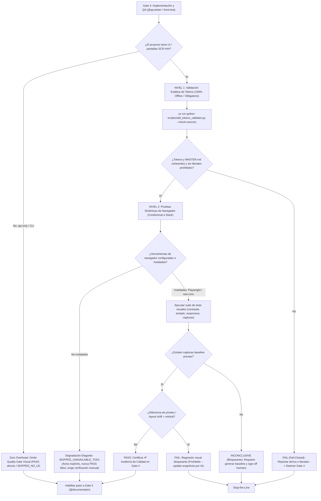
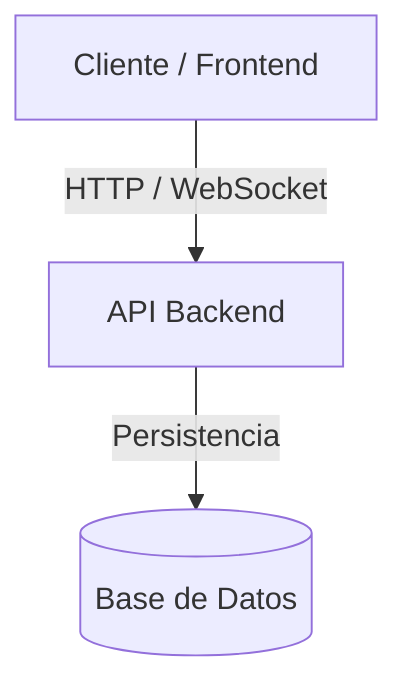

# Topología Física y Lógica del Sistema

## 1. Topología del Framework SDD y Materialización de Packs (`FWK-001` & `FWK-002`)

### Inventario de Componentes del Framework

| Componente / Ruta | Responsabilidad | Límites y Aislamiento |
| :--- | :--- | :--- |
| `scripts/sdd_pack_registry.py` | Parsea el bloque `yaml sdd:stack-config` de `specs/STACK.md`, valida Gate S0 (con soporte legacy Gate 00), el esquema estricto `uiux` y su coherencia con `packs`, carga `pack.json` (`targets`, `upstream`), comprueba `requires`, delega `verify_vendor_lock()` y resuelve rutas seguras anti-*path-traversal*. | Solo librería estándar Python 3.12+ (sin PyYAML); *fail-closed* ante errores de esquema, incompatibilidad `api-only`, discrepancia `uiux` ↔ `packs` o fallo de lock (`<= 500` líneas; 496 líneas actuales). |
| `scripts/sdd_agent_generator.py` | Construye el plan de materialización, valida colisiones intra-plan, destinos artesanales no gestionados y conflictos SHA-256 contra disco antes de mutar `.agents/` y `.agent-inbox/`, y persiste `squad.lock.json` v2 con campos canónicos `stack_approved` y legacy `gate00_approved`. | No modifica `.agents/rules/` ni `.sdd/catalog/`; conserva buzones desactivados si tienen tickets pendientes (`<= 500` líneas). |
| `scripts/sdd_vendor_update.py` | Verifica `VENDOR.lock.json` (`verify_vendor_lock()`) y ejecuta actualizaciones explícitas de `ui-ux-pro-max-cli@<X.Y.Z>` en `tempfile.TemporaryDirectory()`, validando `validate_data.py`, excluyendo skills hermanas/tests, normalizando EOL a LF y mostrando diff previo a `--apply`. | Único módulo autorizado para invocar `npx` en staging temporal; nunca escribe sin `--apply` (`<= 500` líneas). |
| `scripts/sdd_catalog_import.py` | Importa `UNIVERSAL_SPECIALISTS` (20) y `STACK_PACKS` (18) desde `affaan-m/ecc` (incluidos `workflows/`), normaliza *frontmatter*, protege `SDD_CUSTOMIZED_SPECIALISTS` (`spec-miner`) salvo `--overwrite-sdd-custom` y admite `fetcher` inyectable para pruebas offline. | Nunca modifica ni borra directorios de packs en `.sdd/catalog/packs/` ajenos a `STACK_PACKS`, preservando `capability-ui-design` byte a byte (`RN-05`, `RF-012`, `RF-1203`; `480L`). |
| `scripts/sdd_sync.py` | Sincroniza bidireccionalmente artefactos core del framework entre proyectos derivados y plantilla. | Excluye `.agents/overrides/`, `.agents/squad.lock.json`, cualquier ruta en `squad.lock.json["files"]` y archivos con marcador `GENERATED` (primeros 4096 caracteres). |
| `.sdd/catalog/packs/capability-ui-design/` | Pack no-ECC (`id: "capability:ui-design"`, `requires: ["capability:web-frontend"]`, `targets: ["web"]`, `rules: []`) con `NOTICE.md` (MIT), `@ui-ux-designer`, skill `sdd-ui-design`, workflow `ui-design-review.md` y `vendor/ui-ux-pro-max/` (`46` entradas en `VENDOR.lock.json`: `45` runtime + `LICENSE` MIT). | Opera 100% offline con stdlib Python (`search.py`, `validate_data.py`); excluye 6 skills hermanas y `scripts/tests/`; nunca añade reglas *always-on*. |
| `.gitattributes` | Fija `text eol=lf` para `.sdd/catalog/packs/capability-ui-design/**` y `.agents/**`. | Evita discrepancias CRLF/LF en Windows frente a hashes SHA-256 de `VENDOR.lock.json` y `squad.lock.json`. |
| `.agents/pack-rules/<pack>/` | Aloja reglas específicas de packs activos (p. ej. `coding-style.md`) fuera de `.agents/rules/00-..07-`. | Cumple `RN-SDD-SELECTIVE-CONTEXT`; se poda automáticamente al desactivar el pack si no hay ediciones manuales. |
| `.agents/squad.lock.json` | Fuente de verdad de estado materializado (`schema_version: 2`, `active_packs`, `files` con `sha256`/`owner`/`kind`). | No se sincroniza en `sdd_sync.py`; en plantilla base con Gate 00 sin aprobar mantiene `active_packs: []` y 22 ficheros base (2 builders + 20 especialistas). |
| `scripts/sdd_tokens_validator.py` | Validador determinista offline de tokens de diseño y anti-deriva estilística. Comprueba la estructura DTCG de `design-tokens.json`, el cotejo bidireccional contra `MASTER.md` y el escaneo estático de ficheros frontend (`--check-sources`) para detectar literales de color hardcodeados. | Solo librería estándar Python 3.12+; *fail-closed* ante discrepancias o literales prohibidos; soporte de comentarios de escape y flags `--allow-missing`, `--strict` y `--format json` (`<= 500` líneas). |
| `tests/test_sdd_pack_materialization.py`, `tests/test_sdd_ui_design.py`, `tests/test_sdd_visual_gates.py`, `tests/test_sdd_terminology_unification.py`, `tests/test_sdd_security_guards.py`, `tests/test_sdd_ownership_dag.py`, `tests/test_sdd_git_concurrency.py`, `tests/test_sdd_sync_and_modularity.py`, `tests/test_sdd_governance.py`, `tests/test_sdd_token_usage.py`, `tests/test_sdd_l5_perfection.py`, `tests/test_sdd_ci.py`, `tests/test_sdd_release.py`, `tests/test_sdd_brownfield.py`, `tests/test_sdd_drift.py` & `tests/test_sdd_portfolio.py` | Suites unitarias y de aceptación 100% offline en `16` módulos de `tests/` (`174` tests totales): `12` en pack materialization, `7` en ui design, `8` en visual gates, `22` en terminology unification, `15` en security guards, `11` en ownership & DAG, `8` en git concurrency `405L`, `10` en sync & modularity, `14` en governance, `13` en token usage, `8` en L5 perfection, `10` en CI-agnostic verify, `5` en release readiness `381L`, `7` en brownfield adoption `376L`, `10` en Spec Drift / Strangler Fig `417L` y `14` en Portfolio / Épicas / Feature DAG `373L`; todos los `49` archivos `.py` cumplen `<= 500` líneas (`OVER_500=0`). | Usan `tempfile.TemporaryDirectory`, fixtures sintéticas y runner offline con `0` llamadas de red reales. |
| `scripts/sdd_stack_parser.py` & `scripts/sdd_ownership.py` (`FWK-006` & `FWK-016`) | `sdd_stack_parser.py` sanitiza comentarios HTML/bloques vallados y parsea el subconjunto YAML de `specs/STACK.md`; `sdd_ownership.py` (`499L`) parsea `yaml sdd:ownership-map` (incluido `governance: governed \| legacy-readonly`), valida solapamiento de globs y cobertura de rutas (`derive_candidate_roots`, `resolve_path_zone`, `validate_repo_coverage`) y compila `BuilderSpec` dinámicos. | Solo stdlib Python 3.12+; *fail-closed* ante conflictos, solapamientos, `governance` inválido o rutas huérfanas (`<= 500` líneas; `437L` y `499L`). |
| `scripts/sdd_generator_tx.py` & `scripts/sdd_dag.py` (`FWK-006`) | `sdd_generator_tx.py` ejecuta la transacción con backup/rollback y `os.replace`, resuelve comandos DoD de `STACK.md §2.5`, reconcilia buzones (`.agent-inbox/`) y verifica `squad.lock.json` (`--verify`, `content_digest`); `sdd_dag.py` valida aciclicidad y olas en `03-tasks.md` (`--verify`, `--plan`) y gestiona transiciones atómicas de tickets. | `sdd_generator_tx.py` (`491L`) y `sdd_dag.py` (`486L`); invocados desde `sdd_agent_generator.py` y `sdd_healthcheck.py`. |
| `.sdd/catalog/{specialists,specialists-optin,archetypes}/` & `domains/` (`FWK-007`) | `.agents/agents/` mantiene `9` agentes base activos (`6` core + `2` builders + `@security-reviewer` desde `.sdd/catalog/specialists/`); `.sdd/catalog/specialists-optin/` aloja `19` especialistas universales opt-in; `.sdd/catalog/archetypes/` contiene `12` arquetipos canónicos únicos (eliminado `.agents/archetypes/`); `domains/` ofrece contexto de dominio bajo demanda (`_template/{overview,decisions}.md`). | Presupuesto Markdown activo en `.agents/` mantenido bajo `< 25k` (`50` ficheros, `76.7 KB`, `~19.2k` tokens); incluye `/bug-fast-track`, `/brownfield-adopt` y `/gate6-release`. |
| `scripts/sdd_git.py`, `scripts/sdd_git_state.py` & `scripts/sdd_git_worktree.py` (`FWK-005`, `FWK-008`, `FWK-012` & `FWK-014`) | `sdd_git_state.py` (`485L`) gestiona gobernanza Git (`copy.deepcopy(DEFAULT_GOVERNANCE)`), estado aislado en `.agents/worktree_states/<wt_id>.json` y sincronización de `.agents/ACTIVE_STATE.md`; `sdd_git_worktree.py` (`394L`) asigna puertos sin colisión (`ports_registry.json` + bind TCP loopback) y contiene `WorktreeManager.remove` a `worktrees_root`; `sdd_git.py` (`480L`) expone la CLI incluyendo `release-start`, `release-finish` (con preflight *fail-closed* `_run_release_preflight`) y `hotfix-finish` en flujo PR-first por defecto (`--local-merge` opt-in). | Bloqueos de fichero multi-hilo/multi-proceso (`msvcrt`/`fcntl`), rechazo de symlinks/junctions (`is_link_or_junction`) y prohibición de push directo a `main` (`RN-SDD-BRANCH-SYNC`). |
| `.agents/scripts/{sdd_code_gate_guard,sdd_immutable_feature_guard,sdd_stack_gate_guard,sdd_trim_exec,sdd_healthcheck,verify_architecture_boundaries}.py` (`FWK-005`, `FWK-006`, `FWK-012` & `FWK-016`) | Guardias `PreToolUse` y verificadores *fail-closed*: `sdd_code_gate_guard.py` (`494L`) valida `Gate S0`, sellos SHA-256, raíces brownfield (`_BROWNFIELD_PREFIX_RE`) y zonas `legacy-readonly` vía `inspect_ownership_path` (`sdd_drift.py`), normaliza rutas Win32 `\\?\` y protege `tests/`, `.agents/`, `specs/STACK.md`; `sdd_healthcheck.py` (`499L`) audita `SPIKE_REPORT.md` y delega baselines `Origin: brownfield-mined` en `sdd_gate_seal.py` (`validate_brownfield_baseline_docs`); `sdd_trim_exec.py` ejecuta `shell=False` y `verify_architecture_boundaries.py` verifica `forbid_imports` por AST. | Configurados en `.agents/hooks.json` (UTF-8 sin BOM); `sdd_hooks.py` elimina `SDD_FORCE_MAIN_PUSH`. |
| `.agents/scripts/{sdd_token_usage,sdd_token_parsers,sdd_token_report,sdd_repo_map,sdd_repo_map_parsers}.py` (`FWK-009`) | Submódulos desacoplados para telemetría multi-IDE (`sdd_token_usage.py` `405L`, `sdd_token_parsers.py` `370L`, `sdd_token_report.py` `84L`) e indexación estructural AST/símbolos (`sdd_repo_map.py` `213L`, `sdd_repo_map_parsers.py` `369L`). | Todos los ficheros `.py` en `scripts/`, `.agents/scripts/` y `tests/` cumplen estrictamente `<= 500` líneas (`pyproject.toml` PEP 621 stdlib-only). |
| `scripts/sdd_gate_seal.py`, `.agents/scripts/verify_architecture_boundaries.py`, `scripts/sdd_dag.py` & `tests/test_sdd_l5_perfection.py` (`FWK-010` & `FWK-016`) | `sdd_gate_seal.py` (`359L`) gestiona sellos criptográficos SHA-256 de Gates 1..3 (y Gates 1..2 para baselines `Origin: brownfield-mined` vía `is_brownfield_mined_baseline` y `validate_brownfield_baseline_docs`) verificados en `sdd_code_gate_guard.py`; `verify_architecture_boundaries.py` (`422L`) ejecuta `check_polyglot_imports` en Python/TS/JS/C#/Go/Rust/Java/Kotlin; `sdd_dag.py` (`486L`) previene colisiones de `target_paths` en olas paralelas (`DagWriteSetCollisionError`, `--auto-split`); `tests/test_sdd_l5_perfection.py` (`336L`) forma parte de la suite determinista. | Validados en `.github/workflows/ci.yml` con step `sdd_dag.py --verify` y umbral `>= 120` tests unitarios. |
| `scripts/sdd_cli.py`, `specs/templates/{06-spike-report,07-hotfix-fast-track,09-epic-roadmap}.template.md` & `.sdd/catalog/specialists-optin/spec-miner.md` (`FWK-012`, `FWK-014`..`FWK-017`) | `scripts/sdd_cli.py` (`266L`) implementa `work-item show/set` en modo `PENDING_APPROVAL` sin autoaprobar Gates 1..3 y registra `ci-verify`, `release`, `adopt`, `drift` y `portfolio` en `DISPATCH_MAP` y `print_help()`; `specs/templates/` añade `06-spike-report.template.md`, `07-hotfix-fast-track.template.md` y `09-epic-roadmap.template.md` (`38L`, `0` bytes en `.agents/`) junto a `SDD_FRAMEWORK.md §3` (`398L`, `specs/epics/EPIC-XXX-<slug>.md`); `.sdd/catalog/specialists-optin/spec-miner.md` genera specs SDD nativas (`specs/features/` + `domains/`) protegido por `SDD_CUSTOMIZED_SPECIALISTS`. | Coherencia CLI/docs (`README.md`, `bug-fast-track.md`), soporte `HOTFIX-*`/`SPIKE-*`/`EPIC-*` end-to-end y todos los `.py` `<= 500L`. |
| `scripts/sdd_ci.py`, `.github/workflows/ci.yml` & `specs/templates/ci/` (`FWK-013`, `FWK-014`, `FWK-016` & `FWK-017`) | `scripts/sdd_ci.py` (`491L`, stdlib-only) encapsula la verificación CI-agnóstica (`hooks`, `healthcheck`, `odd_compliance`, `boundaries`, `catalog_verify`, `dag_verify`, `gate_seals` con exención de `REL-*`, `git_and_instincts`, `tokens`, `spec_drift` vía `check_spec_drift`, `portfolio` vía `check_portfolio`, `framework_tests` y `stack_commands` con `shell=False`); `.github/workflows/ci.yml` (`35L`) delega en `uv run python scripts/sdd_cli.py ci-verify --mode auto --run-stack-if-approved --format text`; `specs/templates/ci/` provee `README.md`, `gitlab-ci.yml`, `bitbucket-pipelines.yml` y `ci-verify.sh` (`0` bytes en `.agents/`). | Detección automática `framework` vs `project`; `spec_drift` y `portfolio` devuelven `SKIPPED_NO_APPLICABLE` cuando no aplican; ejecución de `STACK.md §2.5` estrictamente opt-in y *fail-closed* ante metacaracteres o `Gate S0` sin aprobar. |
| `scripts/sdd_release.py`, `specs/templates/08-release-readiness.template.md` & `.agents/workflows/gate6-release.md` (`FWK-014`) | `scripts/sdd_release.py` (`459L`, stdlib-only) implementa el motor `Gate 6` (`REL-vX.Y.Z`) y `CHANGELOG.md` determinista (`prepare`, `changelog`, `verify`), formalizado en `specs/SDD_FRAMEWORK.md` (§3 y §4 `Gate 6`), plantilla `specs/templates/08-release-readiness.template.md` (`0` bytes en `.agents/`), workflow `.agents/workflows/gate6-release.md` y pruebas en `tests/test_sdd_release.py` (`381L`). | 100% offline y *fail-closed* (prohíbe autoaprobación de `Gate 6`, filtra comentarios HTML/fences y verifica sellos SHA-256 si existen); `<= 500L` por `.py` y presupuesto `.agents/` `< 25k` tokens. |
| `scripts/sdd_brownfield.py`, `scripts/sdd_cli.py` & `.agents/workflows/brownfield-adopt.md` (`FWK-015`) | `scripts/sdd_brownfield.py` (`462L`, stdlib-only) ejecuta descubrimiento brownfield determinista offline (`discover_brownfield_repo`, `MAX_SCAN_DEPTH = 3`), planificación `--dry-run` por defecto y adopción `--apply` no destructiva de `specs/STACK.md` (con `Gate S0` bloqueado), `docs/knowledge/BROWNFIELD_INVENTORY.md` y `specs/BACKLOG.md`; `scripts/sdd_cli.py` (`266L`) expone `adopt` en `DISPATCH_MAP` y `print_help()`; `.agents/workflows/brownfield-adopt.md` (`16L`, `<= 25L`) conecta `sdd adopt` -> `Gate S0` -> `sdd generate --materialize` -> `sdd repo-map` -> `@spec-miner`, validado por `tests/test_sdd_brownfield.py` (`376L`, `7` tests). | 100% offline sin ejecutar comandos del proyecto; *fail-closed* ante symlinks/junctions, escapes de ruta y metacaracteres inseguros (`split_safe_chained_command`); nunca sobrescribe `STACK.md` ni `BACKLOG.md` y mantiene `.agents/` `< 25k` tokens y `.py <= 500L`. |
| `scripts/sdd_drift.py` & `tests/test_sdd_drift.py` (`FWK-016`) | `scripts/sdd_drift.py` (`468L`, stdlib-only) implementa el detector determinista offline de *Spec Drift* (`run_drift_check`, `--repo-root`, `--base-ref`, `--strict`, `--format text\|json`) e `inspect_ownership_path`; se conecta con `sdd_cli.py` (`drift`), `sdd_ci.py` (`check_spec_drift`), `sdd_ownership.py` (`resolve_path_zone`, `derive_candidate_roots`), `sdd_repo_map.py` (`collect_source_files`, `EXTENSION_PARSERS`), `sdd_healthcheck.py` (`_parse_backlog_entries`) y `sdd_code_gate_guard.py` (`legacy-readonly` lock), validado por `tests/test_sdd_drift.py` (`417L`, `10` tests). | 100% offline (`shell=False` en `git`, rechazo de symlinks/junctions vía `validate_repo_root` e `is_link_or_junction`), consolida citas/SHAs de `CR-XXX` cerrados sin mutar `FEAT-*`, `0` bytes añadidos en `.agents/*.md` (`< 25k` tokens) y todos los `.py <= 500L`. |
| `scripts/sdd_portfolio.py`, `specs/templates/09-epic-roadmap.template.md` & `tests/test_sdd_portfolio.py` (`FWK-017`) | `scripts/sdd_portfolio.py` (`476L`, stdlib-only) implementa la gestión offline de Portfolio, Épicas `EPIC-XXX` (`yaml sdd:epic`), priorización *MoSCoW*/*RICE*, *rollup* cruzado con `specs/BACKLOG.md`, orden topológico Kahn (`waves`), `critical_path` y validación *fail-closed* (`init_epic_doc`, `analyze_portfolio`, `build_feature_graph`, `run_portfolio_ci_check`); integrado en `sdd_cli.py` (`portfolio`) y `sdd_ci.py` (`check_portfolio`), y cubierto por `tests/test_sdd_portfolio.py` (`373L`, `14` tests offline). | 100% offline sin PyYAML ni llamadas de red; rechaza symlinks/junctions (`is_link_or_junction`), escapes Win32 `\\?\` y sobrescrituras sin `--force`; `0` bytes añadidos en `.agents/` (`< 25k` tokens) y todos los `49` archivos `.py` en `<= 500L` (`OVER_500=0`). |

### 1.1. Flujo Condicional de Diseño Visual en Gate 2 (`FWK-002`)

Cuando `capability-ui-design` y `uiux.enabled: true` están activos y una feature (o `CR-XXX`) afecta al menos a una pantalla `SCR-###`:

- **Poda UI-Only:** En proyectos `api-only` o CLI, `sdd-bootstrap` poda las preguntas `uiux` y no activa `capability-ui-design`; con `capability-web-frontend` y `uiux.enabled: false`, permanecen activos `@a11y-architect` y las skills ECC (`design-system`, `accessibility`, `browser-qa`) sin `@ui-ux-designer`.
- **Plantilla Base Limpia:** El repositorio starter **no** crea `docs/design-system/` vacío; dicha carpeta nace únicamente en el proyecto usuario durante la feature fundacional `Design System Foundation` (registrada en `specs/BACKLOG.md` tras Gate 00 cuando `uiux.enabled: true`).

### 1.2. Flujo Bi-Nivel de Quality Gates Visuales y Anti-Deriva en Gate 4 (`FWK-003`)

Cuando una feature afecta a pantallas (`SCR-###`) con `capability-ui-design` o interfaz web activa, `@qa-tester` y el arquetipo `front-test` ejecutan el protocolo de verificación bi-nivel en Gate 4:

#### Estados de Ejecución del Quality Gate Visual:
- **`PASS`**: Todas las comprobaciones visuales, ratios de contraste WCAG 2.2 AA (`>= 4.5:1`), foco accesible por teclado, responsive y comparación de capturas están dentro del umbral de tolerancia (`< 0.1%` de píxeles).
- **`FAIL`**: Violación explícita de contraste, ausencia de indicador de foco, desbordamiento horizontal inesperado o regresión de píxeles (`>= 0.1%`). Bloqueante para Gate 4.
- **`INCONCLUSIVE`**: No existe captura de referencia previa (baseline) para la pantalla o componente en la ruta designada. Bloquea la aprobación de Gate 4 hasta que el baseline sea generado y revisado/aprobado expresamente por un humano (`RN-SDD-HUMAN-GATE-OWNERSHIP`).
- **`SKIPPED_UNAVAILABLE_TOOL`**: El proyecto requiere pruebas dinámicas pero los navegadores/herramientas no están instalados en el entorno de ejecución. No bloquea automáticamente el pipeline si el Nivel 1 está en verde, pero emite una advertencia formal y exige verificación visual manual humana (nunca emite un aprobado falso).
- **`SKIPPED_NO_UI`**: El proyecto está configurado sin interfaz gráfica (`api-only`, CLI o `uiux.enabled: false`). Salida exitosa directa con coste cero en tiempo y tokens.

---

## 2. Topología de la Aplicación del Proyecto *(Plantilla Base — Pendiente de Gate 00)*

*(Actualizar esta sección con los servicios reales definidos en `specs/STACK.md` tras aprobar Gate 00).*
