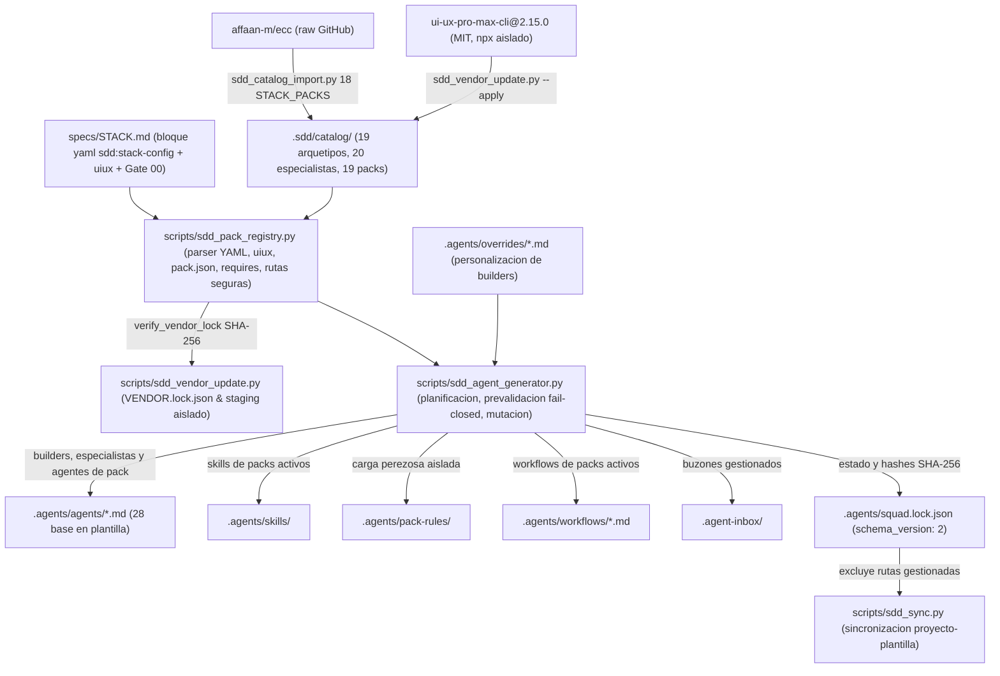
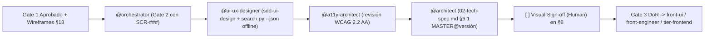
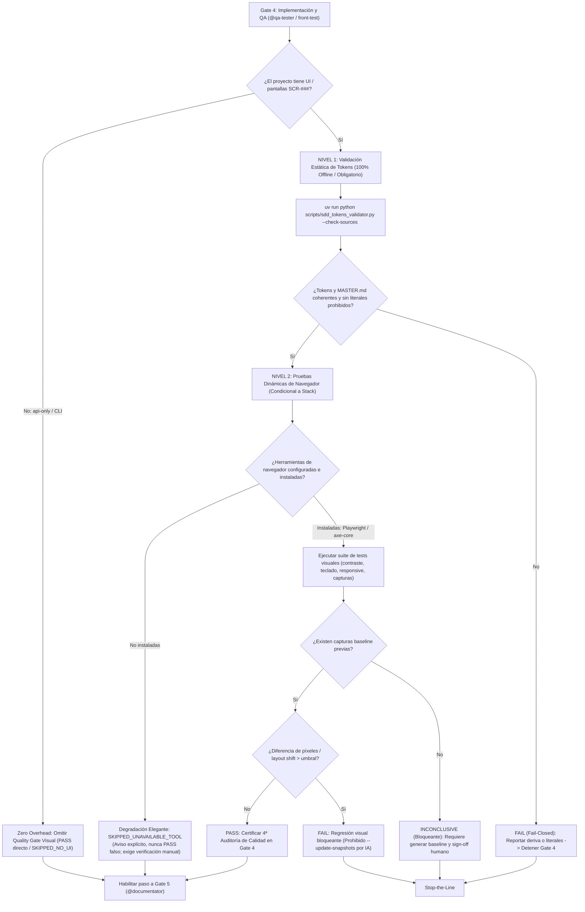
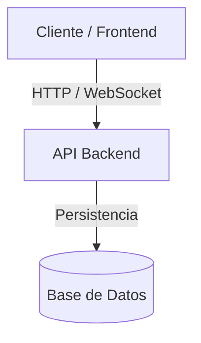

# Topología Física y Lógica del Sistema

## 1. Topología del Framework SDD y Materialización de Packs (`FWK-001` & `FWK-002`)

### Inventario de Componentes del Framework

| Componente / Ruta | Responsabilidad | Límites y Aislamiento |
| :--- | :--- | :--- |
| `scripts/sdd_pack_registry.py` | Parsea el bloque `yaml sdd:stack-config` de `specs/STACK.md`, valida Gate S0 (con soporte legacy Gate 00), el esquema estricto `uiux` y su coherencia con `packs`, carga `pack.json` (`targets`, `upstream`), comprueba `requires`, delega `verify_vendor_lock()` y resuelve rutas seguras anti-*path-traversal*. | Solo librería estándar Python 3.12+ (sin PyYAML); *fail-closed* ante errores de esquema, incompatibilidad `api-only`, discrepancia `uiux` ↔ `packs` o fallo de lock (`<= 500` líneas; 496 líneas actuales). |
| `scripts/sdd_agent_generator.py` | Construye el plan de materialización, valida colisiones intra-plan, destinos artesanales no gestionados y conflictos SHA-256 contra disco antes de mutar `.agents/` y `.agent-inbox/`, y persiste `squad.lock.json` v2 con campos canónicos `stack_approved` y legacy `gate00_approved`. | No modifica `.agents/rules/` ni `.sdd/catalog/`; conserva buzones desactivados si tienen tickets pendientes (`<= 500` líneas). |
| `scripts/sdd_vendor_update.py` | Verifica `VENDOR.lock.json` (`verify_vendor_lock()`) y ejecuta actualizaciones explícitas de `ui-ux-pro-max-cli@<X.Y.Z>` en `tempfile.TemporaryDirectory()`, validando `validate_data.py`, excluyendo skills hermanas/tests, normalizando EOL a LF y mostrando diff previo a `--apply`. | Único módulo autorizado para invocar `npx` en staging temporal; nunca escribe sin `--apply` (`<= 500` líneas). |
| `scripts/sdd_catalog_import.py` | Importa `UNIVERSAL_SPECIALISTS` (20) y `STACK_PACKS` (18) desde `affaan-m/ecc` (incluidos `workflows/`), normaliza *frontmatter* y admite `fetcher` inyectable para pruebas offline. | Nunca modifica ni borra directorios de packs en `.sdd/catalog/packs/` ajenos a `STACK_PACKS`, preservando `capability-ui-design` byte a byte (`RN-05`, `RF-012`). |
| `scripts/sdd_sync.py` | Sincroniza bidireccionalmente artefactos core del framework entre proyectos derivados y plantilla. | Excluye `.agents/overrides/`, `.agents/squad.lock.json`, cualquier ruta en `squad.lock.json["files"]` y archivos con marcador `GENERATED` (primeros 4096 caracteres). |
| `.sdd/catalog/packs/capability-ui-design/` | Pack no-ECC (`id: "capability:ui-design"`, `requires: ["capability:web-frontend"]`, `targets: ["web"]`, `rules: []`) con `NOTICE.md` (MIT), `@ui-ux-designer`, skill `sdd-ui-design`, workflow `ui-design-review.md` y `vendor/ui-ux-pro-max/` (`46` entradas en `VENDOR.lock.json`: `45` runtime + `LICENSE` MIT). | Opera 100% offline con stdlib Python (`search.py`, `validate_data.py`); excluye 6 skills hermanas y `scripts/tests/`; nunca añade reglas *always-on*. |
| `.gitattributes` | Fija `text eol=lf` para `.sdd/catalog/packs/capability-ui-design/**` y `.agents/**`. | Evita discrepancias CRLF/LF en Windows frente a hashes SHA-256 de `VENDOR.lock.json` y `squad.lock.json`. |
| `.agents/pack-rules/<pack>/` | Aloja reglas específicas de packs activos (p. ej. `coding-style.md`) fuera de `.agents/rules/00-..07-`. | Cumple `RN-SDD-SELECTIVE-CONTEXT`; se poda automáticamente al desactivar el pack si no hay ediciones manuales. |
| `.agents/squad.lock.json` | Fuente de verdad de estado materializado (`schema_version: 2`, `active_packs`, `files` con `sha256`/`owner`/`kind`). | No se sincroniza en `sdd_sync.py`; en plantilla base con Gate 00 sin aprobar mantiene `active_packs: []` y 22 ficheros base (2 builders + 20 especialistas). |
| `scripts/sdd_tokens_validator.py` | Validador determinista offline de tokens de diseño y anti-deriva estilística. Comprueba la estructura DTCG de `design-tokens.json`, el cotejo bidireccional contra `MASTER.md` y el escaneo estático de ficheros frontend (`--check-sources`) para detectar literales de color hardcodeados. | Solo librería estándar Python 3.12+; *fail-closed* ante discrepancias o literales prohibidos; soporte de comentarios de escape y flags `--allow-missing`, `--strict` y `--format json` (`<= 500` líneas). |
| `tests/test_sdd_pack_materialization.py`, `tests/test_sdd_ui_design.py`, `tests/test_sdd_visual_gates.py` & `tests/test_sdd_terminology_unification.py` | Suites unitarias y de aceptación 100% offline (`67` tests totales en `tests/`: 13 en pack materialization, 24 en ui design, 8 en visual gates y 22 en terminology unification; todos `<= 500` líneas). | Usan `tempfile.TemporaryDirectory`, fixtures sintéticas y runner offline con `0` llamadas de red reales. |

### 1.1. Flujo Condicional de Diseño Visual en Gate 2 (`FWK-002`)

Cuando `capability-ui-design` y `uiux.enabled: true` están activos y una feature (o `CR-XXX`) afecta al menos a una pantalla `SCR-###`:

- **Poda UI-Only:** En proyectos `api-only` o CLI, `sdd-bootstrap` poda las preguntas `uiux` y no activa `capability-ui-design`; con `capability-web-frontend` y `uiux.enabled: false`, permanecen activos `@a11y-architect` y las skills ECC (`design-system`, `accessibility`, `browser-qa`) sin `@ui-ux-designer`.
- **Plantilla Base Limpia:** El repositorio starter **no** crea `docs/design-system/` vacío; dicha carpeta nace únicamente en el proyecto usuario durante la feature fundacional `Design System Foundation` (registrada en `specs/BACKLOG.md` tras Gate 00 cuando `uiux.enabled: true`).

### 1.2. Flujo Bi-Nivel de Quality Gates Visuales y Anti-Deriva en Gate 4 (`FWK-003`)

Cuando una feature afecta a pantallas (`SCR-###`) con `capability-ui-design` o interfaz web activa, `@qa-tester` y el arquetipo `front-test` ejecutan el protocolo de verificación bi-nivel en Gate 4:

#### Estados de Ejecución del Quality Gate Visual:
- **`PASS`**: Todas las comprobaciones visuales, ratios de contraste WCAG 2.2 AA (`>= 4.5:1`), foco accesible por teclado, responsive y comparación de capturas están dentro del umbral de tolerancia (`< 0.1%` de píxeles).
- **`FAIL`**: Violación explícita de contraste, ausencia de indicador de foco, desbordamiento horizontal inesperado o regresión de píxeles (`>= 0.1%`). Bloqueante para Gate 4.
- **`INCONCLUSIVE`**: No existe captura de referencia previa (baseline) para la pantalla o componente en la ruta designada. Bloquea la aprobación de Gate 4 hasta que el baseline sea generado y revisado/aprobado expresamente por un humano (`RN-SDD-HUMAN-GATE-OWNERSHIP`).
- **`SKIPPED_UNAVAILABLE_TOOL`**: El proyecto requiere pruebas dinámicas pero los navegadores/herramientas no están instalados en el entorno de ejecución. No bloquea automáticamente el pipeline si el Nivel 1 está en verde, pero emite una advertencia formal y exige verificación visual manual humana (nunca emite un aprobado falso).
- **`SKIPPED_NO_UI`**: El proyecto está configurado sin interfaz gráfica (`api-only`, CLI o `uiux.enabled: false`). Salida exitosa directa con coste cero en tiempo y tokens.

---

## 2. Topología de la Aplicación del Proyecto *(Plantilla Base — Pendiente de Gate 00)*

*(Actualizar esta sección con los servicios reales definidos en `specs/STACK.md` tras aprobar Gate 00).*
