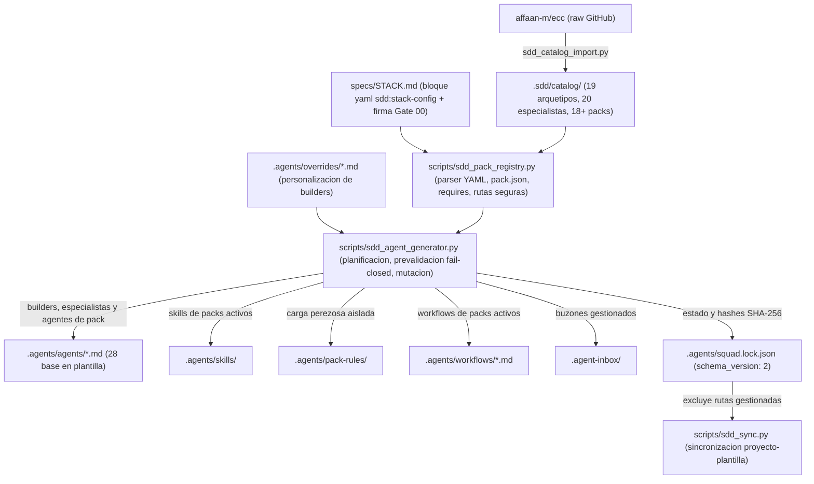
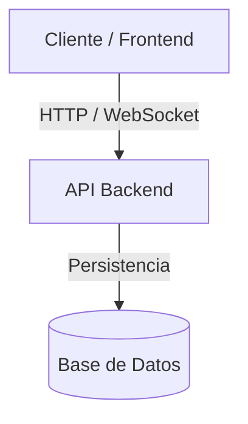

# Topología Física y Lógica del Sistema

## 1. Topología del Framework SDD y Materialización de Packs (`FWK-001`)

### Inventario de Componentes del Framework

| Componente / Ruta | Responsabilidad | Límites y Aislamiento |
| :--- | :--- | :--- |
| `scripts/sdd_pack_registry.py` | Parsea el bloque `yaml sdd:stack-config` de `specs/STACK.md`, valida Gate 00, carga y valida `pack.json`, comprueba `requires` y resuelve rutas seguras anti-*path-traversal*. | Solo librería estándar Python 3.12+ (sin PyYAML); *fail-closed* ante errores de esquema o dependencias. |
| `scripts/sdd_agent_generator.py` | Construye el plan de materialización, valida colisiones intra-plan, destinos artesanales no gestionados y conflictos SHA-256 contra disco antes de mutar `.agents/` y `.agent-inbox/`, y persiste `squad.lock.json` v2. | No modifica `.agents/rules/` ni `.sdd/catalog/`; conserva buzones desactivados si tienen tickets pendientes. |
| `scripts/sdd_catalog_import.py` | Importa `UNIVERSAL_SPECIALISTS` (20) y `STACK_PACKS` (18) desde `affaan-m/ecc` (incluidos `workflows/`), normaliza *frontmatter* y admite `fetcher` inyectable para pruebas offline. | Nunca modifica ni borra directorios de packs en `.sdd/catalog/packs/` ajenos a `STACK_PACKS` (`RN-05`). |
| `scripts/sdd_sync.py` | Sincroniza bidireccionalmente artefactos core del framework entre proyectos derivados y plantilla. | Excluye `.agents/overrides/`, `.agents/squad.lock.json`, cualquier ruta en `squad.lock.json["files"]` y archivos con marcador `GENERATED` (primeros 4096 caracteres). |
| `.agents/pack-rules/<pack>/` | Aloja reglas específicas de packs activos (p. ej. `coding-style.md`) fuera de `.agents/rules/00-..07-`. | Cumple `RN-SDD-SELECTIVE-CONTEXT`; se poda automáticamente al desactivar el pack si no hay ediciones manuales. |
| `.agents/squad.lock.json` | Fuente de verdad de estado materializado (`schema_version: 2`, `active_packs`, `files` con `sha256`/`owner`/`kind`). | No se sincroniza en `sdd_sync.py`; en plantilla base con Gate 00 sin aprobar mantiene `active_packs: []` y 22 ficheros base (2 builders + 20 especialistas). |
| `tests/test_sdd_pack_materialization.py` | Suite unitaria y de aceptación 100% offline (12 tests cubriendo los 9 grupos de `02-tech-spec.md` §7 y Escenarios 1–7). | Usa `tempfile.TemporaryDirectory` y *fetcher* simulado sin red real. |

---

## 2. Topología de la Aplicación del Proyecto *(Plantilla Base — Pendiente de Gate 00)*

*(Actualizar esta sección con los servicios reales definidos en `specs/STACK.md` tras aprobar Gate 00).*
