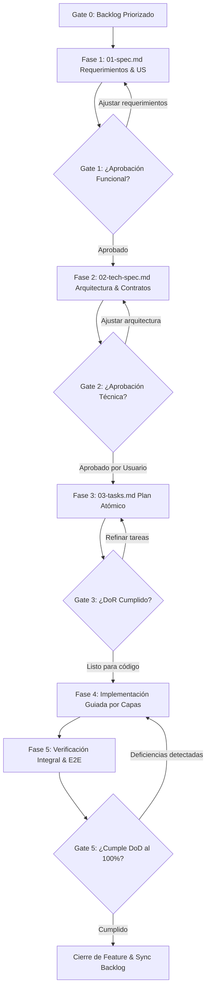
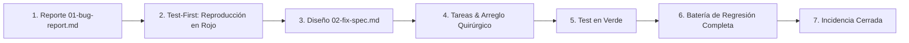

# Spec-Driven Development (SDD) Framework
**Estándar Universal de Gobernanza, Ciclo de Vida y Calidad de Software**

---

## 🎯 1. Filosofía y Principios Fundamentales

El desarrollo de software bajo este marco se rige por el principio de **Especificación Previa**:
> *"El código es la consecuencia determinista y verificable de una especificación validada, nunca el medio exploratorio para descubrir requerimientos en caliente."*

### 1.1. La Regla de Oro Innegociable
> **Queda estrictamente prohibido crear, modificar o eliminar una sola línea de código de producción sin haber superado de forma explícita el Gate 2 (`02-tech-spec.md` para Features o `02-fix-spec.md` para Incidencias) con aprobación formal.**

### 1.2. Política de Cero Atajos (Zero Shortcut Policy)
- **Alcance total:** La metodología aplica a cualquier cambio, sin importar su tamaño o aparente simplicidad:
  - Modificación de constantes, literales o cadenas de texto.
  - Corrección de erratas en mensajes de error o etiquetas de interfaz.
  - Actualización de variables de entorno, configuración o dependencias.
  - Ajustes de estilo o micro-optimizaciones.
- **Prohibido el desarrollo exploratorio sobre producción ("Code-and-Fix"):** No se permite modificar código fuente para "ver qué pasa" o "probar si funciona". Las pruebas exploratorias pertenecen a entornos aislados de Spike/PoC (ver [Sección 8.1](#81-protocolo-de-spikes-y-pruebas-de-concepto-poc)).
- **Detención ante ambigüedad:** Si un requerimiento no está completamente determinado, un contrato carece de tipos claros o existe una contradicción lógica, **el trabajo se detiene de inmediato**. Queda prohibido asumir comportamientos o inventar soluciones no documentadas.

---

## 🏛️ 2. Jerarquía Metodológica: SCRUM Integrado en SDD

El framework unifica los conceptos clave de gestión ágil (Scrum) con el rigor contractual de SDD:

```text
[ ÉPICA (Epic) ] — Macro-iniciativa o hito estratégico (specs/BACKLOG.md)
   │
   └── [ FEATURE / VERTICAL SLICE ] — Incremento funcional entregable de principio a fin
         │
         ├── Gate 1: [ USER STORIES & CRITERIOS DE ACEPTACIÓN ] (01-spec.md)
         ├── Gate 2: [ ARQUITECTURA TÉCNICA & CONTRATOS ] (02-tech-spec.md)
         └── Gate 3: [ TAREAS ATÓMICAS POR CAPAS ] (03-tasks.md)
               │
               └── [ CÓDIGO VERIFICABLE & TESTS ] — Implementación paso a paso

[ INCIDENCIA (Bug) ] — Desviación entre el comportamiento real y la especificación
   │
   ├── [ REPORTE & TEST DE REPRODUCCIÓN EN ROJO ] (01-bug-report.md)
   ├── [ ANÁLISIS DE CAUSA RAÍZ & DISEÑO DEL FIX ] (02-fix-spec.md)
   └── [ TAREAS DE CORRECCIÓN & TEST EN VERDE ] (03-tasks.md)
```

### 2.1. Definición de Entidades
1. **Épica (Epic):** Objetivo de negocio de alto nivel que agrupa múltiples funcionalidades para materializar una capacidad de producto. Se registran en `specs/BACKLOG.md`.
2. **Feature (Vertical Slice):** Unidad funcional de entrega completa que atraviesa todas las capas de la arquitectura (persistencia, dominio, servicios, API, interfaz y pruebas) aportando valor directo e independiente al usuario.
3. **Historia de Usuario (User Story):** Unidad atómica de valor desde la perspectiva de un actor del sistema, estructurada formalmente:
   > **Como** `[rol/actor del sistema]`  
   > **Quiero** `[capacidad o acción concreta]`  
   > **Para** `[beneficio o valor medible obtenido]`
   - **Criterios de Aceptación obligatorios:** Cada User Story debe incorporar escenarios redactados en formato **Given-When-Then** (o tablas de equivalencia con datos concretos de entrada y salida esperados), sin adjetivos ambiguos ("fácil", "rápido", "adecuado").
4. **Especificación Técnica:** Diseño determinista de interfaces, contratos de comunicación, modelos de persistencia, algoritmos y tratamientos de error que resuelven los requerimientos funcionales.
5. **Tarea Técnica Atómica (Task):** Unidad mínima de trabajo de ingeniería. Está acotada a una capa o archivo específico, incluye su propio criterio de verificación y cuenta con una casilla de estado (`- [ ]` / `- [x]`).
6. **Defecto (Bug):** Cualquier comportamiento observable en el software que rompa una especificación aprobada previamente o viole una invariante del sistema.

### 2.2. Jerarquía de Autoridad y Gobernanza de Contratos
Para evitar que los modelos de IA o las instrucciones textuales vulneren la seguridad o inventen permisos, rige la siguiente **Jerarquía Estricta de 6 Niveles**:
1. **Nivel 1: Controles de Seguridad Externos y Permisos del SO/Backend:** Aplican fuera del razonamiento del LLM (código determinista, RBAC, validación de schemas, límites de sistema, sandboxing). Ningún prompt ni salida de modelo puede eludirlos.
2. **Nivel 2: Principios y Límites Aprobados del Producto:** Documentados en [`specs/SYSTEM_VISION.md`](file:///c:/Projects/sdd-agentic-starter/specs/SYSTEM_VISION.md) (P01–P10) y decisiones formales vigentes. Inmutables mediante autoaprendizaje ordinario.
3. **Nivel 3: Políticas Operativas Versionadas:** Reglas explícitas de autonomía, privacidad, matrices de riesgo, allowlists de herramientas y aprobaciones previas.
4. **Nivel 4: Identidad, Personalidad y Preferencias:** Definidas en `SOUL.md`, `IDENTITY.md` y `USER.md`. Modulan el estilo, honestidad y foco de relación ("leal, no complaciente"), pero jamás otorgan permisos ejecutivos por sí mismas.
5. **Nivel 5: Instrucciones de Tarea, Workflows y Skills:** Procedimientos operativos acotados (`skills/**/SKILL.md`) que operan estrictamente dentro de los permisos concedidos en los niveles superiores.
6. **Nivel 6: Salidas de Modelos y Agentes:** Propuestas, inferencias o resultados sujetos a validación; **nunca elevan sus propios permisos ni convierten una sugerencia en autorización**.

### 2.3. Ciclo de Vida de Aprendizaje y Evolución Trazable
El autoaprendizaje o adaptación de Project no puede convertir automáticamente observaciones en reglas globales:
$$\text{Experiencia} \longrightarrow \text{Observación} \longrightarrow \text{Hipótesis} \longrightarrow \text{Evaluación} \longrightarrow \text{Propuesta/Adopción Acotada} \longrightarrow \text{Seguimiento} \longrightarrow \text{Confirmación o Reversión}$$
- Las hipótesis de aprendizaje requieren validación de procedencia y evidencia.
- Cualquier cambio en personalidad o estrategia debe ser auditable y reversible (*rollback*).
- Los principios fundamentales y límites de seguridad **no son reescribibles** por aprendizaje autónomo.

---

## 📁 3. Estructura Estándar del Directorio `specs/`

```text
specs/
├── SYSTEM_VISION.md                    # Visión global del sistema, arquitectura e invariantes
├── SDD_FRAMEWORK.md                    # Este estándar de gobernanza (fuente de verdad metodológica)
├── BACKLOG.md                          # Registro priorizado de Épicas, Features y Deuda Técnica
├── principles/                         # Principios de identidad, personalidad y gobernanza
│   └── Project_IDENTITY_AND_GOVERNANCE.md # Identidad, archivos declarativos y memoria
├── architecture/                       # Diseños arquitectónicos de alto nivel
│   ├── AGENT_MODEL_RUNTIME_ARCHITECTURE.md
│   └── Project_OS_CONCEPTUAL_ARCHITECTURE.md # Arquitectura conceptual de Project Desktop & OS
├── roadmap/                            # Planificación estratégica por etapas (0 a 8)
│   └── IMPLEMENTATION_ROADMAP.md
├── templates/                          # Plantillas oficiales del proyecto
│   ├── 01-functional-spec.template.md  # Plantilla para Gate 1
│   ├── 02-technical-spec.template.md   # Plantilla para Gate 2
│   └── 03-tasks.template.md            # Plantilla para Gate 3
├── features/                           # Especificaciones vivas de funcionalidades
│   └── <ID>-<kebab-case-name>/         # Ej: FEAT-001-core-scaffolding/
│       ├── 01-spec.md                  # Gate 1: Requerimientos funcionales y US
│       ├── 02-tech-spec.md             # Gate 2: Arquitectura, contratos y diseño
│       └── 03-tasks.md                 # Gate 3: Desglose de tareas y seguimiento activo
├── bugs/                               # Especificaciones de corrección de incidencias
│   └── <ID>-<kebab-case-name>/         # Ej: BUG-004-session-timeout-leak/
│       ├── 01-bug-report.md            # Síntomas, entorno y pasos de reproducción
│       ├── 02-fix-spec.md              # Causa raíz, diseño técnico y riesgos
│       └── 03-tasks.md                 # Test de reproducción y tareas de resolución
├── changes/                            # Peticiones y especificaciones de cambio (Change Requests)
│   └── CR-<NUM>-<kebab-case-name>/     # Ej: CR-001-hud-arc-reactor-redesign/
│       ├── 01-spec.md                  # Gate 1: Requerimientos funcionales del cambio y US
│       ├── 02-tech-spec.md             # Gate 2: Arquitectura delta, contratos y rendimiento
│       └── 03-tasks.md                 # Gate 3: Desglose atómico y validación
└── spikes/                             # Investigaciones técnicas acotadas (opcional)
    └── <ID>-<kebab-case-name>/         # Ej: SPIKE-002-webrtc-latency/
        └── SPIKE_REPORT.md             # Hipótesis, hallazgos, métricas y conclusión
```

---

## 🚦 4. Ciclo de Vida y Gates de Calidad

El avance entre fases es estrictamente secuencial y está controlado por compuertas de calidad (**Quality Gates**). Cada gate actúa como un filtro que impide propagar errores de diseño hacia la fase de codificación.



### Gate 0: Trazabilidad en Backlog
- Toda iniciativa debe estar registrada formalmente en `specs/BACKLOG.md` con su identificador unívoco, descripción del problema, prioridad e impacto.
- **Criterio de salida:** Identificador asignado y alcance preliminar acordado.

### Gate 1: Especificación Funcional (`01-spec.md`)
- Se redacta la definición funcional enfocándose en el *qué* y el *para qué*, sin condicionar la tecnología interna.
- **Contenido obligatorio:**
  - Contexto de negocio y actores involucrados.
  - Historias de Usuario estructuradas.
  - Matriz exhaustiva de criterios de aceptación con ejemplos y datos concretos.
  - Flujo principal, flujos alternativos y flujos de excepción (fallos de red, accesos no autorizados, datos inválidos).
  - Casos explícitamente fuera de alcance (*Out of Scope*) para evitar desviaciones.
- **Aprobación:** Requiere revisión y validación explícita del usuario/propietario del producto.

### Gate 2: Especificación Técnica y Contratos (`02-tech-spec.md`)
- Se diseña la solución técnica que satisfará la especificación funcional.
- **Contenido obligatorio:**
  - Diagrama de flujo de datos y arquitectura lógica.
  - Modelos de dominio e invariantes de negocio.
  - Contratos de interfaz y APIs (endpoints, métodos, payloads JSON con tipos estrictos, códigos de estado, eventos y DTOs).
  - Esquema de base de datos, índices, estrategias de persistencia y migraciones.
  - Algoritmos críticos y tratamiento de concurrencia/idempotencia.
  - Análisis de riesgos, impacto en seguridad y estrategia de mitigación.
- **Aprobación:** **Visto bueno explícito e innegociable del usuario.** Sin esta confirmación, está prohibido abrir cualquier archivo de código fuente para implementar la funcionalidad.

### Gate 3: Desglose de Tareas Atómicas y DoR (`03-tasks.md`)
- Descomposición de la solución en tareas de ingeniería atómicas, ordenadas estrictamente por orden de dependencias arquitectónicas:
  1. **Dominio / Núcleo:** Entidades, objetos de valor, interfaces y lógica pura.
  2. **Persistencia / Infraestructura:** Esquemas, migraciones, adaptadores de datos y clientes externos.
  3. **Servicios / Casos de Uso:** Orquestación de negocio, comandos y consultas.
  4. **Exposición / APIs:** Endpoints, controladores, middleware y serialización.
  5. **Interfaz de Usuario (Frontend):** Tipos, estado local/remoto, componentes y vistas.
  6. **Pruebas Automatizadas:** Tests unitarios, integración y pruebas end-to-end.
- **Criterio de salida:** Cumplimiento total de la Definition of Ready (DoR).

### Gate 4: Implementación Guiada por Tareas
- Se codifica de forma estrictamente secuencial, resolviendo tarea por tarea.
- Conforme se completa una tarea y se valida su comando de comprobación, se marca su casilla (`- [x]`).
- Si surge un obstáculo o contradicción imprevista, se detiene la codificación inmediatamente (ver [Sección 7: Gestión del Cambio](#-7-protocolo-de-gestión-del-cambio-stop-the-line)).

### Gate 5: Verificación Integral y DoD
- Ejecución completa de las pruebas de regresión, integración y verificación en entorno real.
- **Criterio de salida:** Cumplimiento total y demostrable de la Definition of Done (DoD).

---

## 🏆 5. Definition of Ready (DoR) y Definition of Done (DoD)

### 5.1. Definition of Ready (DoR) — Condiciones para Iniciar Codificación
Una Feature o corrección solo se declara **lista para codificar** si se cumplen todos los puntos:
- [ ] `01-spec.md` aprobado formalmente (Gate 1 superado).
- [ ] `02-tech-spec.md` aprobado formalmente por el usuario (Gate 2 superado).
- [ ] Todos los contratos de datos y APIs están completamente tipados y cerrados.
- [ ] El desglose en `03-tasks.md` está completo, secuenciado por dependencias y cada tarea tiene un comando o método de verificación explícito.
- [ ] No existen dependencias externas no resueltas o bloqueantes.
- [ ] El entorno de desarrollo y arnés de pruebas están operativos.

### 5.2. Definition of Done (DoD) — Condiciones para Declarar Entrega Final
Una Feature o corrección solo se declara **terminada y aceptada** cuando satisface los **7 criterios innegociables**:

1. **Documentación Viva Completa y Sincronizada:**
   - `01-spec.md`, `02-tech-spec.md` y `03-tasks.md` están actualizados reflejando el código final real.
   - 100% de las tareas en `03-tasks.md` están marcadas como completadas (`- [x]`).
2. **Cobertura Automatizada de Criterios de Aceptación:**
   - Cada criterio de aceptación definido en Gate 1 cuenta con al menos una prueba automatizada asociada (unitaria o de integración) que se ejecuta en verde.
   - Las reglas de negocio y algoritmos de dominio cuentan con tests unitarios exhaustivos (cubriendo casos nominales y casos límite).
3. **Prueba End-to-End (E2E) Verificada:**
   - Existe una prueba automatizada o script de validación que ejercita el flujo completo de principio a fin sobre servicios reales levantados.
4. **Política de Cero Regresiones (Zero-Regression Policy):**
   - La suite completa de pruebas de todas las features previas del proyecto se ejecuta y pasa en verde. Cero roturas colaterales.
5. **Compilación Limpia y Calidad de Código:**
   - El código compila sin errores ni advertencias críticas.
   - Las herramientas de análisis estático (linter, verificador de tipos) pasan sin incidencias.
6. **Seguridad e Invariantes Preservadas:**
   - Sin secretos, claves o contraseñas expuestas en código ni en historiales.
   - Manejo explícito de accesos no autorizados, expiraciones y validaciones de entrada.
7. **Trazabilidad Cerrada y Sincronización de Ramas (`RN-SDD-BRANCH-SYNC`):**
   - Estado actualizado en `specs/BACKLOG.md` a `Completado`.
   - Registro de cambios documentado con referencia a la especificación.
   - **Commit y Push en Rama de Trabajo:** Una vez superadas las validaciones y aprobada la entrega, todos los cambios deben registrarse con `git commit` semántico y subirse a su rama de trabajo (`feat/*`, `change/*`, `fix/*`) o `develop`. La rama `main` permanece blindada contra commits directos y solo recibe cambios mediante PRs de Release o Hotfix aprobadas.

---

## 🐞 6. Protocolo de Resolución de Incidencias (Bug Protocol)

Ante cualquier anomalía, fallo inesperado o desviación de una especificación en cualquier fase:



### 6.1. Clasificación por Severidad
- **S1 — Crítico / Bloqueante:** Caída del sistema, pérdida o corrupción de datos, fallo grave de seguridad o bloqueo total del flujo principal sin alternativa. Parada inmediata de todo desarrollo nuevo hasta su resolución.
- **S2 — Alto:** Funcionalidad principal rota o inaccesible, pero existe una alternativa temporal conocida.
- **S3 — Medio:** Comportamiento incorrecto en casos secundarios o bordes, errores en mensajes o degradación leve de rendimiento.
- **S4 — Bajo / Cosmético:** Errores de alineación visual, inconsistencias menores en textos o advertencias de linter que no afectan la ejecución.

### 6.2. Ciclo de Ejecución Test-First (Innegociable)
1. **Creación del expediente:** Se crea `specs/bugs/<ID>-<nombre>/` con `01-bug-report.md` documentando entorno, pasos exactos, comportamiento observado y comportamiento esperado.
2. **Reproducción en Rojo (Test-First):**
   > **Antes de tocar una sola línea del código de producción, se debe escribir una prueba automatizada (unitaria o de integración) que reproduzca de manera determinista el fallo y falle (`Red`).**
   - Si no se puede reproducir con un test automatizado, se debe justificar técnicamente y redactar un script determinista de reproducción.
3. **Diseño de la Corrección (`02-fix-spec.md`):** Identificar la causa raíz (*Root Cause Analysis*) y plantear la corrección mínima y suficiente sin efectos secundarios.
4. **Corrección Quirúrgica y Pase a Verde (`03-tasks.md`):** Se aplica el cambio de código hasta que la prueba de reproducción pase a verde (`Green`).
5. **Protección Permanente:** El test de reproducción se incorpora de forma definitiva a la suite de pruebas del proyecto para asegurar que el error nunca vuelva a presentarse.
6. **Verificación de Regresión:** Se ejecuta la suite completa del proyecto para confirmar que no se han introducido roturas colaterales.

---

## ⚠️ 7. Protocolo de Gestión del Cambio (Stop-the-Line)

En proyectos de software es común descubrir impedimentos o requerimientos imprevistos durante la codificación (Fase 4). Cuando esto ocurre, rige el principio industrial de la parada de línea (*Andon Cord*):

### 7.1. Detonantes de Parada Obligatoria
- Se detecta una limitación técnica no prevista que hace inviable el diseño de `02-tech-spec.md`.
- El usuario o una parte interesada solicita modificar el comportamiento de una funcionalidad mientras se está codificando.
- Una librería, API externa o dependencia no responde según los contratos asumidos.
- Se descubre una vulnerabilidad de seguridad o un conflicto estructural con otra funcionalidad existente.

### 7.2. Procedimiento de Actuación
1. **Alto Inmediato:** Se suspende al instante la escritura de código de producción.
2. **Documentación del Hallazgo:**
   - Se crea una sección `## ⚠️ Registro de Cambio / Conflicto` dentro de `02-tech-spec.md` (o `01-spec.md` si afecta a negocio).
   - Se describe con precisión: el problema encontrado, por qué la solución anterior no es válida y la propuesta de ajuste.
3. **Solicitud de Aprobación Formal:** Se presenta el cambio al usuario para su revisión y visto bueno explícito.
4. **Replanificación de Tareas:** Una vez aprobado el cambio, se actualiza `03-tasks.md` agregando, modificando o eliminando las tareas afectadas.
5. **Reanudación:** Solo entonces se reanuda la codificación. **Nunca se aplican cambios sobre la marcha sin haber actualizado primero la especificación.**

### 7.3. Expedientes Formales de Cambio (Change Requests - CR) e Inmutabilidad del Baseline
Cuando una alteración cambia el diseño visual, la tecnología, las dependencias o el comportamiento de una feature ya implementada (`Done` / `Completado` en `specs/BACKLOG.md`):

1. **Regla de Inmutabilidad del Baseline Histórico (`RN-SDD-IMMUTABLE-DONE`):**
   - Una vez que una Feature (`FEAT-XXX`) supera el Gate 5 y figura como `Done` / `Completado` en `specs/BACKLOG.md`, su carpeta `specs/features/<FEAT-ID>/` (`01-spec.md`, `02-tech-spec.md`, `03-tasks.md`) queda **CONGELADA EN MODO LECTURA (READ-ONLY)** como registro histórico auditable de lo que se construyó y certificó originalmente.
   - **Queda terminantemente prohibido** reescribir o sobrescribir `01-spec.md`, `02-tech-spec.md` o `03-tasks.md` de una Feature `Done` para inyectar nuevos requerimientos, cambios de motor/librería o rediseños.
2. **Cardinalidad Estricta 1:1 (`RN-SDD-1-TO-1-CR`):**
   - Todo cambio sobre una Feature `Done` exige crear un expediente independiente bajo `specs/changes/CR-<NUM>-<kebab-case-name>/`.
   - Si un cambio transversal impacta a $N$ Features ya completadas, **se deben crear $N$ Change Requests independientes (1 CR por cada Feature afectada)**, aislando el delta funcional, técnico y de tareas de cada módulo.
3. **Estructura y Gates del Expediente (`specs/changes/CR-<NUM>-<kebab-case-name>/`):**
   - **Gate 1 (`01-spec.md`):** Requerimientos del cambio, alcance delta respecto a la Feature base, nuevas US y criterios de aceptación Given-When-Then. **Requiere validación y aprobación explícita del usuario.**
   - **Gate 2 (`02-tech-spec.md`):** Arquitectura delta modificada, contratos y análisis de impacto/rendimiento. **Requiere validación y aprobación explícita del usuario.**
   - **Gate 3 (`03-tasks.md`):** Desglose atómico de tareas secuenciadas con comandos de verificación. **Requiere validación y aprobación explícita del usuario.**
4. **Propiedad Humana de los Gates (`RN-SDD-HUMAN-GATE-OWNERSHIP`):**
   - Ningún agente de IA puede auto-aprobar un Gate ni marcar casillas de validación humana (`[ ]`) en nombre del usuario.
5. **Trazabilidad sin Mutación Destructiva (Cero Spec Drift):**
   - La evolución del sistema se audita leyendo el baseline en `specs/features/<FEAT-ID>/` más la cadena cronológica de `specs/changes/CR-<NUM>-*/` registrada en `specs/BACKLOG.md` y en la documentación funcional de `docs/`.
   - Si se desea enlazar el CR desde la carpeta de la Feature original una vez completado el CR (Gate 5), únicamente se permite añadir una fila en una tabla final `## Historial de Evolución (Change Requests)` sin alterar ni una sola línea del texto original de la especificación base.

### 7.4. Árbol de Decisión Pre-Edición Obligatorio (Pre-Edit Decision Gate)
Antes de ejecutar cualquier herramienta de escritura o edición sobre `specs/` o sobre el código fuente, el agente debe evaluar:
1. **¿Qué `FEAT-XXX` se ven afectadas según `specs/BACKLOG.md`?**
   - **No existe la Feature:** Registrar en `specs/BACKLOG.md` (Gate 0) y crear `specs/features/FEAT-XXX-<slug>/`.
   - **Feature en estado `Pending` o `In Progress` (Gate 5 NO superado):** Aplicar el ajuste en `specs/features/FEAT-XXX-<slug>/` siguiendo el protocolo Stop-the-Line (Sección 7.2).
   - **Feature en estado `Done` / `Completado` (Gate 5 SUPERADO):**
     - Si es un fallo respecto a la spec aprobada $\rightarrow$ Crear `specs/bugs/BUG-XXX-<slug>/`.
     - Si es una evolución, nueva librería, nuevo contrato o rediseño $\rightarrow$ **Prohibido tocar `specs/features/FEAT-XXX/`**. Crear un `specs/changes/CR-XXX-<slug>/` por cada Feature `Done` afectada.

---

## 🏢 8. Escenarios Complejos en Proyectos de Gran Escala

En proyectos de envergadura surgen dinámicas que van más allá del flujo básico de una Feature. Estas situaciones deben ser gestionadas con protocolos formales:

### 8.1. Protocolo de Spikes y Pruebas de Concepto (PoC)
Cuando se evalúa una tecnología desconocida, un algoritmo complejo o una integración con alto grado de incertidumbre:
- **Timeboxed y Aislado:** Se crea una carpeta bajo `specs/spikes/<ID>-<nombre>/`. El spike tiene un tiempo límite de ejecución y un objetivo claro (ej. "Evaluar latencia de librería X vs Y").
- **Código Desechable:** El código escrito durante un Spike reside en ramas o scripts aislados y **bajo ningún concepto se fusiona directamente en producción**.
- **Entregable del Spike:** El resultado de un Spike es **conocimiento documentado** (`SPIKE_REPORT.md`) que sirve de base para redactar un `02-tech-spec.md` sólido cuando la funcionalidad se planifique formalmente.

### 8.2. Refactorizaciones y Gestión de Deuda Técnica
- Toda refactorización estructural debe tratarse como una **Feature Técnica** (o *Technical Story*), con su propia entrada en Backlog y especificación técnica (`02-tech-spec.md`).
- **Regla de Invarianza de Comportamiento:** Una refactorización pura **no debe alterar el comportamiento externo observable** ni los contratos existentes.
- **Red de Seguridad:** Antes de iniciar una refactorización, debe comprobarse que los módulos afectados cuentan con una cobertura de pruebas suficiente. Las pruebas existentes deben pasar en verde antes y después de la refactorización.

### 8.3. Migraciones de Persistencia y Cambios Rompientes (Breaking Changes)
En proyectos con datos persistentes en uso:
- Todo cambio de esquema de datos (tablas, columnas, índices, formatos de serialización) debe incluir un plan de migración bidireccional (*Up/Down* o migración progresiva).
- Se prohíbe el borrado destructivo de campos o tablas en uso activo sin un período previo de marcado de obsolescencia (*deprecation*).
- El procedimiento de migración y la estrategia de reversión (*rollback*) deben quedar detallados en la sección de infraestructura de `02-tech-spec.md`.

### 8.4. Prevención de la Deriva de Especificaciones (Spec Drift)
- **Principio de Fuente de Verdad:** Si el código en producción y la especificación en `specs/` difieren, **el código se considera erróneo o en desacato metodológico**, a menos que se trate de un bug del propio documento.
- **Auditoría Continua:** En cada ciclo de revisión, se valida que los diagramas, contratos de endpoints y estructuras descritas en las specs reflejan con total exactitud el estado del repositorio.

### 8.5. Procedimiento de Hotfix de Emergencia
Cuando ocurre una incidencia crítica S1 en un entorno productivo que requiere corrección inmediata:
1. Se crea un ticket `specs/bugs/HOTFIX-<ID>-<nombre>/`.
2. Se permite una versión abreviada de `01-bug-report.md` y `02-fix-spec.md` enfocada estrictamente en el análisis de causa raíz y mitigación del riesgo inmediato.
3. Se escribe el test de reproducción y se aplica el parche mínimo indispensable.
4. Una vez solventada la emergencia y verificado el despliegue, **es obligatorio completar la documentación detallada y la actualización de las suites de regresión en las 24 horas posteriores**.

### 8.6. Gobernanza de Secretos y Seguridad
- **Cero Secretos en Repositorio:** Queda estrictamente prohibido incorporar claves API, certificados, contraseñas, tokens de sesión o secretos en código fuente, archivos markdown de especificación o commits de Git.
- Los secretos deben ser inyectados en tiempo de ejecución a través de variables de entorno seguras o sistemas de gestión de credenciales autorizados.
- La especificación técnica debe identificar los activos sensibles y describir su modelo de acceso sin exponer valores literales reales.

### 8.7. Concurrencia y Trabajo en Paralelo (Multi-Agente / Multi-Equipo)
En proyectos donde colaboran múltiples desarrolladores o agentes autónomos:
- **Aislamiento por Vertical Slices:** Dos agentes o desarrolladores no deben modificar la misma capa de la misma Feature simultáneamente sin un contrato de interfaz congelado en Gate 2.
- **Contratos como Fronteras:** El desarrollo frontend y backend puede ejecutarse en paralelo únicamente cuando los contratos de la API (definidos en `02-tech-spec.md`) han sido aprobados y sellados.
- Si un agente o desarrollador necesita alterar un contrato compartido, debe activar el **Protocolo de Gestión del Cambio** antes de propagar la modificación.

### 8.8. Protocolo de Obsolescencia y Eliminación (Deprecation)
La eliminación de capacidades o APIs existentes debe ser planificada para evitar fallos en clientes dependientes:
1. **Fase de Anuncio:** Se documenta la obsolescencia en la especificación y se emiten avisos o cabeceras de deprecación en la interfaz correspondiente.
2. **Período de Gracia:** Se mantiene la compatibilidad durante el tiempo o versiones estipuladas.
3. **Eliminación Segura:** La retirada física del código se realiza mediante una tarea técnica dedicada, verificando que ninguna otra parte del sistema mantenga referencias activas.

---

## 📌 9. Compromiso y Auditoría del Marco

Este documento no es una sugerencia ni una guía de estilo; es el **estándar operativo innegociable** para todo desarrollo en el proyecto. Cualquier contribución que eluda los Quality Gates, omita pruebas automatizadas o modifique código al margen de una especificación aprobada será rechazada automáticamente.
