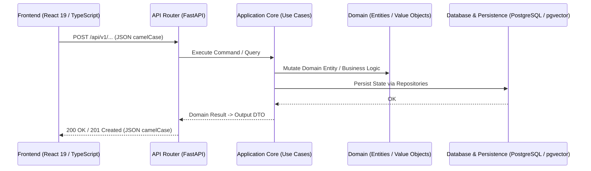

# Especificación Técnica: [Título de la Feature]

- **ID de la Feature**: [Ej. FEAT-006-declarative-agents]
- **Estado**: [Borrador | En Revisión | Aprobado | En Implementación | Completado]
- **Especificación Funcional Asociada**: `01-spec.md`
- **Tech Lead / Arquitecto**: `@orchestrator` & `@architect`
- **Fecha de Creación**: YYYY-MM-DD
- **Última Actualización**: YYYY-MM-DD

---

## 0. Inventario *Research-First* y Fronteras de Propiedad (`ecc` & `rea`)
- **Activos y Librerías Reutilizadas del Workspace**:
  - [Listar módulos de `backend/src/`, `frontend/src/` o paquetes de `packages/` que se reutilizan para evitar reinventar utilidades.]
- **Documentación Primaria y Contratos Verificados**:
  - [Referencias a documentación oficial o contratos empaquetados inspeccionados.]
- **Frontera Productora Única (*Producing-Boundary Ownership*)**:
  - [Indicar qué clase/módulo único es dueño de parsear y validar los datos externos/eventos de esta feature.]
- **Plan de Limpieza de Código Obsoleto (*Zero Zombie Code*)**:
  - [Archivos, wrappers o tipos antiguos que deben eliminarse en esta entrega (o `N/A` si es feature 100% nueva).]

---

## 1. Arquitectura General y Flujo de Datos

---

## 2. Base de Datos y Persistencia (`DDBB/scripts/` & `backend/src/infrastructure/`)
- **Scripts DDL e Índices (`DDBB/scripts/definition/`)**:
  - Definición de tablas (`snake_case`), tipos ENUM, extensiones e índices (HNSW para vectores, GIN para texto).
- **Scripts de Semillas y Catálogos (`DDBB/scripts/data/`)**:
  - Inserciones idempotentes de configuración base o catálogos iniciales.
- **Modelos de Persistencia (SQLModel / SQLAlchemy)**:
  - Mapeo en `backend/src/infrastructure/repositories/`.

---

## 3. Modelo de Dominio (`backend/src/domain/`)
- **Entidades y Modelos de Dominio**:
  - `class [Nombre](BaseModel)`: Atributos inmutables, métodos de negocio e invariantes sin dependencias externas (`verify_architecture_boundaries.py`).
- **Interfaces de Repositorio & Servicios**:
  - `class I[Nombre]Repository(ABC)`: Contrato abstracto de persistencia.

---

## 4. Capa de Aplicación (`backend/src/application/`)
- **Casos de Uso / Comandos / Queries**:
  - `class [Nombre]UseCase`: Orquestación asíncrona, transacciones y control de flujo.
- **DTOs de Entrada y Salida**:
  - Esquemas de validación y transformación de datos.

---

## 5. API REST & WebSockets (`backend/src/api/`)
- **Rutas y Controladores**:
  - Endpoints REST `/api/v1/[recurso]` y WebSockets/SSE para eventos en tiempo real.
- **Contratos Espejo Biunívocos**:
  - DTO Python (Pydantic con `ConfigDict(alias_generator=to_camel)`).
  - Interfaz TypeScript espejo correspondiente en `frontend/src/types/` (cero `any`).

---

## 6. Frontend (`frontend/src/`)
- **Tipos TypeScript**:
  - Interfaces idénticas a los DTOs de backend en `frontend/src/types/[recurso].ts`.
- **Estado y Mutaciones**:
  - TanStack Query / Zustand hooks en `frontend/src/stores/` o `frontend/src/features/[recurso]/`.
- **Componentes Visuales**:
  - Componentes React 19 + Tailwind, manteniendo cada archivo por debajo del límite de modularidad (<400 líneas objetivo, <800 líneas máximo).

---

## 7. Pruebas, Auditoría Semántica y Criterios de Verificación
- **Backend**: Tests unitarios y de integración con `pytest backend/tests/`.
- **Frontend**: Tests con `vitest` y chequeo de tipos con `npx tsc --noEmit`.
- **Auditoría de Calidad (`rea` + `ecc`)**:
  - `verify_architecture_boundaries.py` en verde.
  - Verificación de perturbación semántica (los tests deben fallar si se rompe la regla de negocio).

---

## 8. Aprobación Formal Gate 2 (`RN-SDD-HUMAN-GATE-OWNERSHIP`)
> ⚠️ **Exclusivo para el Stakeholder Humano** (Sin esta aprobación queda bloqueada toda edición de código por `sdd_code_gate_guard.py`):
- [ ] **Gate 2 Aprobado por el Usuario**: La arquitectura, los contratos de datos y el análisis de impacto han sido validados.
