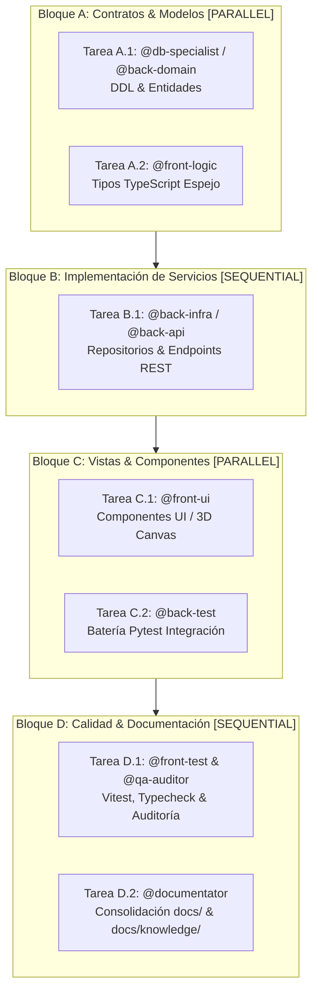

# Tareas de Implementación: [Título de la Feature, Change Request o Bug]

- **ID del Expediente**: [Ej. FEAT-006-declarative-agents | CR-012-hands-free-wake-word | BUG-010-voice-channel-auto-mute]
- **Feature Base**: [Ej. FEAT-010 / FEAT-008B]
- **Orquestador Principal**: `@jarvis`
- **Agentes Especialistas Asignados**: [`@db-specialist`, `@back-domain`, `@back-infra`, `@back-api`, `@front-logic`, `@front-ui`, `@back-test`, `@front-test`, `@documentator`, `@qa-auditor`]
- **Especificaciones de Referencia**:
  - Funcional (Qué): [`01-spec.md`](01-spec.md) (Gate 1 Passed)
  - Técnica (Cómo): [`02-tech-spec.md`](02-tech-spec.md) (Gate 2 Passed)

---

## 🗺️ Grafo de Ejecución de Tareas (DAG / OpenSpec)

---

## 📋 Desglose Operativo por Bloques de Ejecución

### 🔹 Bloque A: Contratos Base, DDL y Modelos [PARALLEL]
> *Tareas concurrentes independientes. Los subagentes se ejecutan en paralelo con aislamiento de contexto.*

- [ ] **Tarea A.1** [`@db-specialist`]: Diseñar scripts DDL y extensiones en `DDBB/scripts/definition/`
  - *Ámbito permitido*: `DDBB/scripts/`
  - *Archivos exactos*: `DDBB/scripts/definition/V...__[descripcion].sql`
  - *Contrato de referencia*: `02-tech-spec.md` Sección 2.1 (Modelo Relacional / Tablas)
  - *Comando de verificación DoD*: `psql -f DDBB/scripts/definition/V...__[descripcion].sql`

- [ ] **Tarea A.2** [`@back-domain`]: Crear entidades de dominio puro y Value Objects
  - *Ámbito permitido*: `backend/src/domain/`
  - *Archivos exactos*: `backend/src/domain/entities/[modulo].py`, `backend/src/domain/repositories/[modulo]_repository.py`
  - *Contrato de referencia*: `02-tech-spec.md` Sección 2.2 (Entidades de Dominio)
  - *Comando de verificación DoD*: `pytest backend/tests/unit/domain/test_[modulo].py`

- [ ] **Tarea A.3** [`@front-logic`]: Crear contratos espejo e interfaces TypeScript
  - *Ámbito permitido*: `frontend/src/types/`
  - *Archivos exactos*: `frontend/src/types/[modulo].ts`
  - *Contrato de referencia*: `02-tech-spec.md` Sección 2.3 (Contratos Espejo TypeScript camelCase)
  - *Comando de verificación DoD*: `cd frontend && npx tsc --noEmit`

---

### 🔹 Bloque B: Persistencia, Lógica y Endpoints [SEQUENTIAL - Requiere Bloque A]
> *Requiere que los contratos del Bloque A estén completados y verificados con tests verdes.*

- [ ] **Tarea B.1** [`@back-infra`]: Implementar repositorios de persistencia y clientes externos
  - *Ámbito permitido*: `backend/src/infrastructure/`
  - *Archivos exactos*: `backend/src/infrastructure/repositories/[repo].py`, `backend/src/infrastructure/models/[modelo].py`
  - *Contrato de referencia*: `02-tech-spec.md` Sección 3 (Infraestructura)
  - *Comando de verificación DoD*: `pytest backend/tests/unit/infra/test_[repo].py`

- [ ] **Tarea B.2** [`@back-api`]: Implementar routers FastAPI, DTOs Pydantic y WebSockets/SSE
  - *Ámbito permitido*: `backend/src/api/`
  - *Archivos exactos*: `backend/src/api/routers/[router].py`, `backend/src/api/dtos/[dto].py`
  - *Contrato de referencia*: `02-tech-spec.md` Sección 4 (API REST & Event Bus)
  - *Comando de verificación DoD*: `python -m py_compile backend/src/api/**/*.py && pytest backend/tests/unit/api/test_[router].py`

- [ ] **Tarea B.3** [`@front-logic`]: Implementar clientes HTTP, SSE listeners y Zustand Stores
  - *Ámbito permitido*: `frontend/src/api/`, `frontend/src/store/`, `frontend/src/services/`
  - *Archivos exactos*: `frontend/src/api/[cliente].ts`, `frontend/src/store/[store].ts`
  - *Contrato de referencia*: `02-tech-spec.md` Sección 5 (Gestión de Estado Frontend)
  - *Comando de verificación DoD*: `cd frontend && npx tsc --noEmit`

---

### 🔹 Bloque C: Componentes UI, Audio y Vistas [PARALLEL - Requiere Bloque B]
> *Tareas concurrentes de maquetación y experiencia visual interactiva.*

- [ ] **Tarea C.1** [`@front-ui`]: Maquetar componentes React, widgets y cinemática 3D
  - *Ámbito permitido*: `frontend/src/components/`, `frontend/src/views/`
  - *Archivos exactos*: `frontend/src/components/[widget]/[componente].tsx`
  - *Contrato de referencia*: `02-tech-spec.md` Sección 6 (Componentes UI y Ergonomía)
  - *Comando de verificación DoD*: `cd frontend && npm run build`

- [ ] **Tarea C.2** [`@audio-voice`]: Implementar adaptadores TTS y captura Web Audio (si aplica)
  - *Ámbito permitido*: `backend/src/infrastructure/audio/`, `frontend/src/services/audio/`
  - *Archivos exactos*: `backend/src/infrastructure/audio/[tts].py`, `frontend/src/services/audio/[audio].ts`
  - *Contrato de referencia*: `02-tech-spec.md` Sección 7 (Motor de Audio)
  - *Comando de verificación DoD*: `pytest backend/tests/unit/audio/`

---

### 🔹 Bloque D: Auditorías de Calidad, Regression & Consolidación [SEQUENTIAL - Requiere Bloque C]
> *Quality Gates finales, prevención de regresiones y retroalimentación del Conocimiento Vivo.*

- [ ] **Tarea D.1** [`@back-test`]: Ejecución de regresión integral backend
  - *Comando de verificación DoD*: `pytest backend/tests/` (100% verde)

- [ ] **Tarea D.2** [`@front-test`]: Ejecución de tests frontend y typecheck estricto
  - *Comando de verificación DoD*: `cd frontend && npx tsc --noEmit && npm test -- --run` (100% verde)

- [ ] **Tarea D.3** [`@qa-auditor`]: Auditoría estricta de límites arquitectónicos (`rea` + `ecc`)
  - *Comando de verificación DoD*: `python .agents/scripts/verify_architecture_boundaries.py && python .agents/scripts/sdd_healthcheck.py`

- [ ] **Tarea D.4** [`@documentator`]: Consolidación documental y actualización de Conocimiento Vivo
  - *Ámbito permitido*: `docs/es/`, `docs/en/`, `docs/knowledge/`
  - *Archivos a actualizar*:
    - `docs/es/...` y `docs/en/...` (Documentación viva de usuario y arquitectura)
    - `docs/knowledge/API_CATALOG.md` (Nuevos endpoints registrados)
    - `docs/knowledge/DATA_MODELS.md` (Nuevas tablas/columnas/índices)
    - `docs/knowledge/ADRS.md` (Decisión técnica registrada)
    - `docs/{es,en}/06-traceability/TRACEABILITY-MATRIX.md` (Matriz de trazabilidad)
  - *Comando de verificación DoD*: Validación de enlaces y 0DD (*Zero Document Debt*)

---

## 🚦 Aprobación Formal Gate 3 (`RN-SDD-HUMAN-GATE-OWNERSHIP`)
> ⚠️ **Exclusivo para el Stakeholder Humano**:
- [ ] **Gate 3 Aprobado por el Usuario**: El grafo de dependencias, bloques paralelos y comandos de verificación DoD están autorizados para iniciar ejecución desatendida mediante subagentes.
